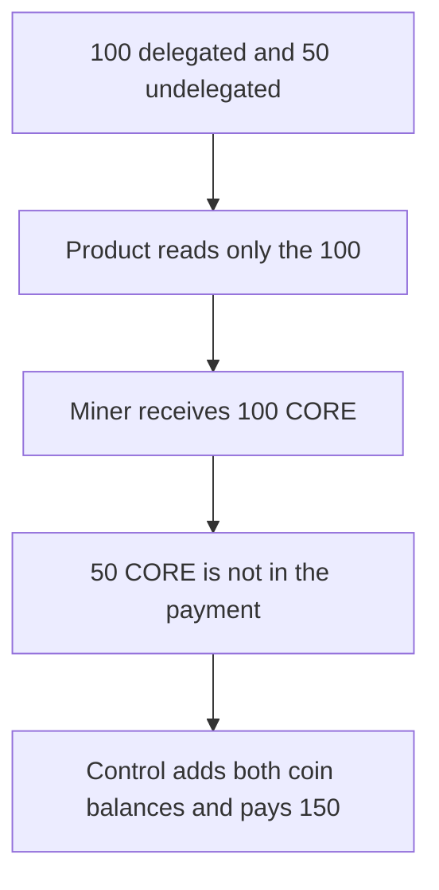

# Power reward pays 100 CORE and skips 50 undelegated coins

> **Vulnerability classes:** vuln/logic/reward-calculation
>
> **Reproduction:** self-contained synthetic Foundry reduction; see [output.txt](output.txt).

<!-- non-defihacklabs -->
<!-- source-auditvault: https://github.com/Auditware/AuditVault/blob/main/findings/50907-undelegated-coins-are-not-considered-on-the-reward-distribut.md -->
<!-- date: 2022-11 -->

## Key info

| Field | Value |
|---|---|
| **Loss** | Miner receives 100 CORE instead of 150. The 50 undelegated coins are omitted |
| **Vulnerable contract** | `PledgeAgent.distributePowerReward` |
| **Attacker EOA** | `0x1111111111111111111111111111111111111111` |
| **Attack contract** | `Exploit` |
| **Attack tx** | `Exploit.run()` |
| **Chain / block / date** | Ethereum model · block 0 · 2022-11 |
| **Compiler** | solc 0.8.27, cancun, via IR |
| **Bug class** | Reward product uses delegated `rs.coin` and ignores undelegated coins |

## TL;DR

`distributePowerReward` computes

`rs.coin * POWER_BLOCK_FACTOR * powerFactor / 10000 * totalReward / score`.

`rs.coin` is the delegated amount. Undelegated coins are a separate balance and are not added. With 100 delegated, 50 undelegated, `powerFactor` 10,000, `totalReward` 1,000 CORE and `score` 1,000, the miner is paid 100 CORE. Adding the 50 undelegated coins pays 150 CORE. The miner is short 50 CORE.

## Background

Halborn reviewed CoreDAO Genesis. `PledgeAgent.distributePowerReward` is called at the start of the turn-round flow and is supposed to distribute hash-power rewards. The finding says undelegated coin rewards are not considered, so the remaining-reward comparison and the per-miner payment are short. The quoted function is `PledgeAgent.sol` around line 204 in commit `eac9eb44` (2022-11-17).

## The vulnerable code

```solidity
function distributePowerReward(address miner) external returns (uint256 reward) {
    // @> VULN: rs.coin is delegated only; undelegatedCoin is not in the product
    reward = rsCoin * POWER_BLOCK_FACTOR * powerFactor / 10000 * totalReward / score;
    uint256 paid = reward * 1;
    require(remainReward >= paid, "there is not enough reward");
    rewardMap[miner] += reward;
    remainReward -= paid;
    core.transfer(miner, reward);
}
```

`POWER_BLOCK_FACTOR` is 1. The fixed path uses `rsCoin + undelegatedCoin` in the same product.

## Root cause

Delegated and undelegated coins are both in the round, but only the delegated field is multiplied into the reward. The `remainReward >= paid` check then succeeds against the smaller number, and the miner is credited the smaller number.

## Preconditions

- Delegated coin is 100. Undelegated coin is 50. `powerFactor` is 10,000. `totalReward` and the funded pool are 1,000 CORE. `score` is 1,000.
- One miner is passed in. No round clock is advanced. The call is the distribution itself.
- The control agent is seeded with the same numbers and adds the two coin balances before the product.

## Attack walkthrough

1. The buggy distribution pays the miner 100000000000000000000 CORE ([output.txt:9](output.txt)).
2. The control distribution, which adds the 50 undelegated coins, pays 150000000000000000000 ([output.txt:11](output.txt)).
3. The shortfall is 50000000000000000000 ([output.txt:13](output.txt)).
4. `[PASS]` ([output.txt:6](output.txt)).

## Diagrams



## Impact

The miner is paid 100 CORE for a round whose coin base is 150. The other 50 CORE that the same formula would have paid stays out of `rewardMap` and out of the miner's balance. The control agent pays 150 CORE from the same pool.

## Remediation

Include undelegated coins in the coin term before multiplying by `POWER_BLOCK_FACTOR`, `powerFactor`, `totalReward`, and `score`. Keep the `remainReward` check on that larger total.

```diff
-    reward = rsCoin * POWER_BLOCK_FACTOR * powerFactor / 10000 * totalReward / score;
+    uint256 coin = rsCoin + undelegatedCoin;
+    reward = coin * POWER_BLOCK_FACTOR * powerFactor / 10000 * totalReward / score;
```

## How to reproduce

```bash
cd 50907-undelegated-coins-are-not-considered-on-the-reward-distribut_exp
forge test -vv
```

## Sources

- AuditVault finding: [50907-undelegated-coins-are-not-considered-on-the-reward-distribut](https://github.com/Auditware/AuditVault/blob/main/findings/50907-undelegated-coins-are-not-considered-on-the-reward-distribut.md)
- Halborn, CoreDAO Genesis: https://www.halborn.com/audits/coredao/genesis-smart-contract-security-assessment
- `PledgeAgent.sol` at commit eac9eb44b762fd64511d5e88f82b926da26bb7fd, the `distributePowerReward` body quoted in the finding
