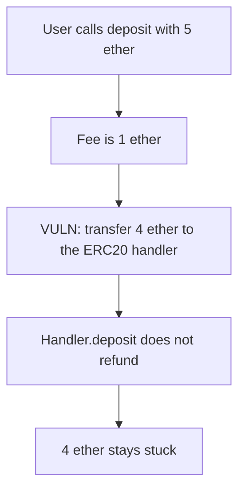

# Chiliz bridge: a 5 ether ERC20 deposit locks the 4 ether overpayment

> **Vulnerability classes:** vuln/bridge · vuln/logic

> **Reproduction:** a self-contained Foundry PoC that compiles and runs offline
> with only `forge-std` - no fork and no RPC.
> PoC: [test/50982-lack-of-refund-mechanism-for-overpayment-halborn-chiliz-brid_exp.sol](test/50982-lack-of-refund-mechanism-for-overpayment-halborn-chiliz-brid_exp.sol).

<!-- non-defihacklabs -->
<!-- source-auditvault: https://github.com/Auditware/AuditVault/blob/main/findings/50982-lack-of-refund-mechanism-for-overpayment-halborn-chiliz-brid.md -->
<!-- date: 1970-01 -->

## Key info

| Field | Value |
|---|---|
| **Loss** | 4 ether of native value stuck in the ERC20 handler |
| **Protocol** | Chiliz Bridge |
| **Bug class** | No refund of native overpayment on ERC20 deposit |
| **Source** | [AuditVault finding](https://github.com/Auditware/AuditVault/blob/main/findings/50982-lack-of-refund-mechanism-for-overpayment-halborn-chiliz-brid.md) |
| **Report** | [Halborn, Chiliz Bridge Updates](https://www.halborn.com/audits/chiliz/bridge-updates-smart-contract-security-assessment) |
| **Chain / block / date** | Ethereum model · block 0 · 1970-01 |
| **Compiler** | solc 0.8.27, cancun, via IR |

## TL;DR

`Bridge.deposit` requires `msg.value >= fee` and then sends `msg.value - fee` to the resource handler. The ERC20 handler's `deposit` never refunds that native value. A depositor who sends 5 ether against a 1 ether fee locks 4 ether in the handler. The fixed bridge returns the 4 ether to the caller and keeps only the fee.

## The vulnerable code

```solidity
require(msg.value >= FEE, "invalid value");
uint256 valueToSend = msg.value - FEE;
if (valueToSend > 0) {
    // @> VULN: excess native value is forwarded and never refunded
    payable(address(handler)).transfer(valueToSend);
}
handler.deposit(resourceID, destinationChainID, 1, msg.sender, data);
```

## Root cause

The fee is `msg.value` minus a remainder, and the remainder is pushed to the handler with `transfer`. For an ERC20 resource the handler does not spend or return that ETH. Nothing in `deposit` sends the excess back to `msg.sender`. The user who overpays cannot recover it.

## Preconditions

- `deposit` is permissionless.
- The resource id maps to an ERC20 handler.
- Fee is 1 ether. The caller sends 5 ether. The note's own test uses value 500 against the same function.

## Attack walkthrough

1. Call deposit with 5 ether.
2. Pass the fee check because 5 >= 1.
3. Compute the excess as 4 ether.
4. Transfer the 4 ether to the ERC20 handler.
5. Handler.deposit returns without a refund.
6. Handler balance is 4 ether. Bridge balance is the 1 ether fee.

## Diagrams



## Impact

The depositor loses 4 ether. It sits on the ERC20 handler with no withdraw path in the quoted code. The control refunds the 4 ether and the handler balance stays 0; the only amount kept is the 1 ether fee.

## Remediation

Refund `msg.value - fee` to `msg.sender` (the fix the Chiliz team applied in the handler), or do not forward native value to an ERC20 handler.

## How to reproduce

```bash
cd 50982-lack-of-refund-mechanism-for-overpayment-halborn-chiliz-brid_exp
forge test -vv
```

`run()` is the harm path. The control test uses the corrected comparison or guard and does not produce the loss number.
