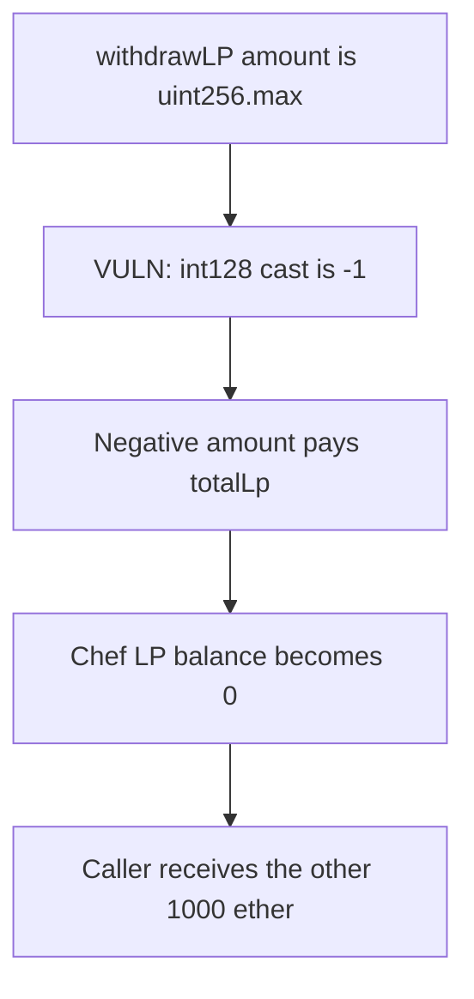

# Entangle: withdrawLP(uint256.max) casts to -1 and pays the whole pool

> **Vulnerability classes:** vuln/arithmetic

> **Reproduction:** a self-contained Foundry PoC that compiles and runs offline
> with only `forge-std` - no fork and no RPC.
> PoC: [test/51368-unsafe-casting-leads-to-overflowunderflow-halborn-entangle-l_exp.sol](test/51368-unsafe-casting-leads-to-overflowunderflow-halborn-entangle-l_exp.sol).

<!-- non-defihacklabs -->
<!-- source-auditvault: https://github.com/Auditware/AuditVault/blob/main/findings/51368-unsafe-casting-leads-to-overflowunderflow-halborn-entangle-l.md -->
<!-- date: 1970-01 -->

## Key info

| Field | Value |
|---|---|
| **Loss** | 1,000 ether of another depositor's LP |
| **Protocol** | Entangle Trillion MasterChef |
| **Bug class** | Unsafe uint256 to int128 cast |
| **Source** | [AuditVault finding](https://github.com/Auditware/AuditVault/blob/main/findings/51368-unsafe-casting-leads-to-overflowunderflow-halborn-entangle-l.md) |
| **Report** | [Halborn, Entangle Trillion](https://www.halborn.com/audits/entangle-labs/entangle-trillion) |
| **Chain / block / date** | Ethereum model · block 0 · 1970-01 |
| **Compiler** | solc 0.8.27, cancun, via IR |

## TL;DR

`withdrawLP` casts the amount with `int128(int256(amount))`. `uint256.max`, the value in the published PoC, becomes `-1`. A negative amount pays `totalLp` to the caller, so the chef balance goes to 0. The caller deposited 1 ether and a second depositor deposited 1,000 ether. The caller receives both. `SafeCast` reverts on the same input and the 1,000 ether stays.

## The vulnerable code

```solidity
// @> VULN: uint256.max truncates through int256 to int128(-1)
int256 casted = int256(int128(int256(amount)));
uint256 pay = casted < 0 ? poolBefore : uint256(casted);
```

## Root cause

`reinvest` and `withdraw` convert `uint256` amounts to `int128` with no range check. `uint256.max` does not fit in `int128`. The conversion wraps to `-1`. The withdraw path treats that negative value as 'pay the pool', which is why the published test sees the chef LP balance fall to 0.

## Preconditions

- `withdrawLP` is callable by a depositor. No admin role is required.
- Attacker has deposited 1 ether of LP. Another account has deposited 1,000 ether.
- The amount argument is `type(uint256).max`, the literal in the Halborn PoC.

## Attack walkthrough

1. Snapshot totalLp at 1,001 ether.
2. Cast uint256.max to int128. The result is -1.
3. Because the cast is negative, set the payout to the full pool.
4. Set totalLp to 0.
5. Transfer 1,001 ether to the caller. 1,000 ether of it is not their deposit.

## Diagrams



## Impact

The other depositor's 1,000 ether of LP is transferred to the caller. Their deposit record is still 1,000 ether and the chef balance is 0, so the tokens are gone. The SafeCast control reverts and that 1,000 ether remains in the chef.

## Remediation

Use OpenZeppelin `SafeCast` (the note's fix) so a value above `int128` max reverts before the payout is computed. Cap the payout at `deposits[msg.sender]`.

## How to reproduce

```bash
cd 51368-unsafe-casting-leads-to-overflowunderflow-halborn-entangle-l_exp
forge test -vv
```

`run()` is the harm path. The control test uses the corrected comparison or guard and does not produce the loss number.
