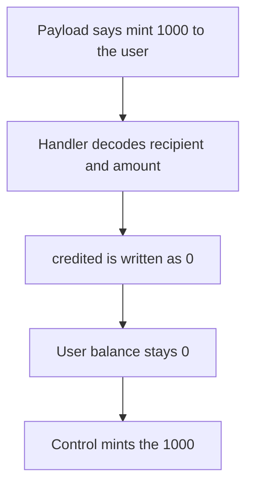

# HandleTokenMintAndSwap decodes a 1,000 token mint and credits 0

> **Vulnerability classes:** vuln/logic/state-update
>
> **Reproduction:** self-contained synthetic Foundry reduction; see [output.txt](output.txt).

<!-- non-defihacklabs -->
<!-- source-auditvault: https://github.com/Auditware/AuditVault/blob/main/findings/51373-incomplete-implementation-of-handletokenmintandswap-in-maste.md -->
<!-- date: 2024-06 -->

## Key info

| Field | Value |
|---|---|
| **Loss** | A TokenMintAndSwap for 1,000 tokens is decoded and the user receives 0. Control mints 1,000 |
| **Vulnerable contract** | `MasterSpotter.HandleTokenMintAndSwap` |
| **Attacker EOA** | `0x1111111111111111111111111111111111111111` |
| **Attack contract** | `Exploit` |
| **Attack tx** | `Exploit.run()` |
| **Chain / block / date** | Ethereum model · block 0 · 2024-06 |
| **Compiler** | solc 0.8.27, cancun, via IR |
| **Bug class** | The handler decodes the event and returns without minting |

## TL;DR

`HandleTokenMintAndSwap` abi-decodes the spotter payload, then decodes `TokenMintAndSwap` into a recipient and an amount. The body is the `TODO handle?` return from the Halborn quote. A payload that says mint 1,000 tokens leaves the user at 0. The control handler mints those 1,000 tokens to the user.

## Background

Halborn reviewed Entangle Trillion. `MasterSpotter.HandleTokenMintAndSwap` is the spotter entry for a token mint-and-swap event. The quoted function decodes `(bytes32, uint256, uint256, bytes32, bytes)` and then `DecodeTokenMintAndSwap`, and returns. The report says the event is not processed. This reduction keeps that decode and treats the inner payload as `(recipient, amount)`, which is the mint the function name is supposed to perform.

## The vulnerable code

```solidity
function HandleTokenMintAndSwap(bytes calldata b) external returns (uint256 credited) {
    (,,,, bytes memory eventParams) = abi.decode(b, (bytes32, uint256, uint256, bytes32, bytes));
    (address recipient, uint256 amount) = abi.decode(eventParams, (address, uint256));
    seenUser = recipient;
    seenAmount = amount;
    // @> VULN: TokenMintAndSwap is decoded and then dropped
    credited = 0;
}
```

The control function assigns `credited = amount` and mints that amount to `recipient`.

## Root cause

Decoding the event is not handling it. `seenAmount` proves the 1,000 was read. The next write is `credited = 0`, and the token is never minted, so the user balance stays 0.

## Preconditions

- The payload is the quoted outer tuple plus an inner `(recipient, 1000 ether)` mint.
- The handler is invoked in this transaction. No other role check is required to show the drop. The original function is `onlyRole(SPOTTER)`; the spotter is the intended caller.
- The control handler receives the same payload.

## Attack walkthrough

1. The buggy handler returns credited 0 ([output.txt:9](output.txt)). The user balance stays 0 ([output.txt:11](output.txt)).
2. The control handler mints 1000000000000000000000 ([output.txt:13](output.txt)).
3. `[PASS]` ([output.txt:6](output.txt)).

## Diagrams



## Impact

The user named in the event does not receive the 1,000 tokens the payload described. The handler still returns success with credited 0. The completed handler mints 1,000 to that user.

## Remediation

After `DecodeTokenMintAndSwap`, mint `amount` to the recipient and perform the swap the event names. Do not return on the `TODO`.

```diff
-    credited = 0;
+    credited = amount;
+    token.mint(recipient, credited);
```

## How to reproduce

```bash
cd 51373-incomplete-implementation-of-handletokenmintandswap-in-maste_exp
forge test -vv
```

## Sources

- AuditVault finding: [51373-incomplete-implementation-of-handletokenmintandswap-in-maste](https://github.com/Auditware/AuditVault/blob/main/findings/51373-incomplete-implementation-of-handletokenmintandswap-in-maste.md)
- Halborn, Entangle Trillion: https://www.halborn.com/audits/entangle-labs/entangle-trillion
- Quoted `MasterSpotter.HandleTokenMintAndSwap`
