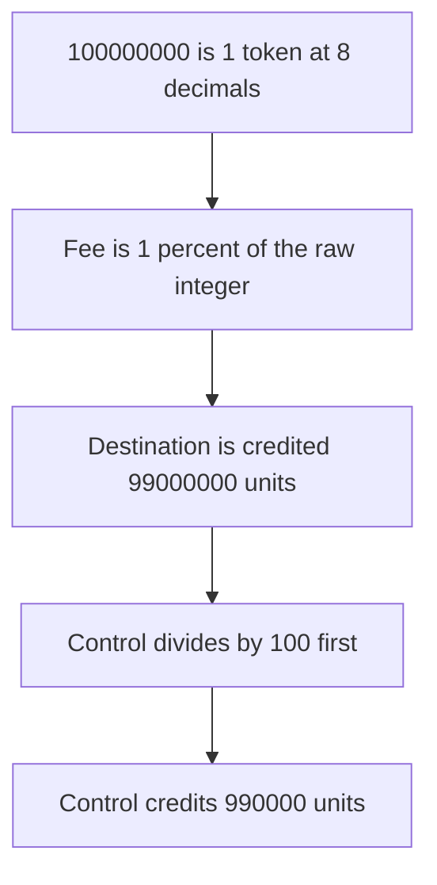

# Bridge pays 99,000,000 units instead of 990,000

> **Vulnerability classes:** vuln/arithmetic/decimal-mismatch · vuln/logic/fee-calculation
>
> **Reproduction:** self-contained synthetic Foundry reduction; see [output.txt](output.txt).

<!-- non-defihacklabs -->
<!-- source-auditvault: https://github.com/Auditware/AuditVault/blob/main/findings/51761-decimals-not-ignored-in-amount-calculation-halborn-runemine.md -->
<!-- date: 2024-11 -->

## Key info

| Field | Value |
|---|---|
| **Loss** | 98,010,000 extra destination base units are minted. Buggy payout 99,000,000, control 990,000 |
| **Vulnerable contract** | `Adapter.bridge` |
| **Attacker EOA** | `0x1111111111111111111111111111111111111111` |
| **Attack contract** | `Exploit` |
| **Attack tx** | `Exploit.run()` |
| **Chain / block / date** | Ethereum model · block 0 · 2024-11 |
| **Compiler** | solc 0.8.27, cancun, via IR |
| **Bug class** | Fee and payout use the raw integer and never scale 8 decimals down to 6 |

## TL;DR

The Solana adapter computes

`fee = amount * feePercent / 1000` and `amountWithoutFee = amount - fee`.

The amount is one token at 8 decimals, `100000000`. `feePercent` is 10, so the fee is 1%. The buggy path treats that integer as the destination amount and mints 99,000,000 units of a 6-decimal token. Scaling 8 decimals to 6 before the fee mints 990,000 units, which is 0.99 tokens. The bridge mints 98,010,000 units too many.

## Background

Halborn's RuneMine bridge reassessment says the Solana adapter's `Bridge` function does not account for token decimals, so fees and transfer amounts are wrong when the two sides use different decimals. The quoted lines are `adapter.go` 115. This reduction keeps that formula and the 8-versus-6 decimal gap the report describes.

## The vulnerable code

```solidity
function bridge(address to, uint256 amount) external returns (uint256 fee, uint256 amountWithoutFee) {
    // @> VULN: fee = rawAmount * feePercent / 1000; decimals are not in the formula
    fee = amount * FEE_PERCENT / 1000;
    amountWithoutFee = amount - fee;
    dest.mint(to, amountWithoutFee);
}
```

`FEE_PERCENT` is 10. The fixed path divides the amount by `10 ** (8 - 6)` before the same fee.

## Root cause

A percentage of the raw integer is only a percentage of the token when both sides share a decimal scale. Here the source integer is 10^8 per token and the destination token is 10^6 per token. Skipping that divide-by-100 mints about 100 times too much, minus the 1% fee on the unscaled amount.

## Preconditions

- Source decimals are 8. Destination decimals are 6. Amount is 100,000,000 (1 source token).
- Fee is 10 per 1,000, the 1% in the quoted `/ 1_000` formula.
- The control adapter is called with the same amount.

## Attack walkthrough

1. The buggy bridge mints 99000000 destination units ([output.txt:9](output.txt)).
2. The control bridge mints 990000 ([output.txt:11](output.txt)).
3. The excess is 98010000 ([output.txt:13](output.txt)).
4. `[PASS]` ([output.txt:6](output.txt)).

## Diagrams



## Impact

The destination user receives 99,000,000 base units of a 6-decimal token instead of 990,000. That is 99 tokens instead of 0.99. The extra 98,010,000 units are minted with no matching source tokens.

## Remediation

Convert the amount into destination base units before the fee. For an 8-decimal source and a 6-decimal destination, divide by 100, then apply `feePercent / 1000`.

```diff
-    fee = amount * FEE_PERCENT / 1000;
-    amountWithoutFee = amount - fee;
+    uint256 normalized = amount / (10 ** (SRC_DECIMALS - DST_DECIMALS));
+    fee = normalized * FEE_PERCENT / 1000;
+    amountWithoutFee = normalized - fee;
```

## How to reproduce

```bash
cd 51761-decimals-not-ignored-in-amount-calculation-halborn-runemine_exp
forge test -vv
```

## Sources

- AuditVault finding: [51761-decimals-not-ignored-in-amount-calculation-halborn-runemine](https://github.com/Auditware/AuditVault/blob/main/findings/51761-decimals-not-ignored-in-amount-calculation-halborn-runemine.md)
- Halborn, RuneMine off-chain bridge: https://www.halborn.com/audits/RuneMine/off-chain-bridge-full-re-assessment
- Quoted `fee` and `amountWithoutFee` lines from `sol/adapter.go`
