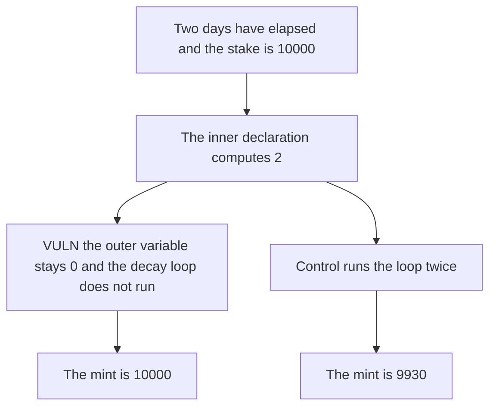

# A shadowed day count skips the share decay

> **Vulnerability classes:** vuln/logic/variable-shadow · vuln/defi/share-calculation

<!-- non-defihacklabs -->
<!-- source-auditvault: https://github.com/Auditware/AuditVault/blob/main/findings/51786-incorrect-shares-calculation-due-to-shadowed-variable-halbor.md -->
<!-- date: 1970-01 -->

## Key info

| Field | Value |
|---|---|
| **Loss** | A stake of 10000 mints 10000 shares. Two days of the 9965/10000 decay mint 9930. The extra is 70 |
| **Vulnerable contract** | `Vault.preview` |
| **Attacker EOA** | `0x1111111111111111111111111111111111111111` |
| **Attack contract** | `Exploit` at `0x15452ec016c4dc8c549e7fe6ff4b26324ea8b7a4` |
| **Attack tx** | `Exploit.run()` |
| **Chain / block / date** | Ethereum model · block 0 · 1970-01 |
| **Compiler** | solc 0.8.27, cancun, via IR |
| **Bug class** | `daysSinceLastDeposit` is declared again inside the if, so the decay loop reads the outer 0 |



## TL;DR

`_deposit` sets `daysSinceLastDeposit` to 0 and then declares a second variable with the same name inside the `if`. The loop later reads the outer variable, which is still 0, so `r = (r * 9965) / 10000` never runs.

Two elapsed days and a stake of 10000 mint 10000 shares. The same loop run twice leaves a rate of 9930 and a mint of 9930. The extra shares are 70.

The finding has no month, so the date marker is 1970-01.

## The vulnerable code

```solidity
uint256 daysSinceLastDeposit = 0;
if (elapsedDays > 0) {
    uint256 daysSinceLastDeposit = elapsedDays > 599 ? 599 : elapsedDays;
}
outerDays = daysSinceLastDeposit;
for (uint256 i = 0; i < daysSinceLastDeposit; i++) {
    r = (r * 9965) / 10000;
}
rate = r; // @> VULN: the loop saw the outer 0, so the rate is still 10000
```

## Impact

A second deposit does not decay the share rate. A 10000 stake receives 70 shares more than two days of the quoted multiplier allow.

## How to reproduce

```bash
cd 51786-incorrect-shares-calculation-due-to-shadowed-variable-halbor_exp
forge test -vv
```

`test_exploit_decay_loop_does_not_run` asserts a mint of 10000 and an outer day count of 0. `test_control_two_days_mint_9930` asserts 9930.

## Sources

- AuditVault finding: https://github.com/Auditware/AuditVault/blob/main/findings/51786-incorrect-shares-calculation-due-to-shadowed-variable-halbor.md
- Halborn report: Altcoinist staking
