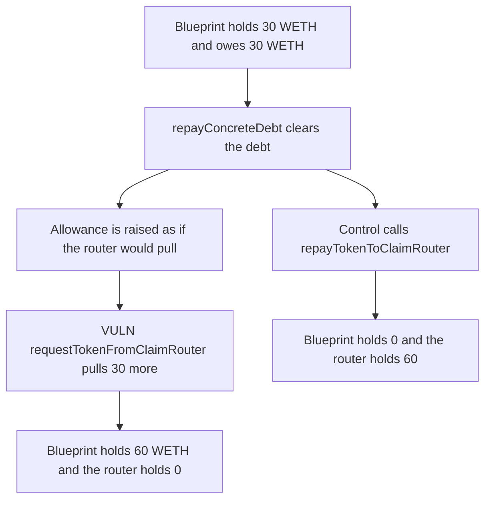

# Repay pulls claim-router assets instead of returning them

> **Vulnerability classes:** vuln/logic/wrong-call · vuln/defi/claim-router

<!-- non-defihacklabs -->
<!-- source-auditvault: https://github.com/Auditware/AuditVault/blob/main/findings/51909-incorrect-function-call-leads-to-loss-of-claim-router-assets.md -->
<!-- date: 1970-01 -->

## Key info

| Field | Value |
|---|---|
| **Loss** | A 30 WETH debt repay leaves 60 WETH on the blueprint. The claim router loses the 30 WETH that should have been sent to it |
| **Vulnerable contract** | `Connector._repayTokenToClaimRouter` |
| **Attacker EOA** | `0x1111111111111111111111111111111111111111` |
| **Attack contract** | `Exploit` at `0x15452ec016c4dc8c549e7fe6ff4b26324ea8b7a4` |
| **Attack tx** | `Exploit.run()` |
| **Chain / block / date** | Ethereum model · block 0 · 1970-01 |
| **Compiler** | solc 0.8.27, cancun, via IR |
| **Bug class** | Repay calls `requestTokenFromClaimRouter` instead of `repayTokenToClaimRouter` |



## TL;DR

`FundsRequesterConnector._repayTokenToClaimRouter` looks up the earn claim router, raises its allowance, and then calls `requestTokenFromClaimRouter`. That call transfers tokens from the router to the blueprint.

The blueprint already holds the 30 WETH protection payout and owes 30 WETH. After the buggy repay the debt is 0, the router has lost its 30 WETH reserve, and the blueprint holds 60 WETH. The finding's proof supplies that 60 onward. The same repay that calls `repayTokenToClaimRouter` leaves the blueprint at 0 and the router at 60.

The finding has no month, so the date marker is 1970-01.

## The vulnerable code

```solidity
function _repayTokenToClaimRouter(address claimRouter, address asset, uint256 amount) internal {
    amountWord = amount;
    _increaseAllowanceIfNecessary(claimRouter, asset, amount);
    allowanceWord = token.allowance(address(this), claimRouter);
    // @> VULN: repay calls request and pulls assets out of the claim router
    funds.requestTokenFromClaimRouter(asset, amount);
    heldAfter = token.balanceOf(address(this));
}
```

## Impact

The borrower clears a 30 WETH concrete debt and is credited 60 WETH. The claim router pays the extra 30 WETH. An honest repay would have delivered the blueprint's 30 WETH to the router.

## How to reproduce

```bash
cd 51909-incorrect-function-call-leads-to-loss-of-claim-router-assets_exp
forge test -vv
```

`test_exploit_repay_credits_60` asserts a blueprint balance of 60 WETH, a cleared debt, and an empty router. `test_control_repay_forwards_30` asserts the blueprint is left at 0 and the router holds 60 WETH.

## Sources

- AuditVault finding: https://github.com/Auditware/AuditVault/blob/main/findings/51909-incorrect-function-call-leads-to-loss-of-claim-router-assets.md
- Halborn report: Concrete Spokes V1
