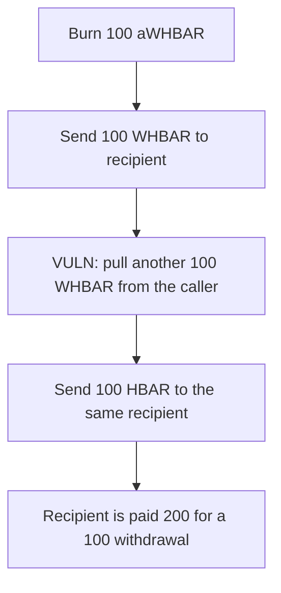

# Bonzo: withdrawing WHBAR to another address pays 100 ether twice

> **Vulnerability classes:** vuln/logic · vuln/defi

> **Reproduction:** a self-contained Foundry PoC that compiles and runs offline
> with only `forge-std` - no fork and no RPC.
> PoC: [test/51947-incorrect-asset-handling-during-withdraw-halborn-bonzo-finan_exp.sol](test/51947-incorrect-asset-handling-during-withdraw-halborn-bonzo-finan_exp.sol).

<!-- non-defihacklabs -->
<!-- source-auditvault: https://github.com/Auditware/AuditVault/blob/main/findings/51947-incorrect-asset-handling-during-withdraw-halborn-bonzo-finan.md -->
<!-- date: 1970-01 -->

## Key info

| Field | Value |
|---|---|
| **Loss** | 100 ether of the caller's wallet WHBAR, on top of the 100 ether aToken burn |
| **Protocol** | Bonzo Finance LendingPool |
| **Bug class** | WHBAR withdraw pays the recipient twice |
| **Source** | [AuditVault finding](https://github.com/Auditware/AuditVault/blob/main/findings/51947-incorrect-asset-handling-during-withdraw-halborn-bonzo-finan.md) |
| **Report** | [Halborn, Bonzo Finance Contracts](https://www.halborn.com/audits/bonzo/finance-contracts) |
| **Chain / block / date** | Ethereum model · block 0 · 1970-01 |
| **Compiler** | solc 0.8.27, cancun, via IR |

## TL;DR

`withdraw` burns the caller's aToken and sends that underlying WHBAR to `to`. When the asset is WHBAR it then also unwraps `amount` from `msg.sender`'s wallet and sends the HBAR to `to`. A 100 ether withdrawal to a different address delivers 100 WHBAR and 100 HBAR. The caller loses the extra 100 WHBAR. The fix unwraps once, from the pool's own reserve, and the caller's wallet balance stays 100 ether.

## The vulnerable code

```solidity
aBalance[msg.sender] -= underlyingOut;
whbar.transfer(to, underlyingOut); // burn already paid `to`
// @> VULN: unwrap pulls a second `amount` from the caller and pays `to` again
whbar.transferFrom(msg.sender, address(this), second);
hbar.transfer(to, second);
```

## Root cause

The WHBAR branch assumes `msg.sender` and `to` are the same account. `burn` has already forwarded the underlying to `to`. The following `IWHBAR.withdraw` pulls a fresh `amount` from the caller. `withdraw` is callable by any supplier and `to` is a free parameter, so the double payment does not need a privileged role.

## Preconditions

- Caller has 100 ether of aWHBAR and 100 ether of wallet WHBAR, and has approved the pool.
- The pool holds 100 WHBAR of reserve and 100 HBAR of unwrap inventory.
- `to` is an address other than the caller. Aave-style `withdraw` allows that.

## Attack walkthrough

1. Burn 100 ether of aToken balance.
2. Transfer 100 WHBAR of underlying to `to`.
3. Pull another 100 WHBAR from the caller's wallet.
4. Send 100 HBAR to the same `to`.
5. `to` now holds 200 ether of value. The extra 100 is the caller's wallet WHBAR.

## Diagrams



## Impact

The recipient receives 100 WHBAR plus 100 HBAR. The caller loses 100 ether of wallet WHBAR that the withdrawal should not have touched. The control sends only the 100 HBAR and leaves the wallet WHBAR at 100 ether, so the extra 100 WHBAR is not paid.

## Remediation

Burn the underlying to the pool (or keep the reserve), then unwrap once to `to`. Do not `transferFrom` the caller's wallet WHBAR.

## How to reproduce

```bash
cd 51947-incorrect-asset-handling-during-withdraw-halborn-bonzo-finan_exp
forge test -vv
```

`run()` is the harm path. The control test uses the corrected comparison or guard and does not produce the loss number.
