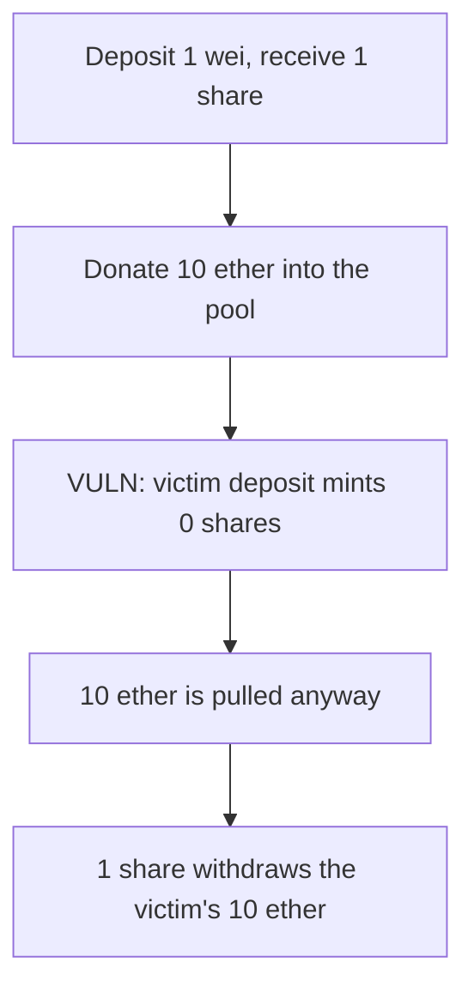

# Bonzo AToken: a 1 wei share takes the next 10 ether deposit

> **Vulnerability classes:** vuln/arithmetic · vuln/defi

> **Reproduction:** a self-contained Foundry PoC that compiles and runs offline
> with only `forge-std` - no fork and no RPC.
> PoC: [test/51950-price-inflation-in-atoken-halborn-bonzo-finance-contracts-ma_exp.sol](test/51950-price-inflation-in-atoken-halborn-bonzo-finance-contracts-ma_exp.sol).

<!-- non-defihacklabs -->
<!-- source-auditvault: https://github.com/Auditware/AuditVault/blob/main/findings/51950-price-inflation-in-atoken-halborn-bonzo-finance-contracts-ma.md -->
<!-- date: 1970-01 -->

## Key info

| Field | Value |
|---|---|
| **Loss** | 10 ether of the next depositor's underlying |
| **Protocol** | Bonzo Finance AToken |
| **Bug class** | First-deposit share inflation |
| **Source** | [AuditVault finding](https://github.com/Auditware/AuditVault/blob/main/findings/51950-price-inflation-in-atoken-halborn-bonzo-finance-contracts-ma.md) |
| **Report** | [Halborn, Bonzo Finance Contracts](https://www.halborn.com/audits/bonzo/finance-contracts) |
| **Chain / block / date** | Ethereum model · block 0 · 1970-01 |
| **Compiler** | solc 0.8.27, cancun, via IR |

## TL;DR

The AToken mint is `shares = amount * supply / pool` with no zero-share check and no initial dead shares. The attacker deposits 1 wei, donates 10 ether, and the victim's 10 ether deposit rounds to 0 shares. Withdrawing the 1 wei share pays the whole pool. Profit is the victim's 10 ether. The control reverts on a 0-share mint and the victim keeps the 10 ether.

## The vulnerable code

```solidity
if (supply == 0) {
    shares = amount;
} else {
    // @> VULN: rounds to 0 when pool has been donated above the victim's deposit
    shares = amount * supply / pool;
}
underlying.transferFrom(msg.sender, address(this), amount);
```

## Root cause

Share price is `pool / supply`. One share against a donated pool prices the next deposit below 1 share, and the division rounds down. The underlying is still transferred. Halborn's note is this first-deposit inflation of the AToken index / share balance, and the fix they give is `require(_shares != 0)` plus a dead initial mint.

## Preconditions

- `deposit` is permissionless. The pool has not been seeded with dead shares.
- Attacker deposits 1 wei and then transfers 10 ether straight to the AToken.
- Victim deposits 10 ether.

## Attack walkthrough

1. Deposit 1 wei into an empty pool and receive 1 share.
2. Donate 10 ether so the pool balance moves without a mint.
3. Victim deposits 10 ether. Shares compute to 0.
4. The 10 ether is still transferred in.
5. Burn the 1 share. It redeems the entire pool.
6. The profit above seed plus donation is the victim's 10 ether.

## Diagrams



## Impact

The victim loses all 10 ether. The attacker net profit is 10 ether. With `require(shares != 0)` the victim's deposit reverts and their balance stays 10 ether.

## Remediation

Reject a mint of 0 shares, and seed the pool with dead shares (the note's 1,000-share initial mint to the zero address) so a donation cannot move the price that far.

## How to reproduce

```bash
cd 51950-price-inflation-in-atoken-halborn-bonzo-finance-contracts-ma_exp
forge test -vv
```

`run()` is the harm path. The control test uses the corrected comparison or guard and does not produce the loss number.
