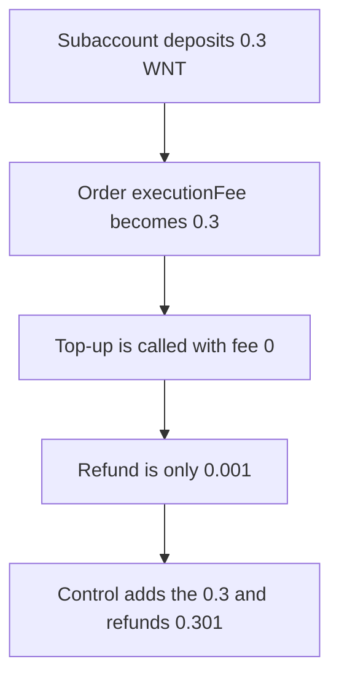

# Order update records 0.3 WNT and refunds only 0.001

> **Vulnerability classes:** vuln/logic/missing-check
>
> **Reproduction:** self-contained synthetic Foundry reduction; see [output.txt](output.txt).

<!-- non-defihacklabs -->
<!-- source-auditvault: https://github.com/Auditware/AuditVault/blob/main/findings/51986-execution-fee-might-not-be-refunded-to-subaccounts-when-upda.md -->
<!-- date: 2024-08 -->

## Key info

| Field | Value |
|---|---|
| **Loss** | Subaccount is not refunded the 0.3 WNT execution fee. Buggy refund is 0.001. Control refund is 0.301 |
| **Vulnerable contract** | `Router.updateOrder` |
| **Attacker EOA** | `0x1111111111111111111111111111111111111111` |
| **Attack contract** | `Exploit` |
| **Attack tx** | `Exploit.run()` |
| **Chain / block / date** | Ethereum model · block 0 · 2024-08 |
| **Compiler** | solc 0.8.27, cancun, via IR |
| **Bug class** | `_autoTopUp` is called with execution fee 0 while the order stores the new deposit |

## TL;DR

On an order update the subaccount deposits 0.3 WNT. The order's `executionFee` becomes 0.3 WNT. The top-up is then called with `0`, matching the quoted `_autoTopUpSubaccount(..., 0)`. `nativeTokensUsed` is only the gas term, fixed here at 0.001 WNT so the fee term is the only difference. The subaccount is refunded 0.001. The control router passes the 0.3 WNT deposit into the same formula and refunds 0.301. The gap is 0.3 WNT.

## Background

Halborn reviewed RFX. `SubaccountRouter.updateOrder` tops a subaccount up after an order change, but the execution-fee argument is hardcoded to 0. The quoted cap formula is `(startingGas - gasleft()) * tx.gasprice + executionFee`. When a frozen order needs a new execution fee, that fee is pulled from the subaccount and stored on the order by `OrderHandler.updateOrder`, and it is not added back. The report's second update deposits 0.3 ETH against a 0.5 ETH cap. This reduction uses those amounts. The gas term is a constant 0.001 WNT so the result does not depend on `gasleft`.

## The vulnerable code

```solidity
function updateOrder(uint256 receivedWnt) external {
    require(wnt.transferFrom(sub, address(this), receivedWnt), "deposit");
    executionFee += receivedWnt;
    // @> VULN: top-up is called with executionFee 0, so the new deposit is not refunded
    _autoTopUp(0);
}

function _autoTopUp(uint256 executionFeeArg) internal {
    uint256 nativeTokensUsed = GAS_SPENT + executionFeeArg;
    uint256 amount = CAP;
    if (nativeTokensUsed < amount) amount = nativeTokensUsed;
    refunded = amount;
    require(wnt.transfer(sub, amount), "refund");
}
```

`CAP` is 0.5 WNT. `GAS_SPENT` is 0.001 WNT. The fixed router calls `_autoTopUp(receivedWnt)`.

## Root cause

The order is credited with the new execution fee and the top-up is told the fee was zero. The cap then binds to the gas term alone, because 0.001 is below 0.5 and the 0.3 is not in the sum.

## Preconditions

- The subaccount holds 1 WNT and deposits 0.3 WNT on the update. The router holds 1 WNT to pay the refund.
- The top-up cap is 0.5 WNT, the figure in the Halborn test.
- Both routers run in this transaction. No block warp.

## Attack walkthrough

1. The order records a fee of 300000000000000000 ([output.txt:9](output.txt)).
2. The buggy refund is 1000000000000000 ([output.txt:11](output.txt)).
3. The gap versus the control refund is 300000000000000000 ([output.txt:13](output.txt)).
4. `[PASS]` ([output.txt:6](output.txt)).

## Diagrams



## Impact

The subaccount paid 0.3 WNT onto the order and received 0.001 WNT back. The control subaccount, with the fee included in `nativeTokensUsed`, is ahead by exactly 0.3 WNT. The 0.5 WNT cap does not hide the fee, because the gas term alone is under the cap.

## Remediation

Pass the wrapped native just deposited, `receivedWnt`, into the top-up instead of 0. Keep the cap.

```diff
-    _autoTopUp(0);
+    _autoTopUp(receivedWnt);
```

## How to reproduce

```bash
cd 51986-execution-fee-might-not-be-refunded-to-subaccounts-when-upda_exp
forge test -vv
```

## Sources

- AuditVault finding: [51986-execution-fee-might-not-be-refunded-to-subaccounts-when-upda](https://github.com/Auditware/AuditVault/blob/main/findings/51986-execution-fee-might-not-be-refunded-to-subaccounts-when-upda.md)
- Halborn, RFX contracts: https://www.halborn.com/audits/rfx-exchange/rfx-contracts
- Quoted `_autoTopUpSubaccount(..., 0)` and `nativeTokensUsed` formula
