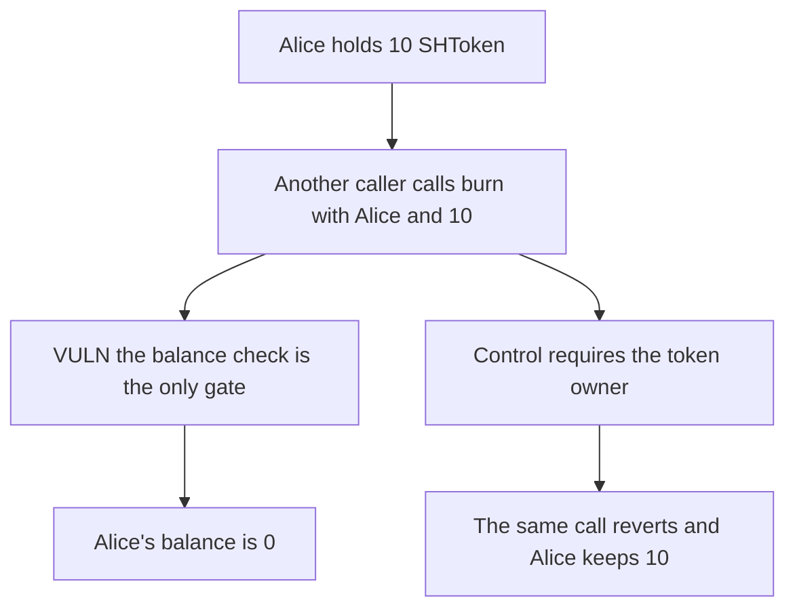

# Anyone can burn another account's SHToken

> **Vulnerability classes:** vuln/access-control/public-burn · vuln/defi/token-burn

<!-- non-defihacklabs -->
<!-- source-auditvault: https://github.com/Auditware/AuditVault/blob/main/findings/52313-hal-06-anyone-can-burn-shtoken-from-other-users-halborn-supe.md -->
<!-- date: 1970-01 -->

## Key info

| Field | Value |
|---|---|
| **Loss** | Alice holds 10 SHToken. Another caller burns all 10 |
| **Vulnerable contract** | `SHToken.burn` |
| **Attacker EOA** | `0x1111111111111111111111111111111111111111` |
| **Attack contract** | `Exploit` at `0x15452ec016c4dc8c549e7fe6ff4b26324ea8b7a4` |
| **Attack tx** | `Exploit.run()` |
| **Chain / block / date** | Ethereum model · block 0 · 1970-01 |
| **Compiler** | solc 0.8.27, cancun, via IR |
| **Bug class** | `burn(account, amount)` does not check the caller |



## TL;DR

`burn` checks that the amount is non-zero and that `account` holds it. It does not check `msg.sender`. Alice is minted 10. The caller burns that 10. Her balance is 0.

The owner-only burn reverts for a third party. Alice still holds 10.

The finding has no month, so the date marker is 1970-01.

## The vulnerable code

```solidity
function burn(address account, uint256 amount) external {
    require(amount > 0, "Amount must be greater than zero");
    require(balanceOf(account) >= amount, "Insufficient balance");
    _balance[account] -= amount;
    burned += amount; // @> VULN: any caller can burn another account's balance
}
```

## Impact

Any account can destroy another holder's tokens. Here that is Alice's entire balance of 10.

## How to reproduce

```bash
cd 52313-hal-06-anyone-can-burn-shtoken-from-other-users-halborn-supe_exp
forge test -vv
```

`test_exploit_bob_burns_alice` asserts Alice's balance is 0. `test_control_only_owner_burns` asserts the third-party burn reverts and she keeps 10.

## Sources

- AuditVault finding: https://github.com/Auditware/AuditVault/blob/main/findings/52313-hal-06-anyone-can-burn-shtoken-from-other-users-halborn-supe.md
- Halborn report: SuperHedge v1 Core
