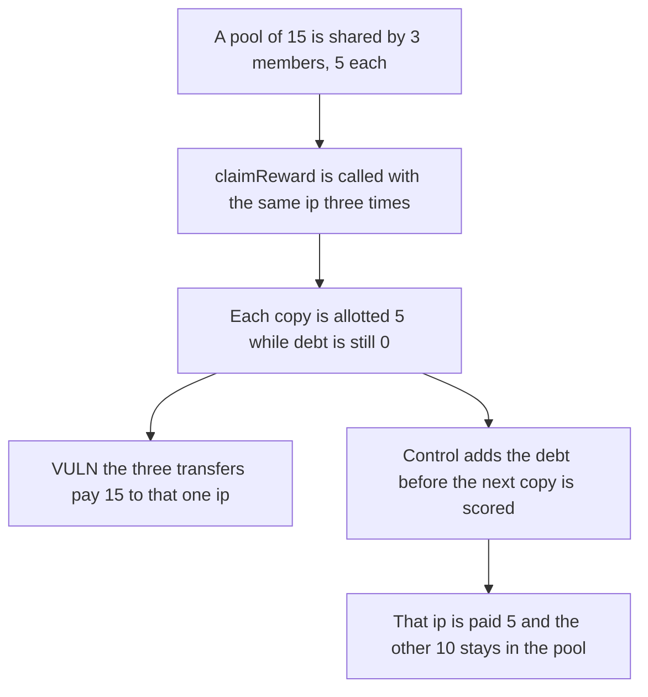

# Duplicate ip entries take the whole even-split reward

> **Vulnerability classes:** vuln/logic/duplicate-claim · vuln/defi/reward-drain

<!-- non-defihacklabs -->
<!-- source-auditvault: https://github.com/Auditware/AuditVault/blob/main/findings/52385-malicious-ip-owner-can-drain-rewards-via-duplicate-entries-i.md -->
<!-- date: 1970-01 -->

## Key info

| Field | Value |
|---|---|
| **Loss** | One ip listed three times is paid 15. Each of the 3 members was owed 5 |
| **Vulnerable contract** | `EvenSplitGroupPool.distributeRewards` |
| **Attacker EOA** | `0x1111111111111111111111111111111111111111` |
| **Attack contract** | `Exploit` at `0x15452ec016c4dc8c549e7fe6ff4b26324ea8b7a4` |
| **Attack tx** | `Exploit.run()` |
| **Chain / block / date** | Ethereum model · block 0 · 1970-01 |
| **Compiler** | solc 0.8.27, cancun, via IR |
| **Bug class** | Reward shares are computed for every array entry before that ip's debt is increased |



## TL;DR

`claimReward` forwards the caller's `ipIds` into `distributeRewards`. `_getAvailableReward` sets every entry to `poolBalance / totalIps` and subtracts the debt recorded so far. The debt is increased only after that whole array has been built.

A pool of 15 with 3 members owes 5 to each. Passing the same ip three times allots 5 + 5 + 5. The pool pays 15 to that ip and is left empty. The control increases debt inside the loop, pays 5 once, and leaves 10.

The finding has no month, so the date marker is 1970-01.

## The vulnerable code

```solidity
uint256 per = poolBalance / totalIps;
rewardPerIpStored = per;
rewards[i] = per - rewardDebt[ipIds[i]];
rewardDebt[ipIds[i]] += rewards[i];
token.transfer(ipIds[i], rewards[i]); // @> VULN: a repeated ip was allotted a full share before debt moved
```

## Impact

The other two members' 10 is paid to the duplicated ip. A unique list pays each member 5.

## How to reproduce

```bash
cd 52385-malicious-ip-owner-can-drain-rewards-via-duplicate-entries-i_exp
forge test -vv
```

`test_exploit_duplicate_ip_takes_15` asserts the duplicated ip receives 15 and the pool is empty. `test_control_duplicate_ip_is_paid_once` asserts that ip receives 5 and 10 stays in the pool.

## Sources

- AuditVault finding: https://github.com/Auditware/AuditVault/blob/main/findings/52385-malicious-ip-owner-can-drain-rewards-via-duplicate-entries-i.md
- Halborn report: Story Proof of Creativity Protocol
