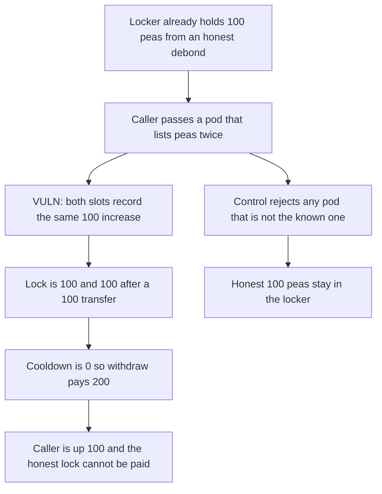

# Peapods: an arbitrary pod drains PodUnwrapLocker

> **Vulnerability classes:** `vuln/input-validation/missing` · `vuln/logic/missing-validation`

<!-- non-defihacklabs -->
<!-- source-auditvault: https://github.com/Auditware/AuditVault/blob/main/findings/52746-h-1-podunwraplocker-can-be-drained-due-to-an-arbitrary-input.md -->
<!-- date: 2025-01 -->

## Key info

| Field | Value |
|---|---|
| **Loss** | 100 peas that an honest debond left in the locker |
| **Vulnerable contract** | `PodUnwrapLocker.debondAndLock` |
| **Attacker EOA** | `0x1111111111111111111111111111111111111111` |
| **Attack contract** | `Exploit` |
| **Attack tx** | `Exploit.run()` |
| **Chain / block / date** | Ethereum model · block 0 · 2025-01 |
| **Compiler** | solc 0.8.27, cancun, via IR |
| **Bug class** | No pod allowlist, so one token listed twice is credited twice |

## TL;DR

`debondAndLock` takes any pod. The balance-delta loop credits every asset the pod returns. A pod that returns the same token twice records one incoming transfer on both slots. The caller supplies 100 peas, the lock stores 100 and 100, and the zero-cooldown withdraw pays 200. The 100 peas already in the locker from an honest debond are the extra 100.

## The vulnerable code

```solidity
for (uint256 i = 0; i < _tokens.length; i++) {
    _receivedAmounts[i] = IERC20(_tokens[i]).balanceOf(address(this)) - _balancesBefore[i]; // @> VULN: one token listed twice is credited for the same balance increase on every slot
}
```

There is no check that `_pod` is a pod the protocol deployed. The pod's `config().debondCooldown` is 0, so `withdraw` runs in the same transaction. The fix is to accept only known pods.

## Preconditions

- An honest user has debonded a one-asset pod. The locker holds 100 peas and that lock is not yet withdrawn.
- The caller holds 100 peas and approves a contract that returns `[peas, peas]` from `getAllAssets`, pulls 100 peas in `debond`, and reports a cooldown of 0.

## Attack walkthrough

1. Both slots snapshot the locker balance of 100.
2. `debond` transfers 100 peas from the caller into the locker. The balance is 200.
3. Each slot stores `200 - 100`. The lock is `[100, 100]`.
4. `withdraw` transfers 100 and then 100. The locker balance is 0.
5. The caller started the transaction with 100 and ends with 200.
6. The honest user's withdraw of their own lock reverts. The control locker rejects any pod other than the legitimate one, so the 100 peas stay.

## Diagrams



## Impact

The caller spends 100 peas and receives 200. The 100 peas that belonged to the earlier debond are gone, and that user's withdraw does not pay them.

## How to reproduce

```bash
cd 52746-h-1-podunwraplocker-can-be-drained-due-to-an-arbitrary-input_exp
forge test -vv
```

`test_exploit_double_counts_one_deposit` asserts a profit of 100 and an empty locker. `test_control_unknown_pod_is_rejected` asserts the malicious pod reverts and the honest 100 remains.

## Sources

- AuditVault finding: https://github.com/Auditware/AuditVault/blob/main/findings/52746-h-1-podunwraplocker-can-be-drained-due-to-an-arbitrary-input.md
- Sherlock issue 37: https://github.com/sherlock-audit/2025-01-peapods-finance-judging/issues/37
- Locker: https://github.com/sherlock-audit/2025-01-peapods-finance/blob/964a6b30c8b3fab408b289ebb26835932086073f/contracts/contracts/PodUnwrapLocker.sol
