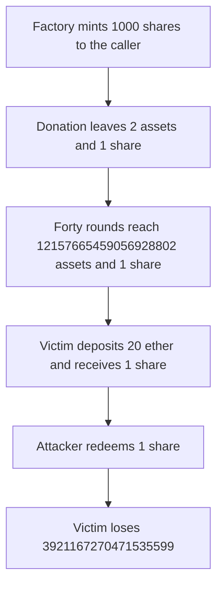

# Peapods: dead shares minted to the caller let that caller take 3.92 ether from the next depositor

> **Vulnerability classes:** vuln/arithmetic/rounding · vuln/logic/state-update

<!-- non-defihacklabs -->
<!-- source-auditvault: https://github.com/Auditware/AuditVault/blob/main/findings/52747-h-2-vault-inflation-attack-in-autocompoundingpodlp-is-possib.md -->
<!-- date: 2025-01 -->

## Key info

| Field | Value |
|---|---|
| **Loss** | The next depositor loses 3921167270471535599 of a 20 ether deposit. The attacker keeps that amount |
| **Vulnerable contract** | `Factory._depositMin` |
| **Attacker EOA** | `0x0000000000000000000000000000000000527471` |
| **Attack contract** | `Exploit` |
| **Attack tx** | `Exploit.run()` |
| **Chain / block / date** | Ethereum model · block 0 · 2025-01 |
| **Compiler** | solc 0.8.27, cancun, via IR |
| **Bug class** | Inflation-protection shares are withdrawable because they are minted to `msg.sender` |

## TL;DR

`_depositMin` is supposed to mint 1000 dead shares. It passes `msg.sender` as the receiver, so the attacker withdraws 999 of them after a 1 asset donation and leaves the vault at 2 assets and 1 share. Forty deposit-and-withdraw rounds grow `totalAssets` to 12157665459056928802 while supply stays 1. The victim's 20 ether deposit mints 1 share. Redeeming the attacker's share takes 3921167270471535599 from the victim. Minting the 1000 shares to `address(0xdead)` leaves them stuck.

## Background

Sherlock's January 2025 Peapods Finance contest, issue 166 (H-2), reported by pkqs90 and X77. The factory calls `deposit(minimumDepositAtCreation, _msgSender())` instead of a dead address. The report's loop is the standard inflation that rounds shares down on deposit and shares burned up on withdraw.

## The vulnerable code

```solidity
asset.transferFrom(msg.sender, address(this), minimumDepositAtCreation);
asset.approve(address(vault), minimumDepositAtCreation);
// @> VULN: the dead shares are minted to the caller, so they can be withdrawn
vault.deposit(minimumDepositAtCreation, msg.sender);
```

`minimumDepositAtCreation` is 1000, matching the report's `1e3` unit deposit.

## Root cause

A share the caller can redeem is not a dead share. After the donation, `ceil(999 * 1000 / 1001)` burns 999 shares for 999 assets and leaves 2 assets and 1 share. Each later round deposits `2 * totalAssets - 1`, mints 1 share, and withdraws 1 asset, which burns that share. Assets become `3^n + 1` after n rounds.

## Preconditions

- The attacker can call the factory mint, which is what happens when the attacker is the deployment caller.
- The vault rounds deposits down and withdrawals up, as in the report.
- A later depositor sends 20 ether.

## Attack walkthrough

1. `_depositMin` mints 1000 shares to the attacker for 1000 assets.
2. `increase` plus a 1 asset transfer makes `totalAssets` 1001. Withdrawing 999 assets leaves 2 assets and 1 share.
3. Forty rounds reach `totalAssets` 12157665459056928802 and `totalSupply` 1.
4. The victim deposits 20 ether and receives 1 share. Supply is 2.
5. The attacker redeems 1 share. The profit above the attacker's own 20 ether seed is 3921167270471535599, and the victim is short the same amount.
6. The control mints the 1000 shares to `address(0xdead)`. The attacker cannot withdraw them, and 1000 assets stay in the vault.

## Diagrams


