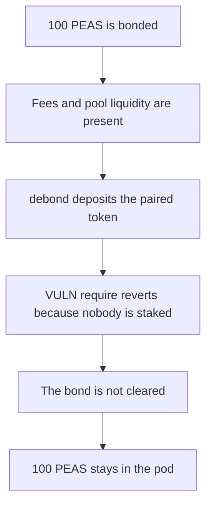

# Peapods: leave-as-paired fees revert debond and lock the bonded PEAS

> **Vulnerability classes:** vuln/dos/frozen-funds · vuln/logic/wrong-condition

<!-- non-defihacklabs -->
<!-- source-auditvault: https://github.com/Auditware/AuditVault/blob/main/findings/52748-h-3-pod-dos-if-the-leave-as-paired-lp-token-option-is-enable.md -->
<!-- date: 2025-01 -->

## Key info

| Field | Value |
|---|---|
| **Loss** | 100 PEAS stuck in the pod |
| **Vulnerable contract** | `TokenRewards._depositRewards` |
| **Attacker EOA** | `0x5274800000000000000000000000000000000001` |
| **Attack contract** | `Exploit` |
| **Attack tx** | `Exploit.run()` |
| **Chain / block / date** | Ethereum model · block 0 · 2025-01 |
| **Compiler** | solc 0.8.27, cancun, via IR |
| **Bug class** | Paired-token deposit reverts with "R" when `totalShares` is 0 |

## TL;DR

`LEAVE_AS_PAIRED_LP_TOKEN` makes `depositFromPairedLpToken` deposit DAI instead of swapping it for the rewards token. `_depositRewards` then requires the token to be the rewards token whenever nobody has staked. `debond` calls that path once the pod has fees and the pool has liquidity, so the call reverts and the bonded PEAS never move. Burning the paired token when `totalShares` is 0 lets debond return the 100 PEAS.

## Background

Sherlock's January 2025 Peapods Finance contest, issue 175, reported by fibonacci and TessKimy. Staking and debonding both run the fee path, and a Uniswap V2 pool keeps a dust balance after the first mint, so the revert does not clear itself.

## The vulnerable code

```solidity
if (LEAVE_AS_PAIRED_LP_TOKEN) {
    _depositRewards(PAIRED_LP_TOKEN, _amountTkn);
    return;
}
if (totalShares == 0) {
    if (!burnWhenNoStakers) {
        // @> VULN: paired-lp fees revert while nobody is staked, so debond cannot finish
        require(_token == rewardsToken, "R");
    }
}
```

## Root cause

The leave-as-paired branch deposits a token that is not `rewardsToken`, and the zero-staker branch only accepts `rewardsToken`.

## Preconditions

- `LEAVE_AS_PAIRED_LP_TOKEN` is true and the paired token is not the rewards token.
- `totalShares` is 0.
- The pod holds fee tokens and the pool's paired balance is nonzero.

## Attack walkthrough

1. Bond 100 PEAS. The pod holds them.
2. The pool receives 1 DAI and the pod receives 10 DAI of fees.
3. `debond` sees the option, the pool balance, and the fees, and calls `depositFromPairedLpToken`.
4. `_depositRewards` hits `require(_token == rewardsToken)` and reverts with "R".
5. The bond record and the 100 PEAS stay on the pod.
6. The control burns the paired token instead of reverting. `debond` returns the 100 PEAS.

## Diagrams


