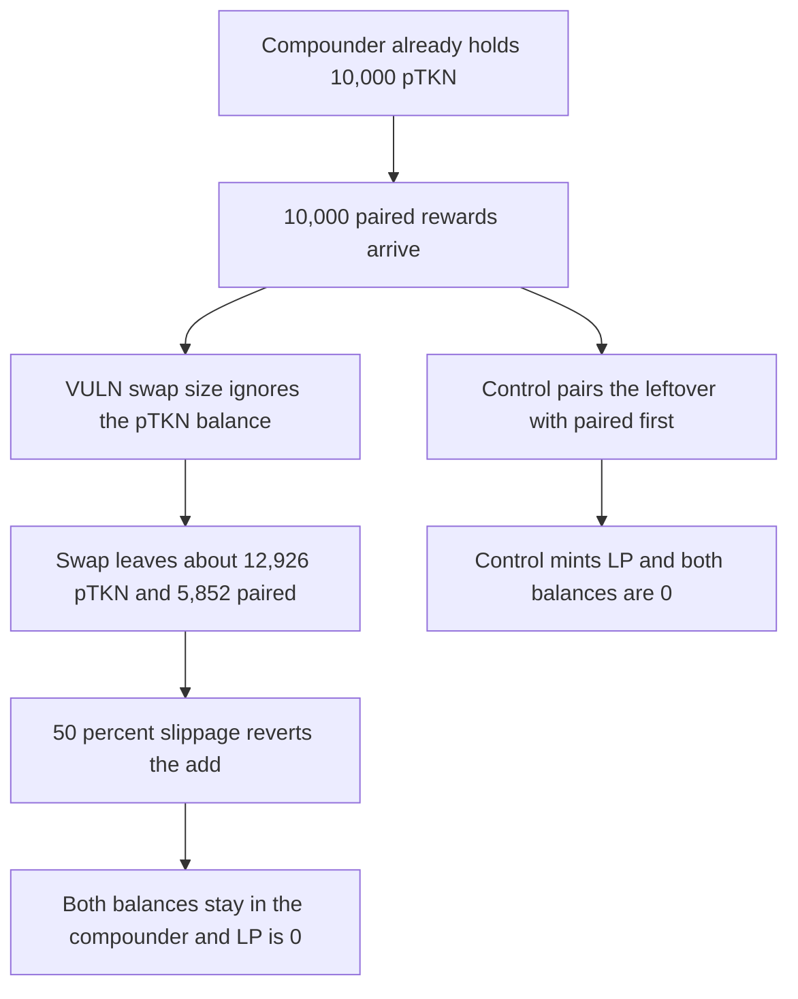

# The pod compounder swaps again while pTKN is left over, and 12,925 pTKN stays stuck

> **Vulnerability classes:** vuln/dos/frozen-funds · vuln/logic/missing-check

<!-- non-defihacklabs -->
<!-- source-auditvault: https://github.com/Auditware/AuditVault/blob/main/findings/52749-h-4-autocompoundingpodlp-pairedlptokentopodlp-does-not-corr.md -->
<!-- date: 2025-01 -->

## Key info

| Field | Value |
|---|---|
| **Loss** | 12,925.820234006285946425 pTKN and 5,851.640468012571892851 paired tokens left in the compounder. LP minted is 0 |
| **Vulnerable contract** | `AutoCompoundingPodLp._pairedLpTokenToPodLp` |
| **Attacker EOA** | `0x9a08674ef07f01c0c22fb4823ff93fbba6f4f77c` (a donor of leftover pTKN) |
| **Attack contract** | `Exploit` |
| **Attack tx** | `Exploit.run()` |
| **Chain / block / date** | Ethereum model · block 0 · 2025-01 |
| **Compiler** | solc 0.8.27, cancun, via IR |
| **Bug class** | The paired-to-pTKN swap size ignores pTKN already held, so the next add is too unbalanced for the slippage check |

## TL;DR

`_getSwapAmt` sizes the swap from pool reserves and the new paired amount. It does not read the contract's pTKN balance. With 10,000 pTKN already there and 10,000 new paired tokens, it still swaps about half the paired side. The add is then about 12,926 pTKN against 5,852 paired. At 50% slippage the minimum on the pTKN side is above what a 1:1 pool will take, so `addLPAndStake` reverts. Both balances stay in the contract. Pairing the 10,000 leftover with 10,000 paired first mints LP and leaves both balances at 0.

## Background

Sherlock's January 2025 Peapods Finance contest, issue 442 (H-4). Rewards are swapped to the paired token, about half of that is swapped to pTKN, and the two sides are added to a Uniswap V2 pair. If an add fails, the leftovers sit on the contract and the next epoch swaps half of the paired balance again. The report's pool example is 1:1 with 50% slippage still failing on a 1:3 input. This run uses a 10,000/10,000 pair, a 0.3% fee, and `lpSlippage = 500`.

## The vulnerable code

```solidity
uint256 _pairedSwapAmt = _getSwapAmt(_pairedLpToken, address(pod), _pairedLpToken, _amountIn);
// @> VULN: the swap size ignores pTKN already in the contract, so a leftover makes the next add more unbalanced
uint256 _pairedRemaining = _amountIn - _pairedSwapAmt;
...
_podAmountOut = pod.balanceOf(address(this));
_pairedRemaining = paired.balanceOf(address(this)) - _protocolFees;
```

`_getSwapAmt` is the report's formula: `(_sqrt(r * (full * 3988000 + r * 3988009)) - r * 1997) / 1994`.

## Root cause

The swap is computed as if the contract held only the new paired tokens. The add then uses the whole pTKN balance, including tokens the swap did not create. The two sides no longer match the pool, and the slippage floors (`amount * (1000 - slippage) / 1000`) cannot both be met.

## Preconditions

- The V2 pool is 10,000 paired and 10,000 pTKN.
- The compounder already holds 10,000 pTKN.
- 10,000 paired tokens are available to compound, and `lpSlippage` is 500.

## Attack walkthrough

1. Leave 10,000 pTKN on the compounder and send in 10,000 paired.
2. `_getSwapAmt` ignores the pTKN and returns the usual half-swap.
3. The swap runs. pTKN on the contract becomes 12,925.820234006285946425. Paired left is 5,851.640468012571892851.
4. `addLPAndStake` requires both minimums. The 1:1 match can only use the smaller side. The pTKN minimum fails.
5. The catch sets `addFailed`. `lpOut` is 0. Both token balances remain.
6. The control pairs 10,000 with 10,000 before any swap, mints 10,000 LP, and both balances are 0.

## Diagrams



## Impact

12,925.820234006285946425 pTKN and 5,851.640468012571892851 paired tokens are stuck in the compounder. That includes the leftover pTKN and the paired rewards that were swapped into more pTKN. No LP token is minted, so the rewards are not staked. The same leftover makes the next epoch more unbalanced.

## Remediation

Before swapping, pair any pTKN already held with an equal value of paired tokens and add that liquidity. Swap only the paired amount that is still unmatched.

## How to reproduce

```bash
cd 52749-h-4-autocompoundingpodlp-pairedlptokentopodlp-does-not-corr_exp
forge test -vv
```

`test_exploit_unbalanced_add_sticks_ptkn` asserts LP out is 0 and the two stuck balances above. `test_control_pairing_leftover_first_mints_lp` asserts 10,000 LP and zero leftover. Captured output is `output.txt`.

## Sources

- AuditVault finding: https://github.com/Auditware/AuditVault/blob/main/findings/52749-h-4-autocompoundingpodlp-pairedlptokentopodlp-does-not-corr.md
- Sherlock issue 442: https://github.com/sherlock-audit/2025-01-peapods-finance-judging/issues/442
