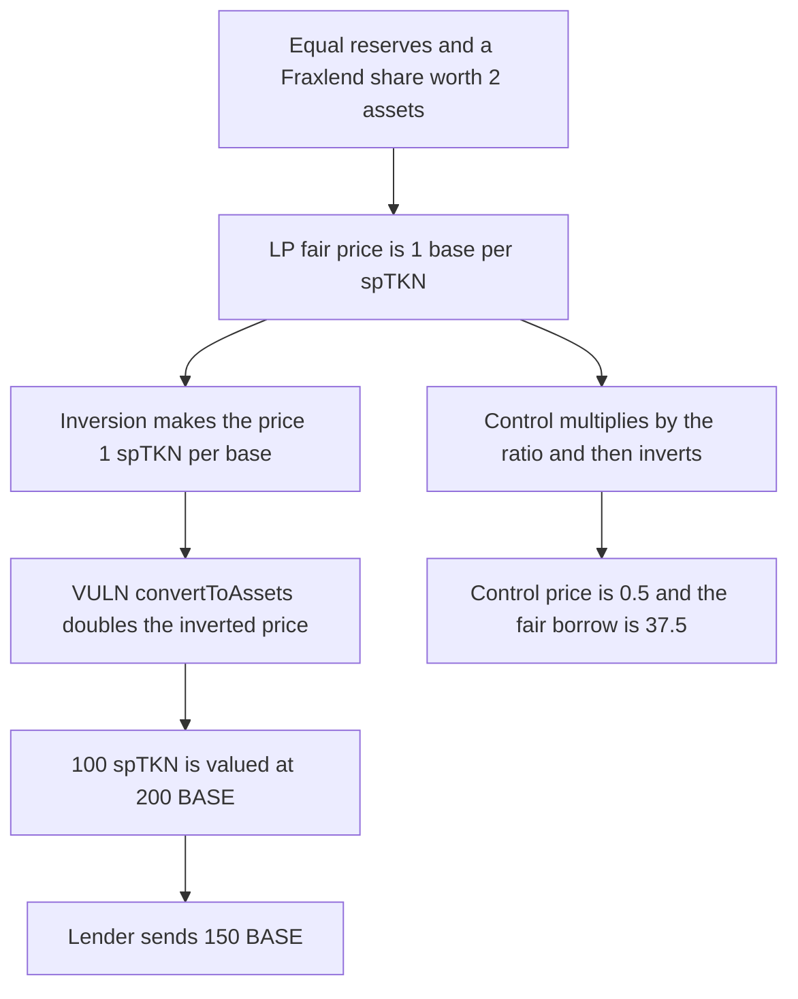

# Peapods: Fraxlend ratio applied after the inversion borrows 150 instead of 37.5

> **Vulnerability classes:** vuln/logic/price-calculation · vuln/logic/incorrect-order-of-operations

<!-- non-defihacklabs -->
<!-- source-auditvault: https://github.com/Auditware/AuditVault/blob/main/findings/52750-h-5-sptknminimaloracle-calculatesptknperbase-does-not-calcu.md -->
<!-- date: 2025-01 -->

## Key info

| Field | Value |
|---|---|
| **Loss** | 100 spTKN borrows 150 BASE. The fair maximum at 75 percent LTV is 37.5 BASE |
| **Vulnerable contract** | `SpOracle._calculateSpTknPerBase` |
| **Attacker EOA** | `0x0000000000000000000000000000000000052750` |
| **Attack contract** | `Exploit` |
| **Attack tx** | `Exploit.run()` |
| **Chain / block / date** | Ethereum model · block 0 · 2025-01 |
| **Compiler** | solc 0.8.27, cancun, via IR |
| **Bug class** | `convertToAssets` runs after the price is inverted |

## TL;DR

`_calculateSpTknPerBase` builds a Uniswap V2 fair LP price, inverts it to spTKN per base, and only then calls `IFraxlendPair.convertToAssets`. With equal 1e18 reserves, LP supply 2e18, and a Fraxlend share worth 2 assets, the inverted price is 1 and `convertToAssets` doubles it to 2. Collateral of 100 spTKN is valued at 200 BASE. At 75 percent LTV the lender sends 150 BASE. Multiplying by the share ratio before the inversion prices the same collateral at 50 BASE and caps the borrow at 37.5.

## Background

Sherlock's January 2025 Peapods Finance contest, issue 445, reported by pkqs90 and bretzel. `spTKNMinimalOracle._calculateSpTknPerBase` is used for podded tokens and Fraxlend-pair tokens that back an LP. The write-up says the code treats pairedLpTKN and base as 1:1, and it applies the asset/share ratio after reversing spTKN/paired into paired/spTKN. The correct order is to scale the LP price by the ratio and only then invert.

## The vulnerable code

```solidity
_basePerSpTkn18 = (2 * _avgBaseAssetInLp18 * 10 ** pair.decimals()) / pair.totalSupply();
require(_basePerSpTkn18 > 0, "V2R");
_spTknBasePrice18 = 10 ** (18 * 2) / _basePerSpTkn18;
if (BASE_IS_FRAX_PAIR) {
    // @> VULN: convertToAssets is applied after the inversion, so the share ratio scales spTKN per base instead of the LP fair price
    _spTknBasePrice18 = frax.convertToAssets(_spTknBasePrice18);
}
```

`convertToAssets` returns `shares * 2`, so 1 share is 2 assets. The inputs above make `_basePerSpTkn18` equal `1e18` and the inversion equal `1e18`. Doubling that returns `2e18`.

## Root cause

The ratio converts pairedLpTKN into base. It has to scale `_basePerSpTkn18` before `1e36 / _basePerSpTkn18`. Applying it after the inversion multiplies spTKN-per-base by the ratio instead of dividing the base-per-spTKN price by it. A share that is worth more than one asset makes spTKN look more expensive to the lender, so the borrower can take more base.

## Preconditions

- `BASE_IS_FRAX_PAIR` is true. The pod branch is not taken.
- Pair reserves are `1e18` and `1e18`, LP total supply is `2e18`, and the pTKN price in base is `1e18`.
- `convertToAssets(1e18)` is `2e18`.
- The lender allows 75 percent of oracle value and holds 150 BASE.

## Attack walkthrough

1. `borrow(100 ether)` asks the oracle for spTKN per 1 base.
2. The LP math produces `_basePerSpTkn18 = 1e18`.
3. The inversion is `1e18`. `convertToAssets` returns `2e18`.
4. Collateral value is `100 ether * 2 = 200 ether`.
5. 75 percent of that is 150 ether. The lender transfers 150 BASE.
6. The control multiplies by the ratio first. The price is `0.5 ether`, the value of 100 spTKN is 50 BASE, and the max borrow is 37.5 BASE.

## Diagrams



## Impact

The attacker posts 100 spTKN and receives 150 BASE. The same position at the corrected price supports 37.5 BASE. The extra 112.5 BASE is the lender's asset, borrowed against an oracle price that is four times too high. The control's view returns `0.5 ether` and a 37.5 ether maximum.

## Remediation

Read `convertToAssets(1e18)` first. Scale `_basePerSpTkn18` by that ratio, then invert. That is the order in the issue 445 mitigation. The same order applies to the pod CBR branch.

## How to reproduce

```bash
cd 52750-h-5-sptknminimaloracle-calculatesptknperbase-does-not-calcu_exp
forge test -vv
```

`test_exploit_fraxlend_ratio_after_invert_borrows_150` asserts a price of 2 ether and a 150 BASE transfer. `test_control_cbr_before_invert_prices_at_half` asserts a price of 0.5 ether and a 37.5 BASE maximum. Captured output is `output.txt`.

## Sources

- AuditVault finding: https://github.com/Auditware/AuditVault/blob/main/findings/52750-h-5-sptknminimaloracle-calculatesptknperbase-does-not-calcu.md
- Sherlock judging issue 445: https://github.com/sherlock-audit/2025-01-peapods-finance-judging/issues/445
