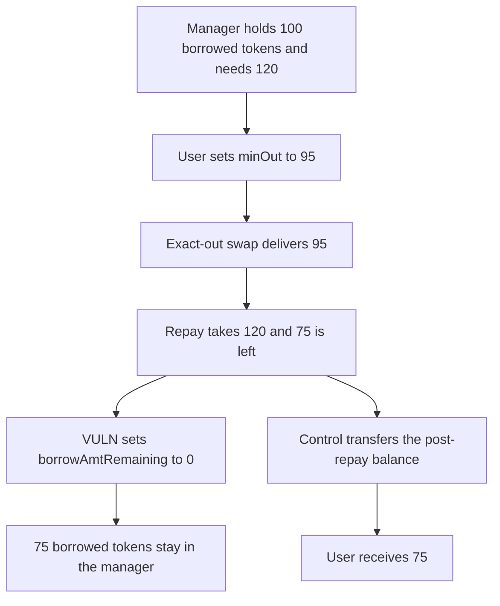

# Peapods: removeLeverage with a slippage floor leaves 75 borrowed tokens in the manager

> **Vulnerability classes:** `vuln/dos/frozen-funds` · `vuln/defi/slippage`

<!-- non-defihacklabs -->
<!-- source-auditvault: https://github.com/Auditware/AuditVault/blob/main/findings/52751-h-6-leveragemanager-remove-leverage-will-lead-to-stuck-token.md -->
<!-- date: 2025-01 -->

## Key info

| Field | Value |
|---|---|
| **Loss** | 75 borrowed tokens stuck in `LeverageManager` |
| **Vulnerable contract** | `LeverageManager.removeLeverage` |
| **Attacker EOA** | `0x1111111111111111111111111111111111111111` |
| **Attack contract** | `Exploit` |
| **Attack tx** | `Exploit.run()` |
| **Chain / block / date** | Ethereum model · block 0 · 2025-01 |
| **Compiler** | solc 0.8.27, cancun, via IR |
| **Bug class** | Post-swap surplus ignored when `podSwapAmtOutMin` is set |

## TL;DR

Removing leverage holds 100 borrowed tokens and needs 120 to repay the flash loan. The user sets `_podSwapAmtOutMin` to 95 so the exact-out swap cannot be pushed to the full pod balance. The swap delivers 95, the repay takes 120, and 75 borrowed tokens are left in the manager. `_borrowAmtRemaining` is computed from the pre-swap 100, so it is 0 and the user is paid nothing. The control sends the post-repay balance and the user receives 75.

## Background

Sherlock contest 2025-01-peapods-finance, issue H-6, found by pkqs90, X77, ZoA, and elolpuer. `_swapPodForBorrowToken` calls `swapV2SingleExactOut` with `_podSwapAmtOutMin` when that argument is non-zero, instead of the exact shortfall. `_removeLeveragePostCallback` then sets the refund to zero whenever the pre-swap paired balance is below the repay.

## The vulnerable code

```solidity
_dexAdapter.swapV2SingleExactOut(
    _pod, _targetToken, _podAmt, _podSwapAmtOutMin == 0 ? _targetNeededAmt : _podSwapAmtOutMin, address(this)
);
require(borrowToken.transfer(flashSource, repayAmount), "repay");
// @> VULN: surplus borrowed tokens from the slippage swap are not included, so they stay in the manager
borrowAmtRemaining = pairedAmtReceived > repayAmount ? pairedAmtReceived - repayAmount : 0;
```

## Root cause

The refund uses `_pairedAmtReceived`, the balance from before the swap. The slippage swap's extra output is invisible to that subtraction, and nothing else transfers `balanceOf(address(this))` after the repay.

## Preconditions

- The position redeem leaves 100 pTKN and 100 borrowed tokens in the manager.
- The flash repay is 120, so a swap is required.
- The user sets `_podSwapAmtOutMin` to 95. The pool can fill an exact output of 95 at one-to-one.

## Attack walkthrough

1. 100 borrowed tokens and 100 pTKN are approved to the manager. The DEX holds 95 borrowed tokens.
2. `removeLeverage` pulls both balances.
3. The swap requests 95, not the 20 token shortfall.
4. The DEX sends 95. The manager holds 195 borrowed tokens.
5. 120 is repaid. 75 remains.
6. `borrowAmtRemaining` is 0. The user receives none of the 75.

## Diagrams



## Impact

The position owner is short 75 borrowed tokens that the swap produced above the 20 token need. They sit in `LeverageManager` with no refund. The flash source did receive its 120. The control returns the 75 to the user and leaves the manager empty.

## Remediation

After the repay, transfer `borrowToken.balanceOf(address(this))` to the position owner. Do not derive the refund only from the pre-swap paired amount.

## How to reproduce

```bash
cd 52751-h-6-leveragemanager-remove-leverage-will-lead-to-stuck-token_exp
forge test -vv
```

`test_exploit_75_borrow_tokens_stuck` asserts 75 in the manager, 0 returned to the user, and 120 repaid. `test_control_returns_the_slippage_surplus` asserts the user receives 75. Captured output is `output.txt`.

## Sources

- AuditVault finding: https://github.com/Auditware/AuditVault/blob/main/findings/52751-h-6-leveragemanager-remove-leverage-will-lead-to-stuck-token.md
- Sherlock issue: https://github.com/sherlock-audit/2025-01-peapods-finance-judging/issues/446
