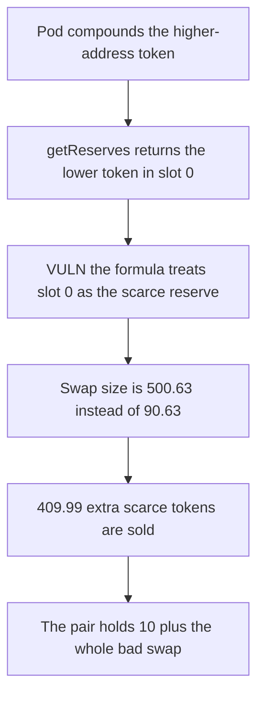

# Peapods: the swap amount reads V2 reserves backwards

> **Vulnerability classes:** `vuln/logic/price-calculation` · `vuln/defi/slippage`

<!-- non-defihacklabs -->
<!-- source-auditvault: https://github.com/Auditware/AuditVault/blob/main/findings/52752-h-7-incorrect-reserve-mapping-leads-to-fault-swap-sherlock-p.md -->
<!-- date: 2025-01 -->

## Key info

| Field | Value |
|---|---|
| **Loss** | 500.63 scarce tokens dumped into a 10 token reserve. The sorted swap dumps 90.63. Extra 409.99 tokens sit in the pair |
| **Vulnerable contract** | `Pod._getSwapAmt` |
| **Attacker EOA** | `0x1111111111111111111111111111111111111111` |
| **Attack contract** | `Exploit` |
| **Attack tx** | `Exploit.run()` |
| **Chain / block / date** | Ethereum model · block 0 · 2025-01 |
| **Compiler** | solc 0.8.27, cancun, via IR |
| **Bug class** | Reserve slot 0 treated as the caller's token0 |

## TL;DR

`_getSwapAmt` takes `getReserves()` and treats slot 0 as `_t0`. Uniswap V2 returns reserves in ascending token address order. Here `_t0` is the higher address, whose reserve is 10 tokens, and slot 0 is the lower token's reserve of 1,000,000. The 0.3 percent zap formula therefore sells 500.63 of the scarce token instead of 90.63. The pair's balance of that token becomes 10 plus 500.63.

## Background

Sherlock's January 2025 Peapods contest, issue 512, reported by pkqs90 and others. `AutoCompoundingPodLp._getSwapAmt` is the blamed function. The recommended fix sorts the two tokens and swaps the reserve tuple when `_t0` is not `token0`.

## The vulnerable code

```solidity
(uint112 _r0, uint112 _r1,) = pair.getReserves();
uint112 _r = _swapT == _t0 ? _r0 : _r1;
return (_sqrt(uint256(_r) * (_fullAmt * 3988000 + uint256(_r) * 3988009)) - (uint256(_r) * 1997)) / 1994; // @> VULN
```

The fix is the report's sort:

```solidity
(address token0,) = sortTokens(_t0, _t1);
(_r0, _r1) = _t0 == token0 ? (_r0, _r1) : (_r1, _r0);
```

## Root cause

`getReserves` is ordered by address. The zap formula is applied to whichever reserve happens to sit in the slot the caller hoped belonged to `_swapT`.

## Preconditions

- The two token addresses are not equal. `_t0` is the higher one.
- The pair holds 1,000,000 of the lower token and 10 of the higher token.
- The pod holds 1000 of the higher token and calls `_getSwapAmt` to compound it.

## Attack walkthrough

1. `compound` asks for a swap of the high token against the low token, passing the high token as `_t0`.
2. `getReserves` returns the low reserve in slot 0.
3. Because `_swapT == _t0`, the formula uses slot 0. The amount is 500626001745396739492 wei.
4. The reserve-sorted amount is 90634800368085047639 wei. The difference is 409991201377311691853 wei.
5. The pod transfers the buggy amount. The pair's high balance is 10 ether plus that amount.

## Diagrams



## Impact

The pod sells 500.63 units of a token whose pool reserve is 10. The fair zap sells 90.63. The extra 409.99 units are in the pair, not in the pod, and the pool price is set by that oversized sell. Users whose compound was supposed to add liquidity at the pool ratio are left with the wrong inventory.

## How to reproduce

```bash
cd 52752-h-7-incorrect-reserve-mapping-leads-to-fault-swap-sherlock-p_exp
forge test -vv
```

`test_exploit_wrong_reserve_dumps_scarce_token` logs the buggy amount, the fair amount, and the extra, and asserts the pair absorbed the bad swap. Output is `output.txt`.

## Sources

- AuditVault finding: https://github.com/Auditware/AuditVault/blob/main/findings/52752-h-7-incorrect-reserve-mapping-leads-to-fault-swap-sherlock-p.md
- Sherlock issue 512: https://github.com/sherlock-audit/2025-01-peapods-finance-judging/issues/512
- Blamed function: https://github.com/sherlock-audit/2025-01-peapods-finance/blob/d28eb19f4b39d3db7997477460f9f9c76839cb0c/contracts/contracts/AutoCompoundingPodLp.sol#L392
