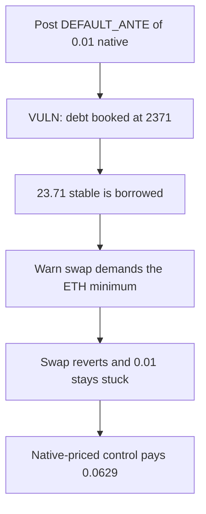

# StackingSalmon — ETH-priced native ante bricks the warn swap

> **Vulnerability classes:** vuln/logic/price-calculation · vuln/dos/frozen-funds

<!-- non-defihacklabs -->
<!-- source-auditvault: https://github.com/Auditware/AuditVault/blob/main/findings/52787-h-01-incorrect-assumptions-about-chain-native-token-will-hea.md -->
<!-- date: 2025-01 -->

## Key info

| | |
|---|---|
| **Protocol** | StackingSalmon Borrower |
| **Finding** | Shieldify, AuditVault 52787 |
| **Vulnerable code** | `DEFAULT_ANTE` booked at the ETH price |
| **Harm** | 23.71 stable borrowed against 0.01 native. The warn swap reverts and the 0.01 stays stuck. |
| **Chain** | local synthetic |

## TL;DR

`DEFAULT_ANTE` is `0.01 ether`, a number that is meaningful if the native token is ETH at about 2371. On the deployment chain the native token is about 6.29. Borrowing multiplies the ante by 2371 and releases 23.71 stable. The warn path then asks the native swap for an ETH-priced minimum. The pool only pays the real native price, the swap reverts, and the 0.01 remains in the borrower with the debt still open. The same 0.01 swapped at 6.29 pays 0.0629 stable.

## The vulnerable code

```solidity
uint208 constant DEFAULT_ANTE = 0.01 ether;
uint216 constant CONSTRAINT_ANTE_MAX = 0.5 ether;

// @> VULN: books the chain native token at the ETH price, so the warn swap cannot clear it
uint256 debt = msg.value * ETH_PRICE / 1e18;
```

`warn` sends `ante / 4` into `NativeSwap` with `minStable = payout * ETH_PRICE / 1e18`. The pool's output is `msg.value * 6.29`. That output is below the ETH minimum, so the call reverts.

## Root cause

The ante constants and the liquidation quote assume the chain native token has ETH's price. The swap that is supposed to turn the ante into stable cannot clear an ETH-sized minimum, so the ante cannot be used to repay or to pay a warner.

## Preconditions

The borrower posts exactly `0.01 ether`. The stable pool will release `0.01 * 2371`. The native swap quotes at 6.29 per token. No governance change of the ante is available in this reduction. The cap `CONSTRAINT_ANTE_MAX` of `0.5 ether` still allows the 0.01 ante.

## Attack walkthrough

1. `borrow` with 0.01 native books debt `23710000000000000000` and transfers that much stable.
2. `warn` tries to swap 0.0025 native for at least `0.0025 * 2371` stable.
3. The pool would pay `0.0025 * 6.29`. The slippage check reverts.
4. The borrower still holds 0.01 native, and the 23.71 debt is still outstanding.
5. A control swap of 0.01 at the native price returns `62900000000000000` stable.

## Diagrams



## Impact

Lenders are out 23.71 stable collateralized by 0.01 of a token worth 0.0629. The warn swap that should start liquidation cannot run, so the ante stays stuck in the borrower and the debt is not repaid. Pricing the same native token at 6.29 lets the swap complete.

## Remediation

Do not hardcode an ETH-sized ante. Price the chain native token, or let governance set the ante and its maximum without assuming ETH.

## How to reproduce

```bash
cd 52787-h-01-incorrect-assumptions-about-chain-native-token-will-hea_exp
forge test -vv
```

## Sources

- AuditVault finding: https://github.com/Auditware/AuditVault/blob/main/findings/52787-h-01-incorrect-assumptions-about-chain-native-token-will-hea.md
- Shieldify report: https://github.com/shieldify-security/audits-portfolio-md/blob/main/StackingSalmon-Security-Review.md
- Constants at the audited commit: https://github.com/cryptovash/sammin-core/blob/c49807ae2965cf6d121a10507a43de1d64ba1e70/core/src/libraries/constants/Constants.sol
