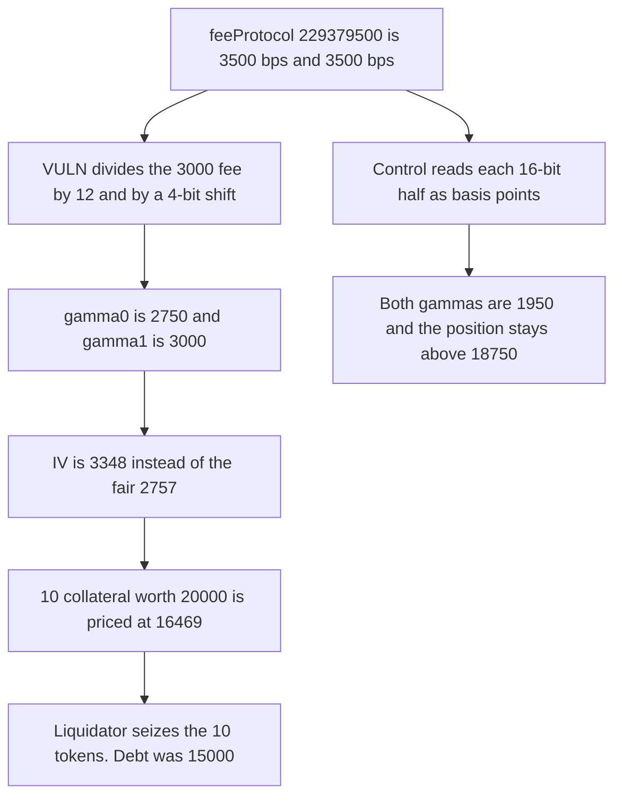

# StackingSalmon: Kodiak fee basis points are read as a Uniswap denominator

> **Vulnerability classes:** vuln/logic/fee-calculation · vuln/oracle/price-manipulation

<!-- non-defihacklabs -->
<!-- source-auditvault: https://github.com/Auditware/AuditVault/blob/main/findings/52788-h-02-the-feeprotocol-calculation-in-the-volatilityoracle-get.md -->
<!-- date: 2025-01 -->

## Key info

| Field | Value |
|---|---|
| **Loss** | Liquidator seizes 10 collateral tokens from a position worth 20,000 against 15,000 of debt |
| **Vulnerable contract** | `VolatilityOracle._getPoolMetadata` |
| **Attacker EOA** | `0x1111111111111111111111111111111111111111` |
| **Attack contract** | `Exploit` |
| **Attack tx** | `Exploit.run()` |
| **Chain / block / date** | Ethereum model · block 0 · 2025-01 |
| **Compiler** | solc 0.8.27, cancun, via IR |
| **Bug class** | uint32 basis-point feeProtocol decoded with Uniswap V3's 4-bit split |

## TL;DR

Kodiak stores `feeProtocol` as two 16-bit basis-point fields. `229379500` is 3500 and 3500, meaning 35% and 35%. `_getPoolMetadata` still does `fee % 16` and `fee >> 4`, the Uniswap V3 denominator split. A 3000 pool fee becomes gamma 2750 and 3000 instead of 1950 and 1950. The same fee growth then implies IV 3348 instead of 2757. Ten collateral tokens worth 20,000, backing 15,000 of debt, are marked at 16,469.53 and liquidated. The 80% threshold is 18,750, so the fair price would not liquidate them.

## Background

Shieldify's StackingSalmon review, H-02. The Kodiak V3 factory on Berachain sets `defaultFeeProtocol = 229379500`. The oracle was copied from the Aloe-style Uniswap path, where `feeProtocol` is a uint8 and gamma is `fee - fee / N`. The team marked the issue fixed. This reduction keeps the blamed subtraction and the revenue formula `feeGrowth * gamma / 1e6`, which is the direction of `Volatility.computeRevenueGamma`.

## The vulnerable code

```solidity
unchecked {
    // @> VULN: feeProtocol is 3500 bps in each 16-bit half, but this divides by a 4-bit Uniswap denominator
    if (feeProtocol % 16 != 0) g0 -= uint24(fee / (feeProtocol % 16));
    if (feeProtocol >> 4 != 0) g1 -= uint24(fee / (feeProtocol >> 4));
}
```

`229379500 % 16` is 12, so gamma0 is `3000 - 250 = 2750`. `229379500 >> 4` is 14,336,218, so gamma1 stays 3000. The low and high 16 bits are both 3500. The LP share is `3000 * 6500 / 10000 = 1950` on each side.

## Root cause

The decoder keeps four bits per token and treats the field as a divisor. Kodiak writes sixteen bits per token and treats the field as basis points. The LP fee used by the implied-vol sum is too high, the IV is too high, and `Borrower.getPrices` marks collateral too cheap.

## Preconditions

- Pool fee is 3000. `feeProtocol` is 229379500.
- Observed fee growth is `1950 * 1e6`, the growth produced by the fair gamma.
- The borrower posted 10 collateral. Spot is 2,000, so face value is 20,000. Debt is 15,000. Liquidation fires when value is below 18,750.

## Attack walkthrough

1. The position is opened. At the fair price it sits above the threshold.
2. `liquidate` loads metadata. gamma0 becomes 2750 and gamma1 stays 3000.
3. IV is 3348. The fair IV at gamma 1950 is 2757.
4. Collateral is priced at `20000 * 2757 / 3348`, which is 16,469.53.
5. That is below 18,750. The liquidator receives the 10 collateral tokens and repays 15,000 of debt.
6. The basis-point control stores gamma 1950 and 1950.

## Diagrams



## Impact

The liquidator receives 10 collateral tokens. Their fair value is 20,000 against 15,000 of debt, which is above the 18,750 liquidation line. The buggy price is 16,469.53, so the position is liquidated and the borrower is left with nothing. The 5,000 of equity is taken. Decoding both 16-bit halves as 3500 basis points keeps both gammas at 1950.

## Remediation

Split `feeProtocol` into `uint16` halves and subtract `fee * bps / 10000` from each gamma, instead of `fee / (feeProtocol % 16)` and `fee / (feeProtocol >> 4)`.

## How to reproduce

```bash
cd 52788-h-02-the-feeprotocol-calculation-in-the-volatilityoracle-get_exp
forge test -vv
```

`test_exploit_buggy_iv_liquidates_healthy_borrower` asserts gammas 2750 and 3000, IVs 3348 and 2757, a seizure of 10 collateral, and a buggy value below 18,750. `test_control_basis_point_gamma_does_not_liquidate` asserts both gammas are 1950. Captured output is `output.txt`.

## Sources

- AuditVault finding: https://github.com/Auditware/AuditVault/blob/main/findings/52788-h-02-the-feeprotocol-calculation-in-the-volatilityoracle-get.md
- Shieldify StackingSalmon review: https://github.com/shieldify-security/audits-portfolio-md/blob/main/StackingSalmon-Security-Review.md
- Kodiak fee layout cited by the review: factory `0xD84CBf0B02636E7f53dB9E5e45A616E05d710990`, `defaultFeeProtocol = 229379500`
