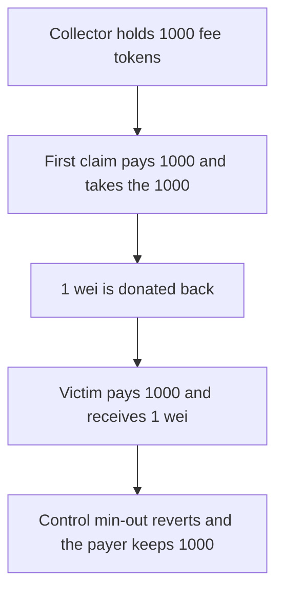

# Victim pays 1,000 payout tokens and receives 1 wei of fees

> **Vulnerability classes:** vuln/defi/slippage
>
> **Reproduction:** self-contained synthetic Foundry reduction; see [output.txt](output.txt).

<!-- non-defihacklabs -->
<!-- source-auditvault: https://github.com/Auditware/AuditVault/blob/main/findings/52868-feecollectorclaimfees-lacks-slippage-protection-leading-to-l.md -->
<!-- date: 2024-10 -->

## Key info

| Field | Value |
|---|---|
| **Loss** | Victim pays 1,000 payout tokens and receives 1 wei of the fee token. Control min-out reverts and keeps 1,000 |
| **Vulnerable contract** | `FeeCollector.claimFees` |
| **Attacker EOA** | `0x1111111111111111111111111111111111111111` |
| **Attack contract** | `Exploit` |
| **Attack tx** | `Exploit.run()` |
| **Chain / block / date** | Ethereum model · block 0 · 2024-10 |
| **Compiler** | solc 0.8.27, cancun, via IR |
| **Bug class** | `claimFees` sells `payoutAmount` for the full fee balance and takes no minimum |

## TL;DR

`claimFees` pulls `payoutAmount` (1,000) of the payout token, then sends `balanceOf` of every fee token to the caller. There is no minimum. A first claim takes the 1,000 fee tokens. One wei is donated back so the balance is not zero. The victim's claim still pays 1,000 payout tokens and receives that 1 wei. A control claim that requires 1,000 fee tokens out reverts, and that payer keeps the 1,000.

## Background

Spearbit reviewed Berachain POL in October 2024. `FeeCollector.claimFees` is the Uniswap V3 factory-owner pattern: anyone may buy the collected fee tokens by paying `payoutAmount`. The report says a delayed or sandwiched call loses `payoutAmount`, and that donating dust after a claim keeps the path alive even if a zero transfer would revert. This reduction is that sequence in one transaction.

## The vulnerable code

```solidity
function claimFees(address recipient, address[] calldata feeTokens) external {
    require(payout.transferFrom(msg.sender, rewardReceiver, payoutAmount), "payout");
    for (uint256 i; i < feeTokens.length; i++) {
        Erc20 fee = Erc20(feeTokens[i]);
        uint256 feeTokenAmountToTransfer = fee.balanceOf(address(this));
        // @> VULN: the whole fee balance is transferred; the caller cannot set a minimum
        require(fee.transfer(recipient, feeTokenAmountToTransfer), "fee");
    }
}
```

The control payer uses the same function and then requires the fee-token balance increase to be at least 1,000. That requirement reverts the inner call, so the payout transfer is undone.

## Root cause

The payout is taken before the caller can see what the fee balance is, and the function does not take a minimum-out argument. Any non-zero dust balance makes the claim succeed.

## Preconditions

- `payoutAmount` is 1,000. The collector starts with 1,000 fee tokens.
- The first claim empties it. 1 wei is donated back before the victim's claim.
- The control collector holds 1 wei, and the control payer demands 1,000 fee tokens out.
- Both claims are in this transaction. No warp.

## Attack walkthrough

1. The victim receives 1 wei of the fee token ([output.txt:9](output.txt)).
2. The victim's payout balance is 0 ([output.txt:11](output.txt)).
3. The control payer still holds 1000000000000000000000 ([output.txt:13](output.txt)).
4. `[PASS]` ([output.txt:6](output.txt)).

## Diagrams



## Impact

The victim pays the full 1,000 payout tokens and receives 1 wei of fees. The control path, which refuses a fill below 1,000 fee tokens, does not pay. The loss is the 1,000 payout tokens.

## Remediation

Take a `minAmounts` array and revert when a fee token's balance is below the caller's minimum, before pulling `payoutAmount`.

```diff
-        require(fee.transfer(recipient, feeTokenAmountToTransfer), "fee");
+        require(feeTokenAmountToTransfer >= minAmounts[i], "slippage");
+        require(fee.transfer(recipient, feeTokenAmountToTransfer), "fee");
```

Check the minimum before `transferFrom` of the payout token, so a failing check does not depend on a later revert.

## How to reproduce

```bash
cd 52868-feecollectorclaimfees-lacks-slippage-protection-leading-to-l_exp
forge test -vv
```

## Sources

- AuditVault finding: [52868-feecollectorclaimfees-lacks-slippage-protection-leading-to-l](https://github.com/Auditware/AuditVault/blob/main/findings/52868-feecollectorclaimfees-lacks-slippage-protection-leading-to-l.md)
- Spearbit, Berachain POL, October 2024: https://github.com/spearbit/portfolio/blob/master/pdfs/Berachain-Pol-Spearbit-Security-Review-October-2024.pdf
- `FeeCollector.claimFees` as described at `src/pol/FeeCollector.sol` line 91 in the report
