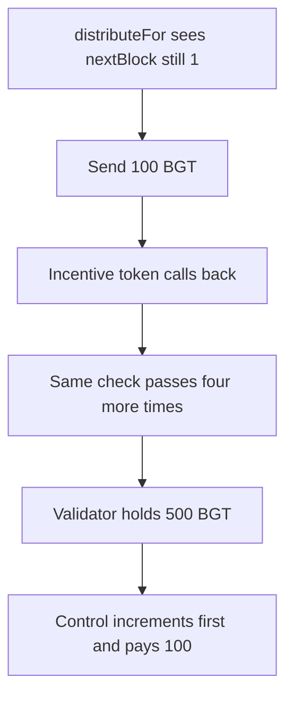

# One distributeFor pays 500 BGT because the block increments too late

> **Vulnerability classes:** vuln/reentrancy/single-function
>
> **Reproduction:** self-contained synthetic Foundry reduction; see [output.txt](output.txt).

<!-- non-defihacklabs -->
<!-- source-auditvault: https://github.com/Auditware/AuditVault/blob/main/findings/52869-distributefor-might-be-reentered-leading-to-the-loss-of-bgt.md -->
<!-- date: 2024-10 -->

## Key info

| Field | Value |
|---|---|
| **Loss** | Validator receives 500 BGT from one block. Control pays 100 BGT once |
| **Vulnerable contract** | `Distributor.distributeFor` |
| **Attacker EOA** | `0x1111111111111111111111111111111111111111` |
| **Attack contract** | `Exploit` |
| **Attack tx** | `Exploit.run()` |
| **Chain / block / date** | Ethereum model · block 0 · 2024-10 |
| **Compiler** | solc 0.8.27, cancun, via IR |
| **Bug class** | Incentive transfer calls back before `nextBlock` increments |

## TL;DR

`distributeFor` checks that the block is still actionable, sends 100 BGT to the validator, then calls the incentive token, and only then increments `nextBlock`. The incentive token calls `distributeFor` again while `nextBlock` is still 1. The pool holds 500 BGT, so the same block pays 100 BGT five times. The validator's balance is 500 BGT. The control distributor increments `nextBlock` before the external call and pays 100 BGT once.

## Background

Spearbit reviewed Berachain POL in October 2024. `Distributor.distributeFor` pays BGT and vault incentive tokens. The report says the incentive transfer is an untrusted external call placed before `getNextActionableBlock` is incremented, so a callback can re-enter and drain the BGT allocated for that block. The parameters of the outer call are visible to a frontrunner. This reduction arms one incentive token whose `transfer` calls back into the distributor that sent it.

## The vulnerable code

```solidity
function distributeFor() external {
    require(nextBlock == 1, "block");
    require(bgt.balanceOf(address(this)) >= PAY, "bgt");
    require(bgt.transfer(validator, PAY), "pay");
    // @> VULN: incentive transfer happens before nextBlock is incremented
    require(hook.transfer(validator, PAY), "incentive");
    nextBlock += 1;
}
```

`PAY` is 100 BGT. The hook re-enters only while the buggy distributor still holds at least 100 BGT. The fixed distributor increments `nextBlock` before either transfer. Its hook call does not re-enter, because the hook is armed only on the buggy distributor.

## Root cause

The effect that stops a second payment is written after the interaction. Every nested call still observes `nextBlock == 1` and passes the check. The increments run on the way out, after the BGT has already moved.

## Preconditions

- The distributor holds 500 BGT. Each successful entry pays 100 BGT.
- The incentive token calls back into this distributor when it is the caller and the remaining BGT covers another payment.
- The control distributor holds the same 500 BGT and increments first.
- One transaction. No warp.

## Attack walkthrough

1. The validator's BGT balance is 500000000000000000000 ([output.txt:9](output.txt)).
2. That balance is 5 payments of 100 ([output.txt:11](output.txt)).
3. The control validator receives 100000000000000000000 ([output.txt:13](output.txt)).
4. `[PASS]` ([output.txt:6](output.txt)).

## Diagrams



## Impact

The validator receives 500 BGT for a block that should have paid 100 BGT. The pool is empty. The control path pays 100 BGT and leaves 400 BGT on the distributor. The extra 400 BGT is the re-entered payments.

## Remediation

Increment the actionable block before the BGT transfer and the incentive transfer, or guard `distributeFor` against re-entry.

```diff
     require(bgt.balanceOf(address(this)) >= PAY, "bgt");
+    nextBlock += 1;
     require(bgt.transfer(validator, PAY), "pay");
     require(hook.transfer(validator, PAY), "incentive");
-    nextBlock += 1;
```

## How to reproduce

```bash
cd 52869-distributefor-might-be-reentered-leading-to-the-loss-of-bgt_exp
forge test -vv
```

## Sources

- AuditVault finding: [52869-distributefor-might-be-reentered-leading-to-the-loss-of-bgt](https://github.com/Auditware/AuditVault/blob/main/findings/52869-distributefor-might-be-reentered-leading-to-the-loss-of-bgt.md)
- Spearbit, Berachain POL, October 2024: https://github.com/spearbit/portfolio/blob/master/pdfs/Berachain-Pol-Spearbit-Security-Review-October-2024.pdf
- `Distributor.distributeFor` lines 113-114 in the report
