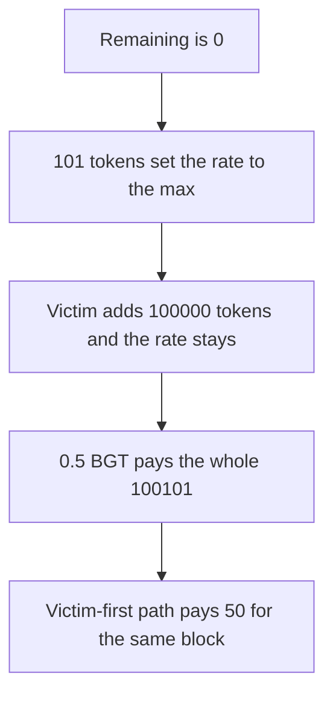

# A 101-token front-run makes one block pay 100,101 incentive tokens

> **Vulnerability classes:** vuln/defi/sandwich-attack · vuln/logic/wrong-condition
>
> **Reproduction:** self-contained synthetic Foundry reduction; see [output.txt](output.txt).

<!-- non-defihacklabs -->
<!-- source-auditvault: https://github.com/Auditware/AuditVault/blob/main/findings/52870-validators-can-front-run-calls-to-addincentive-to-drain-the.md -->
<!-- date: 2024-10 -->

## Key info

| Field | Value |
|---|---|
| **Loss** | One 0.5 BGT block pays 100,101 incentive tokens. The fair rate pays 50 |
| **Vulnerable contract** | `RewardsVault.addIncentive` |
| **Attacker EOA** | `0x1111111111111111111111111111111111111111` |
| **Attack contract** | `Exploit` |
| **Attack tx** | `Exploit.run()` |
| **Chain / block / date** | Ethereum model · block 0 · 2024-10 |
| **Compiler** | solc 0.8.27, cancun, via IR |
| **Bug class** | The first caller pins `incentiveRate` while `amountRemaining` is below the minimum |

## TL;DR

`addIncentive` stores the caller's rate when `amountRemaining <= minIncentiveRate`. The minimum is 100 tokens. An attacker deposits 101 tokens at rate `1e36` while the vault is empty, so the rate is pinned at the maximum. The victim then deposits 100,000 tokens at 100 tokens per BGT. Remaining is already 101, so the victim's rate is ignored. The pot is 100,101 tokens. One block of 0.5 BGT pays `min(100101e18, 0.5e18 * 1e36 / 1e18)`, which is the whole pot. If the victim's deposit lands first, the same 0.5 BGT pays 50 tokens.

## Background

Spearbit reviewed Berachain POL in October 2024. `BerachainRewardsVault.addIncentive` lets any caller set the incentive rate when the remaining inventory is at or below `minIncentiveRate`. The report's sandwich is: deposit a hair over the minimum at `MAX_INCENTIVE_RATE`, let the victim's large deposit at rate 100 succeed without changing the rate, then `distributeFor` one block and take `min(amountRemaining, bgtEmitted * rate / PRECISION)`. The numbers below are that example: 101 tokens, then 100,000 tokens, then one block. Both calls run in this transaction in that order. The control vault runs the victim's deposit first.

## The vulnerable code

```solidity
function addIncentive(uint256 amount, uint256 incentiveRate) external {
    require(incentiveRate <= MAX_RATE, "max");
    require(token.transferFrom(msg.sender, address(this), amount), "pull");
    if (amountRemaining <= MIN_INCENTIVE_RATE && incentiveRate >= MIN_INCENTIVE_RATE) {
        // @> VULN: any caller can pin the rate while remaining is at or below the minimum
        incentiveRateStored = incentiveRate;
    }
    amountRemaining += amount;
}
```

`MIN_INCENTIVE_RATE` is 100 tokens. `MAX_RATE` is `1e36`. `PRECISION` is `1e18`. `distributeFor` pays `min(remaining, bgtEmitted * rate / PRECISION)`.

## Root cause

The rate is a permissionless write whenever the remaining inventory is small. A 101 token deposit is enough to move remaining above the minimum, so the victim's later deposit adds tokens and does not replace the rate. The payout then uses the attacker's rate against the victim's tokens.

## Preconditions

- The vault's remaining inventory starts at 0, which is `<= 100` tokens.
- The front-run amount is 101 tokens at rate `1e36`. The victim amount is 100,000 tokens at 100 tokens per BGT.
- The distributed block is 0.5 BGT, the `0.5e18` term in the report's `min(...)` expression.
- The control vault receives the victim's deposit while remaining is still 0.

## Attack walkthrough

1. `distributeFor` pays 100101000000000000000000 tokens ([output.txt:9](output.txt)).
2. The fair block pays 50000000000000000000 ([output.txt:11](output.txt)).
3. The extra versus that fair payment is 100051000000000000000000 ([output.txt:13](output.txt)).
4. `[PASS]` ([output.txt:6](output.txt)).

## Diagrams



## Impact

The validator receives 100,101 incentive tokens for validating a single 0.5 BGT block. 100,000 of those tokens were the victim's deposit, which was meant to stream at 100 tokens per BGT. At that rate the same block pays 50 tokens. The difference on this block is 100,051 tokens, and the vault is empty.

## Remediation

Do not let an arbitrary caller replace `incentiveRate` just because remaining inventory is low. The report's later fix makes `addIncentive` permissioned to the vault manager. A smaller fix is to revert when the caller passes a rate other than the stored rate unless remaining is 0 and the caller is the manager.

```diff
-    if (amountRemaining <= MIN_INCENTIVE_RATE && incentiveRate >= MIN_INCENTIVE_RATE) {
-        incentiveRateStored = incentiveRate;
-    }
+    if (incentiveRate != incentiveRateStored) {
+        require(amountRemaining == 0, "rate");
+        require(incentiveRate >= MIN_INCENTIVE_RATE, "min");
+        incentiveRateStored = incentiveRate;
+    }
```

That still needs an access check if depositors must not set the opening rate.

## How to reproduce

```bash
cd 52870-validators-can-front-run-calls-to-addincentive-to-drain-the_exp
forge test -vv
```

## Sources

- AuditVault finding: [52870-validators-can-front-run-calls-to-addincentive-to-drain-the](https://github.com/Auditware/AuditVault/blob/main/findings/52870-validators-can-front-run-calls-to-addincentive-to-drain-the.md)
- Spearbit, Berachain POL, October 2024: https://github.com/spearbit/portfolio/blob/master/pdfs/Berachain-Pol-Spearbit-Security-Review-October-2024.pdf
- `BerachainRewardsVault.addIncentive` around line 312, and the `mulDiv` / `min` payout quoted in the finding
