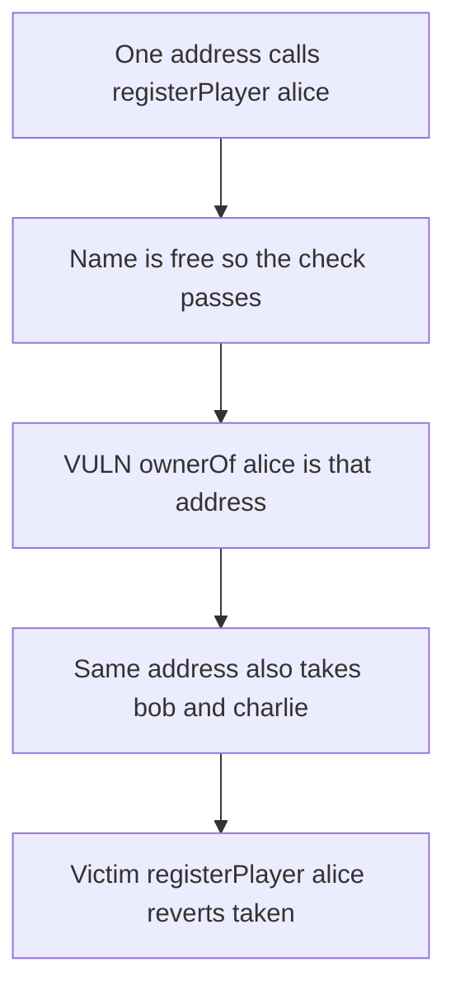

# Ludex Labs: one address registers every free username

> **Vulnerability classes:** `vuln/logic/missing-validation` · `vuln/input-validation/missing`

<!-- non-defihacklabs -->
<!-- source-auditvault: https://github.com/Auditware/AuditVault/blob/main/findings/52922-unrestricted-username-registration-and-sybil-attack-risk-can.md -->
<!-- date: 2025-02 -->

## Key info

| Field | Value |
|---|---|
| **Loss** | alice, bob, and charlie are owned by one address. The legitimate user cannot register alice |
| **Vulnerable contract** | `Riskiit.registerPlayer` |
| **Attacker EOA** | `0x1111111111111111111111111111111111111111` |
| **Attack contract** | `Exploit` |
| **Attack tx** | `Exploit.run()` |
| **Chain / block / date** | Ethereum model · block 0 · 2025-02 |
| **Compiler** | solc 0.8.27, cancun, via IR |

## TL;DR

`registerPlayer` keys a username only by the string. It never records that `msg.sender` already registered, and it stores `isOldEnough` without checking it. One address registers alice, bob, and charlie. The third call passes `isOldEnough = false`. A second user who then calls `registerPlayer("alice")` reverts with `taken`.

## The vulnerable code

```solidity
require(ownerOf[username] == address(0), "taken");
lastAgeFlag = isOldEnough;
ownerOf[username] = msg.sender; // @> VULN: no per-sender cap; one address registers every free name
registrationCount[msg.sender] += 1;
```

The Cantina fix requires one registration per sender and a 65-byte age signature. The control contract reverts the second name from the same sender with `one name`.

## Root cause

Uniqueness is the username, not the account. The age boolean is an input, not a signature check. The function is public, so the sniping does not need a privileged role.

## Preconditions

- The names alice, bob, and charlie are unregistered.
- No backend signature is required. That is the deployed behavior the report describes, before PR 49.

## Attack walkthrough

1. The attacker calls `registerPlayer("alice", true, "")`.
2. The name check passes. `isOldEnough` is stored and ignored.
3. `ownerOf["alice"]` becomes the attacker.
4. The same address registers bob, then charlie with `isOldEnough` false.
5. The victim's `registerPlayer("alice")` reverts.
6. `registrationCount` for the attacker is 3.

## Diagrams



## Impact

A permissionless caller occupies every name they care about, including a call that claims to be under age. The user who should own alice cannot register it. Referral or KYC assumptions that treat one address as one player do not hold.

## Remediation

Reject a second registration from the same `msg.sender`, and require a backend age signature instead of a caller-supplied bool. That is what the control enforces.

## How to reproduce

```bash
cd 52922-unrestricted-username-registration-and-sybil-attack-risk-can_exp
forge test -vv
```

`test_exploit_one_address_snipes_three_names` asserts three names on one address and a blocked victim. `test_control_one_name_per_sender_and_age_sig` asserts the second name from the same sender reverts.

## Sources

- AuditVault finding: https://github.com/Auditware/AuditVault/blob/main/findings/52922-unrestricted-username-registration-and-sybil-attack-risk-can.md
- Cantina report: https://cdn.cantina.xyz/reports/cantina_riskiit_february2025.pdf
- The finding quotes the PoC. No separate commit was published in the report. The reduction keeps `registerPlayer(string,bool,bytes)` as quoted.
