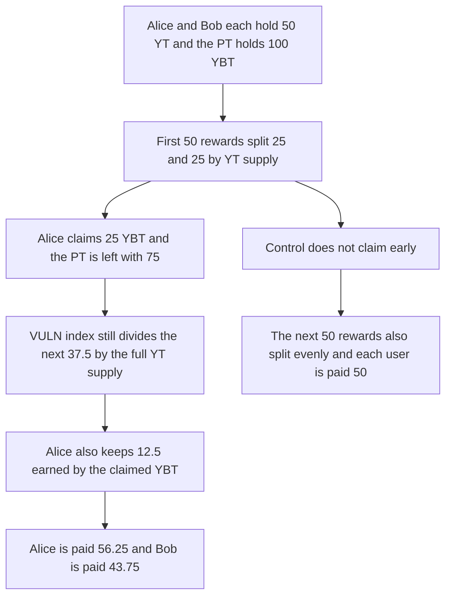

# Napier: claiming YBT early pays Alice 56.25 rewards and Bob 43.75 for the same YT

> **Vulnerability classes:** vuln/logic/reward-calculation

<!-- non-defihacklabs -->
<!-- source-auditvault: https://github.com/Auditware/AuditVault/blob/main/findings/53034-wrong-reward-distribution-formula-yt-holders-can-get-more-re.md -->
<!-- date: 2025-02 -->

## Key info

| Field | Value |
|---|---|
| **Loss** | Bob receives 43.75 reward tokens instead of 50. Alice receives 56.25 for the same 50 YT |
| **Vulnerable contract** | `YieldRewards.updateIndex` |
| **Attacker EOA** | `0x1111111111111111111111111111111111111111` (Alice) |
| **Attack contract** | `Exploit` |
| **Attack tx** | `Exploit.run()` |
| **Chain / block / date** | Ethereum model · block 0 · 2025-02 |
| **Compiler** | solc 0.8.27, cancun, via IR |
| **Bug class** | External rewards accrue as `totalAccrued / ytSupply`, ignoring YBT already claimed out of the PT |

## TL;DR

`updateIndex` adds `divWad(totalAccrued, ytSupply)` and `accrueUserReward` pays that index delta times the user's YT balance. The formula does not notice that claimed YBT has left the PT and now earns rewards for the claimer alone. Alice and Bob each hold 50 of 100 YT. The first leg pays 25 each. Alice claims 25 YBT. The remaining 75 YBT earn 37.5, still split 18.75/18.75 by YT, and Alice's 25 YBT earns another 12.5 privately. Alice is paid 56.25. Bob is paid 43.75. If nobody claims early, each is paid 50.

## Background

Cantina's February 2025 Napier contest, reported by Catowice. YT holders are also entitled to external rewards that accrue to YBT. The index in `RewardMathLib.updateIndex` divides the new rewards by YT supply only. The report's scenario 2 is the one this run executes: exchange rate 1 to 2 pays 50 rewards on 100 YBT, Alice claims, then the move from rate 2 to 3 pays 37.5 on the 75 YBT left in the PT and 12.5 on Alice's claimed YBT.

## The vulnerable code

```solidity
if (ytSupply_ == 0) return (index_, totalAccrued);
// @> VULN: the index is totalAccrued / ytSupply, so YBT already claimed out of the PT still earns a private reward
newIndex = index_ + FixedPointMathLib.divWad(totalAccrued, ytSupply_);
lostReward = totalAccrued - FixedPointMathLib.mulWad(ytSupply_, newIndex - index_);
```

User accrual, from the same report:

```solidity
uint256 accrued = FixedPointMathLib.mulWad(ytBal, index_ - prev.userIndex);
users[account].accrued = prev.accrued + accrued;
```

## Root cause

The YT index assumes every reward-bearing YBT is still inside the PT and that the whole accrual is shared by YT balances. Claiming YBT moves principal out of the PT without reducing the claimer's YT share. The removed YBT then earns its own rewards, and the smaller PT accrual is still divided by the original YT supply.

## Preconditions

- Alice and Bob each hold 50 YT. Total supply is 100. The PT holds 100 YBT.
- The first distribution is 50 rewards. Alice then claims 25 YBT.
- The second PT distribution is 37.5 rewards. Alice's 25 YBT earns 12.5 on the side.

## Attack walkthrough

1. `distribute(50)` sets the index to 0.5. Each 50 YT balance accrues 25.
2. Alice claims 25 YBT. The PT has 75 YBT left.
3. `distribute(37.5)` adds 0.375 to the index. Alice and Bob each accrue 18.75.
4. The 25 claimed YBT is credited 12.5, added only to Alice.
5. Alice is paid 56.25. Bob is paid 43.75.
6. The control skips the claim and distributes 50 then 50. Each user is paid 50.

## Diagrams



## Impact

Bob receives 43.75 reward tokens instead of the 50 he receives when nobody claims early. Alice receives 56.25, which is her 43.75 YT share plus the 12.5 that the claimed YBT earned outside the index. The 12.5 is taken from the rewards the full YBT balance would have shared.

## Remediation

When YBT is claimed out of the PT, stop paying that balance a private reward on top of a full YT share, or accrue the external rewards on the YBT that actually remains in the PT and socialize them. The control's no-early-claim path pays 50 to each holder.

## How to reproduce

```bash
cd 53034-wrong-reward-distribution-formula-yt-holders-can-get-more-re_exp
forge test -vv
```

`test_exploit_alice_receives_56_25_and_bob_43_75` asserts the two balances. `test_control_no_early_claim_pays_50_each` asserts 50 and 50. Captured output is `output.txt`.

## Sources

- AuditVault finding: https://github.com/Auditware/AuditVault/blob/main/findings/53034-wrong-reward-distribution-formula-yt-holders-can-get-more-re.md
- Report: https://cdn.cantina.xyz/reports/cantina_competition_napier_february2025.pdf
