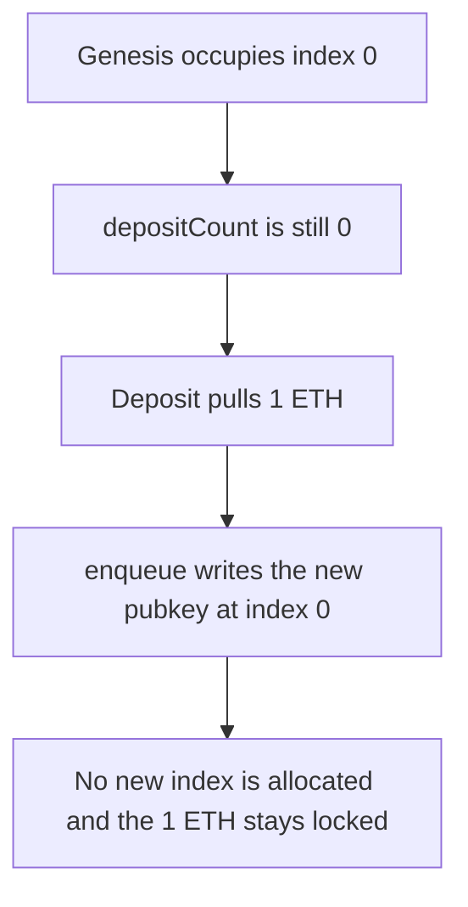

# Berachain: the first post-genesis deposit overwrites a genesis validator and locks 1 ETH

> **Vulnerability classes:** `vuln/logic/state-update` · `vuln/dos/frozen-funds`

<!-- non-defihacklabs -->
<!-- source-auditvault: https://github.com/Auditware/AuditVault/blob/main/findings/53114-first-deposits-will-be-ignored-and-lost-cantina-none-beracha.md -->
<!-- date: 2025-01 -->

## Key info

| Field | Value |
|---|---|
| **Loss** | 1 ETH locked; genesis index 0 is replaced and no new index is allocated |
| **Vulnerable contract** | `DepositStore.enqueue` |
| **Attacker EOA** | `0x1111111111111111111111111111111111111111` |
| **Attack contract** | `Exploit` |
| **Attack tx** | `Exploit.run()` |
| **Chain / block / date** | Local synthetic · 2025-01 |
| **Compiler** | solc 0.8.27, cancun, via IR |
| **Bug class** | depositCount starts at 0 while genesis already occupies index 0 |

## TL;DR

Genesis already occupies deposit index 0, but `depositCount` starts at 0. `deposit` pulls 1 ETH and `enqueue` writes the new pubkey at that index. The genesis record is replaced. `depositCount` advances to 1, which equals `genesisCount`, so the beacon does not see a new validator. There is no withdraw function.

## The vulnerable code

```solidity
function enqueue(uint256 index, bytes32 pubkey, uint256 amount) external {
    deposits[index] = Deposit(pubkey, amount, true);
}

function deposit(bytes32 pubkey, uint256 amount) external {
    ethToken.transferFrom(msg.sender, address(this), amount);
    store.enqueue(depositCount, pubkey, amount);
    depositCount += 1;
}
```

Seed `depositCount` from `genesisCount`, or reject an index below `genesisCount`.

## Root cause

The live counter and the genesis map share an index space, and the live counter is not initialized from genesis.

## Preconditions

- Index 0 holds a genesis pubkey and a 32 ETH accounting amount. `genesisCount` is 1.
- `depositCount` is still 0. The depositor has 1 ETH.

## Attack walkthrough

1. The depositor sends 1 ETH and a new pubkey.
2. The deposit contract pulls the ETH.
3. `enqueue` overwrites index 0 with the new pubkey.
4. The stored key is the new key. `depositCount` reads back as 1, equal to `genesisCount`. The 1 ETH is still in the deposit contract.

## Diagrams



## Impact

The first post-genesis deposit replaces a genesis validator and cannot be withdrawn. This run locks 1 ETH.

## How to reproduce

```bash
cd 53114-first-deposits-will-be-ignored-and-lost-cantina-none-beracha_exp
forge test -vv
```

## Sources

- AuditVault finding: https://github.com/Auditware/AuditVault/blob/main/findings/53114-first-deposits-will-be-ignored-and-lost-cantina-none-beracha.md
- Cantina report: https://cdn.cantina.xyz/reports/cantina_competition_berachain_january2025.pdf
