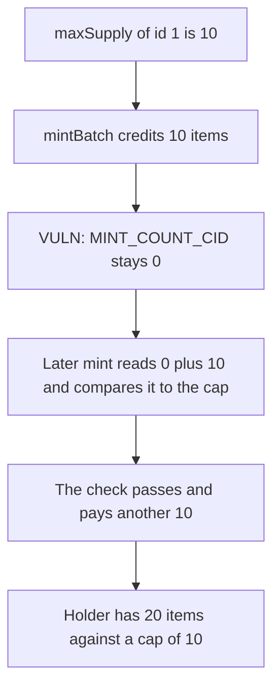

# Gigaverse — `mintBatch` does not update `MINT_COUNT_CID`, so a later mint exceeds max supply

> **Vulnerability classes:** vuln/logic/state-update · vuln/logic/missing-check

> **Reproduction:** self-contained Foundry PoC, no fork and no cheatcodes in the exploit. Trace: [output.txt](output.txt).

<!-- non-defihacklabs -->
<!-- source-auditvault: https://github.com/Auditware/AuditVault/blob/main/findings/53284-h-01-not-updating-mint-count-cid-and-burn-count-cid-pashov-a.md -->
<!-- date: 2025-01 -->

## Key info

| | |
|---|---|
| **Impact** | **HIGH** — 20 items are minted against `maxSupply` 10, because `mintBatch` leaves `MINT_COUNT_CID` at 0 and a later `mint` trusts that counter |
| **Protocol** | Gigaverse `GameItems` |
| **Vulnerable code** | `GameItems.mintBatch` / `_mintBatch` |
| **Bug class** | Supply counter not updated on the batch path |
| **Finding** | Pashov Audit Group — Gigaverse, 2025-01-18 · H-01 · #53284 |
| **Report** | [Gigaverse-security-review_2025-01-18.md](https://github.com/pashov/audits/blob/master/team/md/Gigaverse-security-review_2025-01-18.md) |
| **Source** | [AuditVault](https://github.com/Auditware/AuditVault/blob/main/findings/53284-h-01-not-updating-mint-count-cid-and-burn-count-cid-pashov-a.md) |
| **Audited code** | `0xgarnish/gigaverse-contracts@9ab59658213f842741f3451265659eee39138dcf` `GameItems.sol` |
| **Compiler** | solc 0.8.27, cancun, via_ir |

## TL;DR

`mint` writes `MINT_COUNT_CID` and refuses to mint once `MINT_COUNT + amount` exceeds `maxSupply`. `mintBatch` calls `_mintBatch`, which credits balances and does not write the counter. After a batch of 10 against a cap of 10, `minted()` is still 0. A following `mint` of 10 reads that 0, decides `0 + 10` is within the cap, and pays another 10. The holder has 20. The counter only records the second mint.

## The vulnerable code

```solidity
function mintBatch(address to, uint256[] memory ids, uint256[] memory amounts) external onlyMinter whenNotPaused {
    _mintBatch(to, ids, amounts, "");
}

function _mintBatch(address to, uint256[] memory ids, uint256[] memory amounts, bytes memory) internal {
    for (uint256 i = 0; i < ids.length; ++i) {
        // @> VULN: batch mint credits balances but never writes MINT_COUNT_CID
        _credit(to, ids[i], amounts[i]);
        // FIX: docs[ids[i]][MINT_COUNT_CID] += amounts[i];
    }
}
```

The single-item path does both the check and the write:

```solidity
function _safeMint(address to, uint256 id, uint256 amount) internal {
    uint256 needed = docs[id][MINT_COUNT_CID] + amount;
    if (needed > maxSupply[id]) revert NotEnoughSupply(needed, maxSupply[id]);
    docs[id][MINT_COUNT_CID] = needed;
    _credit(to, id, amount);
}
```

## Root cause

Batch mint and batch burn do not update `MINT_COUNT_CID` / `BURN_COUNT_CID`. The supply check on `mint` reads `MINT_COUNT_CID`. A batch that already issued the whole cap is invisible to that check, so the next single mint is allowed to issue the cap again.

## Preconditions

The caller holds the minter role. `maxSupply` for the id is 10. The batch and the later mint are both for that id. No pause and no time change.

## Attack walkthrough

1. `mintBatch` of 10. Balances become 10. `MINT_COUNT_CID` stays 0. 10 ITEM tokens are paid.
2. `minted(id)` returns 0.
3. `mint` of another 10. `needed = 0 + 10` is not greater than 10, so it does not revert. It writes the counter to 10 and pays 10 more.
4. The holder has 20 items and 20 ITEM tokens. `maxSupply` is 10. The counter says 10, which is the second mint only.

Control: `mintBatchFixed` writes `MINT_COUNT_CID` to 10 and pays 10. The next `mint` of 1 computes `needed = 11` and reverts `NotEnoughSupply(11, 10)`. No eleventh token is paid.

## Diagrams



## Impact

The minter, or any caller the minter role is delegated to, can mint 20 of an item whose cap is 10. The extra 10 are paid out as ITEM tokens. A later reader of `minted()` still sees 10, so the books under-report the real supply by the size of every batch.

## Remediation

In `_mintBatch` and `_burnBatch`, apply the same counter update the single-item paths already perform, and run the `maxSupply` check before increasing `MINT_COUNT_CID`.

## Sources

- AuditVault finding: https://github.com/Auditware/AuditVault/blob/main/findings/53284-h-01-not-updating-mint-count-cid-and-burn-count-cid-pashov-a.md
- Pashov report: https://github.com/pashov/audits/blob/master/team/md/Gigaverse-security-review_2025-01-18.md
- Audited commit named by the report: `0xgarnish/gigaverse-contracts@9ab59658213f842741f3451265659eee39138dcf` (`GameItems.sol`)
