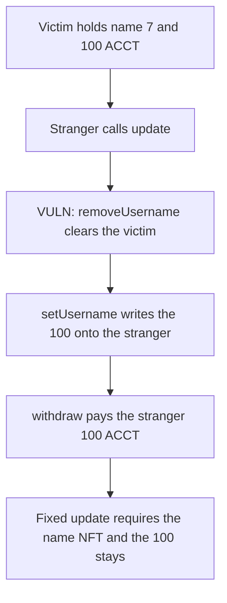

# Gigaverse — anyone can retarget a name and take its 100 ACCT escrow

> **Vulnerability classes:** vuln/access-control/missing-auth · vuln/logic/state-update

<!-- non-defihacklabs -->
<!-- source-auditvault: https://github.com/Auditware/AuditVault/blob/main/findings/53285-h-02-unauthorized-access-to-update-function-pashov-audit-gro.md -->
<!-- date: 2025-01 -->

## Key info

| | |
|---|---|
| **Protocol** | Gigaverse |
| **Finding** | Pashov Audit Group H-02, AuditVault 53285 |
| **Vulnerable code** | `GigaNameNFTBeforeUpdateHandler.update` |
| **Harm** | Caller takes 100 ACCT that was escrowed on the victim's name row |
| **Chain** | local synthetic |

## TL;DR

`GigaNameNFTBeforeUpdateHandler.update` is what `GameNFT._update` calls when a GigaNameNFT is minted, transferred, or burned. It clears the previous owner's account row and writes the new owner. The function is `external` and does not require the caller to be `GigaNameNFT`. Anyone can pass an already-minted token id and a recipient. In this run the victim's row holds 100 ACCT of mint escrow. The attacker calls `update`, the 100 moves onto the attacker's row, and `withdraw` pays it out. The victim's username id is 0 and their escrow is 0.

## The vulnerable code

The report quotes the unguarded signature. The body below is the rewrite that finding describes and that M-04 spells out: if the token exists, drop the previous owner's record; then, if the recipient has no username, store this token id for them. There is no `msg.sender` check.

```solidity
function update(
        address tokenContract,
        address to,
        uint256 tokenId,
        address //auth
    ) external override {
        NameNFT gigaNameNFT = NameNFT(tokenContract);
        if (gigaNameNFT.exists(tokenId)) {
            address prevOwner = gigaNameNFT.ownerOf(tokenId);
            if (prevOwner != address(0) && accountSystem.getPlayerUsernameId(prevOwner) == tokenId) {
                // @> VULN: update() does not require msg.sender == GigaNameNFT, so this clears the real owner's escrow.
                accountSystem.removeUsername(prevOwner);
            }
        }
        if (accountSystem.getPlayerUsernameId(to) == 0) {
            accountSystem.setUsername(to, tokenId);
        }
    }
```

`removeUsername` zeroes the player's escrow and parks it in `pending`. `setUsername` writes the token id and pays `pending` to the new address. On a real transfer that is what the name NFT is supposed to do. Called by a stranger, it is a theft of the row.

```diff
 function update(address tokenContract, address to, uint256 tokenId, address) external {
+    require(msg.sender == address(nameNft), "not name nft");
     // existing removeUsername / setUsername body
 }
```

## Root cause

The handler is trusted because `AccountSystem` grants it `GAME_LOGIC_CONTRACT_ROLE`, and only that role may edit username rows. `update` itself never checks that the caller is the NFT that owns the hook. The `auth` argument is unnamed and unused. The deployed handler later added `require(registeredSystem == msg.sender)`, which is the fix; the reviewed code did not have it.

## Preconditions

A GigaNameNFT id is already minted and the account row for its owner holds a non-zero escrow. No role, signature, or approval is required. The call is one transaction.

## Attack walkthrough

1. Name token 7 is minted to the victim.
2. 100 ACCT is seeded onto that row. `escrow(victim)` is 100 and `usernameId(victim)` is 7.
3. The attacker calls `update(nameNft, attacker, 7, address(0))`.
4. `removeUsername` sees that the victim's username id is 7 and clears the row. The 100 sits in `pending`.
5. `setUsername` writes token 7 and the 100 onto the attacker, because the attacker had no username.
6. `withdraw` pays the attacker 100 ACCT. The victim's escrow and username id are both 0.

The control is the same body with `require(msg.sender == address(nameNft))`. A stranger's call reverts with `not name nft` and the victim still has 100. The name NFT itself can still call `update`, and that authorized call does move the 100 to the transfer recipient.

## Diagrams



## Impact

The account row is the claim on the escrow collected when the name was minted. After the call the victim cannot withdraw that 100 ACCT, and the attacker can. The same unguarded write is what the report says blocks a later `mintWithEth` with "User already has an account": the recipient is now recorded as owning a name they do not. This reduction shows the balance that moves with that record: 100 ACCT, from the victim to the caller.

## Remediation

Require `msg.sender == GigaNameNFT` at the start of `GigaNameNFTBeforeUpdateHandler.update`, and the same check on `GigaNoobNFTBeforeUpdateHandler.update` against `GigaNoobNFT`.

## How to reproduce

```bash
cd 53285-h-02-unauthorized-access-to-update-function-pashov-audit-gro_exp
forge test -vv
```

## Sources

- AuditVault finding: https://github.com/Auditware/AuditVault/blob/main/findings/53285-h-02-unauthorized-access-to-update-function-pashov-audit-gro.md
- Pashov report (H-02 and the M-04 reconstruction of the same function): https://github.com/pashov/audits/blob/master/team/md/Gigaverse-security-review_2025-01-18.md
- Reviewed tree named in that report: https://github.com/0xgarnish/gigaverse-contracts/tree/9ab59658213f842741f3451265659eee39138dcf
- Later deployed handler, which does check `msg.sender`: https://abscan.org/address/0x0f7BFD5A98c6E42F5375261bA9B235E7bE9D7B8E
