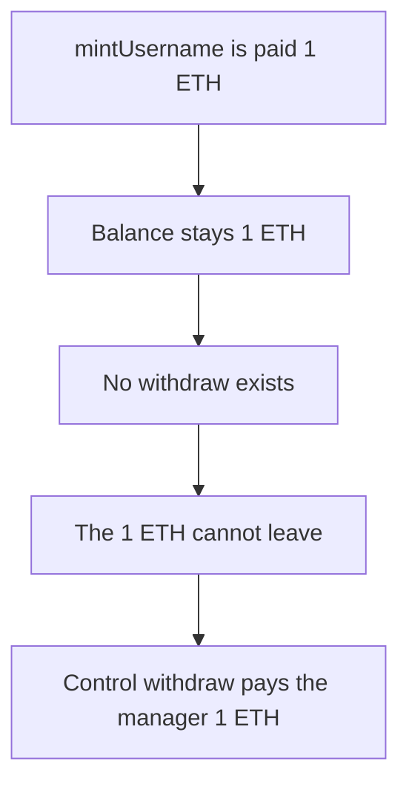

# mintUsername keeps 1 ETH and the NFT has no withdraw

> **Vulnerability classes:** vuln/dos/frozen-funds
>
> **Reproduction:** self-contained synthetic Foundry reduction; see [output.txt](output.txt).

<!-- non-defihacklabs -->
<!-- source-auditvault: https://github.com/Auditware/AuditVault/blob/main/findings/53287-h-04-stuck-eth-in-giganamenft-contract-pashov-audit-group-no.md -->
<!-- date: 2025-01 -->

## Key info

| Field | Value |
|---|---|
| **Loss** | 1 ETH paid to `mintUsername` stays in `GigaNameNFT`. Control withdraw sends 1 ETH to the manager |
| **Vulnerable contract** | `GigaNameNFT.mintUsername` |
| **Attacker EOA** | `0x1111111111111111111111111111111111111111` |
| **Attack contract** | `Exploit` |
| **Attack tx** | `Exploit.run()` with `msg.value` of 2 ETH |
| **Chain / block / date** | Ethereum model · block 0 · 2025-01 |
| **Compiler** | solc 0.8.27, cancun, via IR |
| **Bug class** | The mint is payable and neither this contract nor `GameNFT` can withdraw |

## TL;DR

`mintUsername` takes 1 ETH and increments the token id. `GigaNameNFT` does not forward the ETH, and the finding says the parent `GameNFT` has no withdraw either. After the mint the contract balance is 1 ETH. A control NFT with the same mint plus `withdraw` sends that 1 ETH to the manager and ends at 0.

## Background

Pashov Audit Group reviewed Gigaverse on 2025-01-18. Finding H-04 says `GigaNameNFT` receives ETH when the minter calls `mintUsername` and neither that contract nor `GameNFT` can withdraw it, so the collected ETH is stuck. This reduction is that payable mint, with a control contract that has the missing withdraw.

## The vulnerable code

```solidity
function mintUsername() external payable {
    require(msg.value == 1 ether, "fee");
    // @> VULN: the mint fee stays here; this contract has no withdraw
    nextId += 1;
}
```

There is no `withdraw`, `sweep`, or `receive` forwarder. The control contract adds `withdraw`, which transfers `address(this).balance` to the manager.

## Root cause

The fee is accepted and then there is no function that can move ETH out. The id increment does not change the balance. The ETH is stuck for the manager as well as for the minter.

## Preconditions

- The mint fee is 1 ETH. The transaction carries 2 ETH so the buggy mint and the control mint can each be paid.
- The buggy NFT starts at balance 0.
- The control NFT is minted and then withdrawn in the same transaction. No warp.

## Attack walkthrough

1. The buggy NFT balance is 1000000000000000000 ([output.txt:9](output.txt)).
2. The manager receives 1000000000000000000 from the control withdraw ([output.txt:11](output.txt)).
3. The control NFT is left at 0 ([output.txt:13](output.txt)).
4. `[PASS]` ([output.txt:6](output.txt)).

## Diagrams



## Impact

The 1 ETH mint fee is permanently locked in `GigaNameNFT`. The manager cannot recover it. The same fee on a contract that implements `withdraw` is paid to the manager and the NFT balance returns to 0.

## Remediation

Add a manager withdraw on `GigaNameNFT` or on `GameNFT` that sends the contract's ETH balance to a treasury address.

```diff
+function withdraw(address payable to) external {
+    to.transfer(address(this).balance);
+}
```

Gate it with the manager role used by the rest of the game contracts.

## How to reproduce

```bash
cd 53287-h-04-stuck-eth-in-giganamenft-contract-pashov-audit-group-no_exp
forge test -vv
```

## Sources

- AuditVault finding: [53287-h-04-stuck-eth-in-giganamenft-contract-pashov-audit-group-no](https://github.com/Auditware/AuditVault/blob/main/findings/53287-h-04-stuck-eth-in-giganamenft-contract-pashov-audit-group-no.md)
- Pashov Audit Group, Gigaverse, 2025-01-18: https://github.com/pashov/audits/blob/master/team/md/Gigaverse-security-review_2025-01-18.md
- H-04, stuck ETH in `GigaNameNFT`
