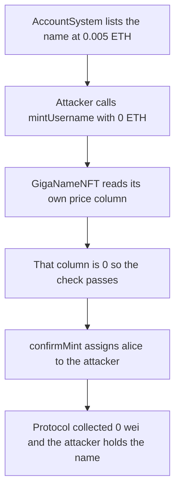

# Gigaverse — `mintUsername` charges 0 for a name listed at 0.005 ETH

> **Vulnerability classes:** vuln/logic/fee-calculation · vuln/logic/price-calculation · vuln/logic/wrong-condition

> **Reproduction:** a self-contained Foundry PoC that compiles and runs with only `forge-std` — no fork, no RPC. Full trace: [output.txt](output.txt). PoC: [test/53288-h-05-zero-username-price-when-it-is-minted-with-mintusername_exp.sol](test/53288-h-05-zero-username-price-when-it-is-minted-with-mintusername_exp.sol).

<!-- non-defihacklabs -->
<!-- source-auditvault: https://github.com/Auditware/AuditVault/blob/main/findings/53288-h-05-zero-username-price-when-it-is-minted-with-mintusername.md -->
<!-- date: 2025-01 -->

**AuditVault taxonomy:** `lang/solidity` · `has/github` · `severity/high` · `sector/perpetuals` · genome: `fee-accounting` · `logic/fee-calculation` · `loss-of-funds/fee-theft`

---

## Key info

| | |
|---|---|
| **Impact** | **HIGH** — a username the protocol lists at **0.005 ETH** (`5000000000000000` wei) is minted for **0 wei**, and the caller receives the name |
| **Protocol** | Gigaverse — `AccountSystem.mintWithEth` / `GigaNameNFT.mintUsername` |
| **Vulnerable code** | `GigaNameNFT.mintUsername` — `require(msg.value >= getTableUint256Value(ETH_MINT_PRICE_CID))` |
| **Bug class** | Fee is read from the name-NFT table, which stays 0, instead of the AccountSystem table the manager writes |
| **Finding** | Pashov Audit Group — Gigaverse, 2025-01-18 · #53288 (H-05) |
| **Report** | [Gigaverse-security-review_2025-01-18](https://github.com/pashov/audits/blob/master/team/md/Gigaverse-security-review_2025-01-18.md) |
| **Source** | [AuditVault](https://github.com/Auditware/AuditVault/blob/main/findings/53288-h-05-zero-username-price-when-it-is-minted-with-mintusername.md) |
| **Status** | Audit finding, reproduced as a local synthetic |
| **Compiler** | solc 0.8.27, cancun, via_ir |

This is an audit finding, not an on-chain incident. `mintUsername` is copied verbatim from the report. The two tables are the minimum scaffolding that makes the wrong read observable: AccountSystem's column holds `0.005 ether`, GigaNameNFT's column holds `0`.

---

## TL;DR

1. The manager sets the username price with `AccountSystem.setMintPrice`. `mintWithEth` reads that table and reverts unless `msg.value` covers it.
2. `GigaNameNFT.mintUsername` checks `ETH_MINT_PRICE_CID` on **its own** table. Nothing writes that cell, so it is `0`.
3. The attacker calls `mintUsername(attacker, "alice")` with no ETH. The check is `0 >= 0`. `confirmMint` assigns the name.
4. **Harm:** listed price `5000000000000000` wei, name-table price `0`, ETH charged `0`, protocol fees `0`, token id `1`, owner is the attacker, name is `alice`.
5. **Control:** `mintWithEth{value: 0.005 ether}` mints `bob` and records a charge of `5000000000000000`. `mintWithEth{value: 0}` reverts and does not mint.

---

## The vulnerable code

From the report, preserved verbatim:

```solidity
function mintUsername(address to, string memory username) external payable {
    // @> VULN: price is read from the GigaNameNFT table, which stays 0
    require(msg.value >= getTableUint256Value(ETH_MINT_PRICE_CID), "Insufficient payment");
    confirmMint(to, username);
}
```

`getTableUint256Value` reads `NAME_TABLE`, not `ACCOUNT_TABLE`:

```solidity
function getTableUint256Value(uint256 columnId) public view returns (uint256) {
    return dataStore.getUint256(NAME_TABLE, columnId);
}
```

The path that charges the real price:

```solidity
function mintWithEth(address to, string memory username) external payable returns (uint256 id) {
    uint256 price = mintPrice(); // AccountSystem table
    require(msg.value >= price, "Insufficient payment");
    feesCollected += msg.value;
    id = names.mintUsernameByMinter{value: msg.value}(to, username);
}
```

Recommended fix from the report: both contracts must read the AccountSystem table.

```diff
- require(msg.value >= getTableUint256Value(ETH_MINT_PRICE_CID), "Insufficient payment");
+ require(msg.value >= accountSystem.mintPrice(), "Insufficient payment");
```

---

## Root cause

`ETH_MINT_PRICE_CID` is a column id, not a global variable. `AccountSystem.setMintPrice` writes it under the account table. `mintUsername` loads it under the name-NFT table. The two cells are independent, the name-NFT cell has no setter, and the default is `0`. Any caller can satisfy the payment check by sending nothing.

## Preconditions

- The manager has set a non-zero mint price on AccountSystem. In this PoC that price is `0.005 ether`, the figure Gigaverse documents for `mintWithEth`.
- `mintUsername` is externally callable. The report describes it as the alternate mint path.
- The username is not already taken.

## Attack walkthrough

Numbers from [output.txt](output.txt):

1. `AccountSystem.mintPrice()` is `5000000000000000` wei.
2. The GigaNameNFT table cell for the same column is `0`.
3. The attacker calls `mintUsername` with `msg.value == 0` and username `alice`.
4. The require passes. `confirmMint` sets `ownerOf(1)` to the attacker and `ethPaid(1)` to `0`.
5. Protocol `feesCollected` stays `0`. The attacker holds one NAME and the string `alice`.

The control test pays `5000000000000000` wei through `mintWithEth`, receives `bob`, and shows a second call with `0` value does not mint.

## Diagrams



## Impact

The protocol sells usernames for a manager-set ETH price and also exposes a mint that ignores that price. Every name taken through `mintUsername` is delivered without the fee. In the PoC the concrete loss is the `0.005 ETH` fee on `alice`: the attacker receives token id `1`, and both the name contract and AccountSystem keep `0` wei. Repeating the call takes every unused name for free. `mintWithEth` still charges, so the bug is the second entry point, not the price setter.

## Remediation

Make `mintUsername` read `AccountSystem.mintPrice()` — the same cell `setMintPrice` writes — or remove the public mint and leave minting to `mintWithEth` after that check.

## Sources

- AuditVault finding: https://github.com/Auditware/AuditVault/blob/main/findings/53288-h-05-zero-username-price-when-it-is-minted-with-mintusername.md
- Pashov report (2025-01-18): https://github.com/pashov/audits/blob/master/team/md/Gigaverse-security-review_2025-01-18.md
- The blamed `mintUsername` body is the snippet in that report. Gigaverse did not publish the audited Solidity commit. The live `mintWithEth` price of 0.005 ETH is documented at https://github.com/Gigaverse-Games/play/blob/main/references/onboarding.md for AccountSystem `0x5f8b7eb615D5FCE81fafFb107450EdE201384C00` on Abstract.
