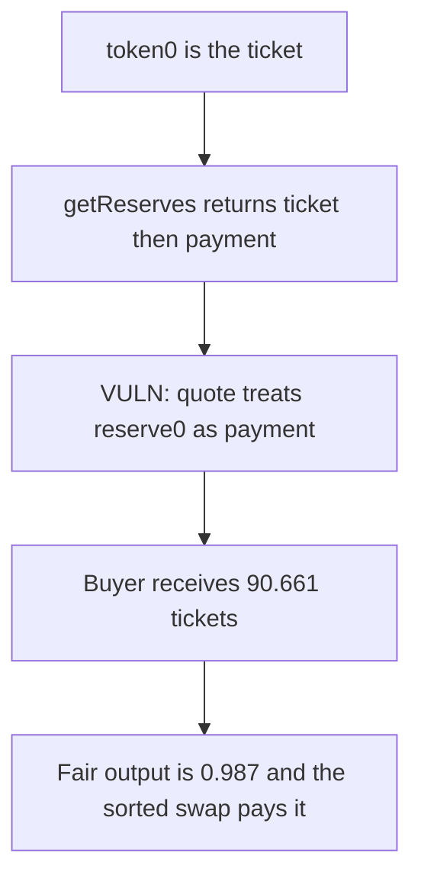

# GachaTickets — swap quotes the reserves in the wrong order

> **Vulnerability classes:** vuln/logic/price-calculation · vuln/logic/incorrect-order-of-operations

<!-- non-defihacklabs -->
<!-- source-auditvault: https://github.com/Auditware/AuditVault/blob/main/findings/53301-c-01-incorrect-reserve-order-in-swap-pashov-audit-group-non.md -->
<!-- date: 2025-01 -->

## Key info

| | |
|---|---|
| **Protocol** | GachaTickets |
| **Finding** | Pashov Audit Group C-01, AuditVault 53301 |
| **Vulnerable code** | `GachaTickets.swap` reserve binding |
| **Harm** | Output 90661089388014913158. Fair output 987158034397061298. |
| **Chain** | local synthetic |

## TL;DR

`getReserves` returns `(reserve0, reserve1)` with `token0` the lower address. `_swap` names those words `(wethReserve, tokenReserve)` without checking `token0`. In this pair the ticket is token0, so the payment reserve is 1000 and the ticket reserve is 100, but the quote uses them backwards. `getAmountOut(10, 100, 1000)` pays 90.661 ticket tokens. The sorted quote `getAmountOut(10, 1000, 100)` is 0.987. The control swap sends that fair amount.

## The vulnerable code

```solidity
(uint256 wethReserve, uint256 tokenReserve,) = pair.getReserves();
if (wethReserve == 0 || tokenReserve == 0) revert InvalidPair();
// @> VULN: reserve0 is used as the payment reserve even when token0 is the output token
maxTokens = getAmountOut(cost, wethReserve, tokenReserve);
```

The fix reads `token0` and assigns `wethReserve` from `reserve0` only when `token0` is the payment token.

## Root cause

Uniswap V2 reserve order is address order, not the order of the tokens the caller cares about. Binding `getReserves()` positionally to payment-then-token is correct only when the payment token is token0.

## Preconditions

The ticket token is token0, so `reserve0` is the ticket reserve (100) and `reserve1` is the payment reserve (1000). The swap input is 10 of the payment token. The pair holds the ticket tokens it sends out.

## Attack walkthrough

1. Confirm token0 is the ticket, not the payment token.
2. `swap(10e18)` reads reserves as `(100e18, 1000e18)` and treats the first as payment.
3. The pair transfers `90661089388014913158` ticket tokens to the buyer.
4. The fair constant-product output is `987158034397061298`.
5. `swapSorted` pays that fair amount to the tickets contract.

## Diagrams



## Impact

The protocol records and transfers 90.661 tickets for a trade whose fair output is 0.987. The extra `89673931353617851860` comes out of the pair. When the inverted quote is used as a minimum instead, the real pool swap reverts and buys are stuck. Sorting by `token0` restores the 0.987 output.

## Remediation

```solidity
uint256 wethReserve = token0 == paymentToken ? reserve0 : reserve1;
uint256 tokenReserve = token0 == paymentToken ? reserve1 : reserve0;
```

## How to reproduce

```bash
cd 53301-c-01-incorrect-reserve-order-in-swap-pashov-audit-group-non_exp
forge test -vv
```

## Sources

- AuditVault finding: https://github.com/Auditware/AuditVault/blob/main/findings/53301-c-01-incorrect-reserve-order-in-swap-pashov-audit-group-non.md
- Pashov report: https://github.com/pashov/audits/blob/master/team/md/Gacha-security-review_2025-01-27.md
