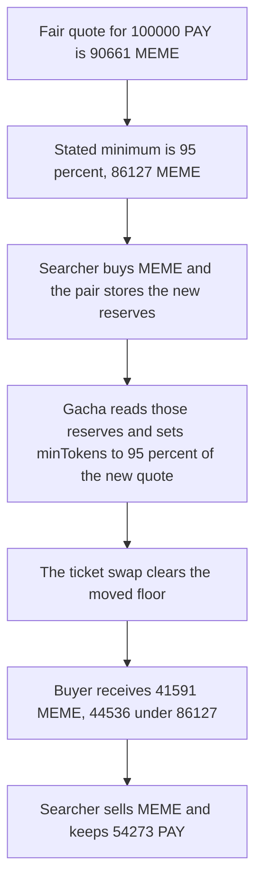

# Gacha `_swap` sets its own slippage floor from the spot price

> **Vulnerability classes:** vuln/defi/sandwich-attack · vuln/defi/slippage

<!-- non-defihacklabs -->
<!-- source-auditvault: https://github.com/Auditware/AuditVault/blob/main/findings/53302-h-01-swap-is-vulnerable-to-sandwich-attacks-pashov-audit-gr.md -->
<!-- date: 2025-01 -->

## Key info

| Field | Value |
|---|---|
| **Loss** | Buyer receives 41,591 MEME, which is 44,536 below the 86,127 stated minimum. Searcher keeps 54,273 PAY |
| **Vulnerable contract** | `GachaTickets._swap` |
| **Attacker EOA** | `0x1111111111111111111111111111111111111111` |
| **Attack contract** | `Exploit` |
| **Attack tx** | `Exploit.run()` |
| **Chain / block / date** | Ethereum model · block 0 · 2025-01 |
| **Compiler** | solc 0.8.27, cancun, via IR |
| **Bug class** | Slippage floor computed from the in-transaction spot quote |

## TL;DR

`GachaTickets._swap` sets `minTokens` to 95% of `getAmountOut` on the reserves it just read. A searcher can move that price in the same transaction, before the ticket swap. The buyer's fill is 41,591 MEME. The minimum implied by the pre-trade quote is 86,127 MEME, so the buyer is short 44,536 MEME, and the searcher keeps 54,273 PAY. The fixed purchase takes that 86,127 as `minOut`: the same price move reverts, and the unmoved pool pays 90,661 MEME.

## Background

Pashov Audit Group reviewed Gacha on 2025-01-27 (H-01, high). Buying a ticket swaps a payment token for a meme token through Uniswap V2. The report's `_swap` reads `getReserves`, quotes `getAmountOut`, and passes 95% of that quote as `amountOutMin`. The synthetic keeps payment as pair token0 so that reserve read matches the quoted code. A separate reserve-order bug in the same review is not this finding.

## The vulnerable code

```solidity
uint256 maxTokens = uni.getAmountOut(cost, wethReserve, tokenReserve); // includes 0.3%
// @> VULN: minTokens is 95% of this transaction's spot quote, so a same-tx price move sets the floor
uint256 minTokens = Math.mulDiv(maxTokens, 95, 100); // 5% slippage
```

The recommended fix passes the buyer's minimum in from the frontend:

```diff
-        uint256 minTokens = Math.mulDiv(maxTokens, 95, 100); // 5% slippage
-        uni.swapExactTokensForTokens(cost, minTokens, path, address(this), block.timestamp + 1);
+        // minOut is the buyer-supplied frontend minimum
+        uni.swapExactTokensForTokens(cost, minOut, path, address(this), block.timestamp + 1);
```

## Root cause

The floor is a function of the reserves at the moment `_swap` runs. Those reserves are public pool state. Nothing in the function binds the floor to a quote the buyer signed before the searcher's trade. The 5% band only limits slippage against the already-moved price.

## Preconditions

- The pool has 1,000,000 PAY and 1,000,000 MEME. A 100,000 PAY swap quotes 90,661 MEME. 95% of that quote is 86,127 MEME.
- The ticket contract holds the 100,000 PAY cost and will swap it for the meme token with no caller-supplied minimum.
- The searcher can trade the same pair in the same transaction, before and after the ticket swap.

## Attack walkthrough

1. The fair quote for 100,000 PAY is 90,661 MEME. The stated minimum is 86,127.
2. The searcher swaps 500,000 PAY for MEME. The pair stores the new reserves.
3. The buyer calls `purchase`. `_swap` reads those reserves.
4. `getAmountOut` on the moved reserves is the new spot quote. `minTokens` is 95% of that quote.
5. `swapExactTokensForTokens` is called with that `minTokens`. The buyer receives 41,591 MEME.
6. 41,591 is at least the moved floor, and 44,536 below 86,127.
7. The searcher sells the MEME back and is paid 54,273 PAY.

## Diagrams



## Impact

The ticket buyer is filled 41,591 MEME instead of at least 86,127. The gap is 44,536 MEME. The searcher's round trip extracts 54,273 PAY from the same reserves. On the fixed path, `purchase(86127)` reverts after that price move and the cost stays in the contract, while the same call on the unmoved pool pays 90,661 MEME.

## PoC

```bash
cd 53302-h-01-swap-is-vulnerable-to-sandwich-attacks-pashov-audit-gr_exp
forge test -vv
```

`test_exploit_user_receives_less_than_stated_min` asserts the stated minimum is 86,127, the buyer receives 41,591, the shortfall is 44,536, and the searcher is paid 54,273 PAY. `test_control_stated_min_reverts_after_the_same_price_move` asserts `purchase(86127)` reverts `INSUFFICIENT_OUTPUT` and the 100,000 PAY cost stays put. `test_control_stated_min_pays_the_fair_quote` asserts the unmoved pool pays 90,661 MEME, which is above 86,127.

## Sources

- AuditVault finding: https://github.com/Auditware/AuditVault/blob/main/findings/53302-h-01-swap-is-vulnerable-to-sandwich-attacks-pashov-audit-gr.md
- Pashov report (Gacha, 2025-01-27): https://github.com/pashov/audits/blob/master/team/md/Gacha-security-review_2025-01-27.md
- Quoted source: `GachaTickets._swap` as printed in that report. The client repository is not linked from the report; this file is the reduced synthetic.
