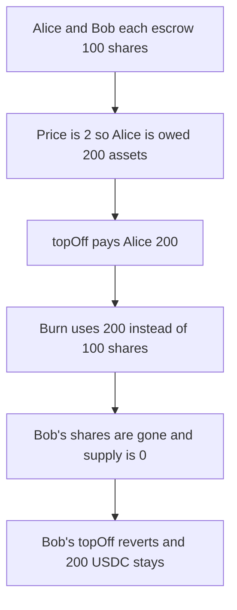

# Omo — topOff burns assets instead of shares, and Bob's 200 is stuck

> **Vulnerability classes:** vuln/logic/wrong-condition · vuln/logic/state-update

> **Reproduction:** a self-contained Foundry PoC that compiles and runs offline
> with only `forge-std` — no fork and no RPC. Trace: [output.txt](output.txt).
> PoC: [test/53313-c-02-passing-the-wrong-value-to-burn-function-pashov-audit_exp.sol](test/53313-c-02-passing-the-wrong-value-to-burn-function-pashov-audit_exp.sol).

<!-- non-defihacklabs -->
<!-- source-auditvault: https://github.com/Auditware/AuditVault/blob/main/findings/53313-c-02-passing-the-wrong-value-to-burn-function-pashov-audit.md -->
<!-- date: 2025-01 -->

---

## Key info

| | |
|---|---|
| **Impact** | **HIGH** — Bob's **100 shares** are burned and his **200 USDC** cannot be paid |
| **Protocol** | Omo `OmoVault.topOff` |
| **Vulnerable code** | `_burn(address(this), agentBalance)` |
| **Bug class** | `agentBalance` is assets, `record.shares` is what should burn |
| **Finding** | Pashov Audit Group — Omo, 25 January 2025 · C-02 · id 53313 |
| **Report** | [Omo-security-review_2025-01-25](https://github.com/pashov/audits/blob/master/team/md/Omo-security-review_2025-01-25.md) |
| **Source** | [AuditVault finding](https://github.com/Auditware/AuditVault/blob/main/findings/53313-c-02-passing-the-wrong-value-to-burn-function-pashov-audit.md) |
| **Status** | Reproduced at a share price of 2. |
| **Compiler** | solc 0.8.27, cancun, via IR |

---

## TL;DR

`topOff` pays the user `agentBalance` assets and then burns that same number of shares. The two numbers are equal only when the share price is 1.

Here the price is 2. Alice's 100 shares are worth 200 assets. The vault is also holding Bob's 100 shares. The burn destroys **200 shares**, which is Alice's escrow and Bob's. Alice is paid **200**. Bob's `topOff` then divides by a zero supply and reverts. **200 USDC** stays in the vault.

Burning `record.shares` leaves Bob's 100 shares and pays him 200 as well.

## The vulnerable code

```solidity
asset.transfer(user, agentBalance);
_totalAssets -= agentBalance;
// @> VULN: agentBalance is assets paid out, not the shares that redeem should burn
_burn(address(this), agentBalance);
```

The report's diff replaces `agentBalance` with `record.shares` on the burn only.

## Root cause

`agentBalance` is the asset amount transferred to the user. Share price is assets per share, so that number is not a share count. Burning it from the vault's share balance consumes every other escrowed position that happened to sit in the same balance.

## Preconditions

- Two open redeems, 100 shares each.
- Share price is 2, so each redeem pays 200 assets.
- Both users' shares are held by the vault, which is how `topOff` burns them.

## Attack walkthrough

1. Escrow 100 shares for Alice and 100 for Bob. Total supply is 200. Assets accounted are 400.
2. Mint 400 USDC to the vault.
3. `topOff(Alice)` transfers 200 USDC and burns 200 shares.
4. Vault share balance is 0. Bob's escrow record still says 100 shares.
5. `topOff(Bob)` reverts. 200 USDC is still in the vault. Alice already has her 200.

Control: burn `record.shares` (100). Bob's 100 shares remain, his `topOff` pays 200, and the vault ends at 0.

## Diagrams



## Impact

Bob loses the claim on **200 USDC**. The tokens are still in the vault and no shares are left that can redeem them. Alice was paid the correct 200. The extra burn is what bricks Bob.

## Remediation

Burn `record.shares`, not `agentBalance`.

## Sources

- [AuditVault finding 53313](https://github.com/Auditware/AuditVault/blob/main/findings/53313-c-02-passing-the-wrong-value-to-burn-function-pashov-audit.md)
- [Pashov Omo review, 25 January 2025](https://github.com/pashov/audits/blob/master/team/md/Omo-security-review_2025-01-25.md)

### Taxonomy

- `vuln/logic/incorrect-calculation` · `vuln/logic/state-update`
