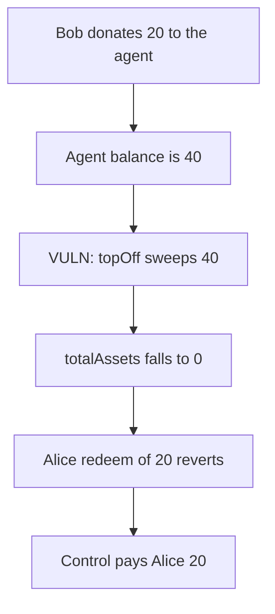

# OmoVault — a donation inflates topOff and Alice cannot redeem

> **Vulnerability classes:** `vuln/logic/state-update` · `vuln/dos/frozen-funds`

<!-- non-defihacklabs -->
<!-- source-auditvault: https://github.com/Auditware/AuditVault/blob/main/findings/53314-c-03-users-cant-redeem-funds-due-to-malicious-manipulation-o.md -->
<!-- date: 2025-01 -->

## Key info

| | |
|---|---|
| **Protocol** | OmoVault |
| **Finding** | Pashov Audit Group C-03, AuditVault 53314 |
| **Vulnerable code** | `OmoVault.topOff` sweeps `agentBalance` |
| **Harm** | Bob is paid 40 and Alice's redeem of 20 reverts. The control pays Alice 20. |
| **Chain** | local synthetic |

## TL;DR

Alice and Bob each have 20 in the vault, so `_totalAssets` is 40. The agent holds the 20 it is supposed to return for Bob's redeem. Bob transfers another 20 to the agent before `topOff`. The function pulls the agent's whole balance, pays Bob 40, and subtracts 40 from `_totalAssets`. Alice's later redeem underflows. A vault that pulls `record.assets` instead still has 20 of accounting left, and Alice is paid 20.

## The vulnerable code

```solidity
uint256 agentBalance = asset.balanceOf(msg.sender);
asset.transferFrom(msg.sender, address(this), agentBalance);
asset.transfer(record.receiver, agentBalance);
totalAssets -= agentBalance;
```

The report's fix pulls and forwards `record.assets`, not the agent's token balance.

## Root cause

`topOff` treats the agent's entire token balance as the amount owed to the redeem receiver. A direct transfer to the agent changes that balance without changing the recorded redeem amount, and the same number is subtracted from `_totalAssets`.

## Preconditions

The caller is `agents(0)`, so the agent check passes. The recorded redeem is 20 to Bob. The agent already holds that 20. Bob donates 20 more. The vault contract still holds Alice's 20. `_totalAssets` starts at 40.

## Attack walkthrough

1. Bob transfers 20 to the agent. The agent balance is 40.
2. The agent calls `topOff`.
3. `transferFrom` pulls 40 and `_totalAssets` becomes 0.
4. Bob's balance goes from 20 to 40. His profit in the attack call is 20.
5. Alice's `redeem(20)` reverts. The vault still holds her 20 tokens.
6. The control agent also holds a 20 donation plus 20 of assets. It pulls only `record.assets`. Alice is then paid 20.

## Diagrams



## Impact

Bob receives 40 after donating 20, so he keeps 20 that was not his redeem. `_totalAssets` is 0 while the vault still holds Alice's 20, and her redeem reverts. The control leaves `_totalAssets` at 20 and pays her that 20.

## Remediation

Pull and forward `record.assets`, and subtract that amount from `_totalAssets`, as the report's diff shows.

## How to reproduce

```bash
cd 53314-c-03-users-cant-redeem-funds-due-to-malicious-manipulation-o_exp
forge test -vv
```

## Sources

- AuditVault finding: https://github.com/Auditware/AuditVault/blob/main/findings/53314-c-03-users-cant-redeem-funds-due-to-malicious-manipulation-o.md
- Pashov report: https://github.com/pashov/audits/blob/master/team/md/Omo-security-review_2025-01-25.md
- Reviewed tree: https://github.com/omo-protocol/omo-mvp/tree/c52b6d39ec34f640533c4fd30310e1fba31f5f39
