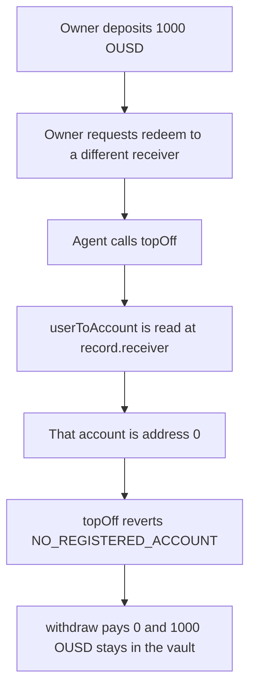

# Omo `topOff` locks a redeem that names another receiver

> **Vulnerability classes:** vuln/dos/frozen-funds · vuln/logic/missing-check

<!-- non-defihacklabs -->
<!-- source-auditvault: https://github.com/Auditware/AuditVault/blob/main/findings/53315-c-04-funds-get-locked-in-the-vault-pashov-audit-group-none-o.md -->
<!-- date: 2025-01 -->

## Key info

| Field | Value |
|---|---|
| **Loss** | 1000 OUSD stuck in the vault. `topOff` reverts and `withdraw` pays 0 |
| **Vulnerable contract** | `OmoVault.topOff` |
| **Attacker EOA** | `0x1111111111111111111111111111111111111111` |
| **Attack contract** | `Exploit` |
| **Attack tx** | `Exploit.run()` |
| **Chain / block / date** | Ethereum model · block 0 · 2025-01 |
| **Compiler** | solc 0.8.27, cancun, via IR |
| **Bug class** | Agent authorization is checked on the redeem receiver |

## TL;DR

A user deposits 1000 OUSD and requests a redeem that pays a different receiver. The registered agent calls `topOff`. The function loads `userToAccount[record.receiver]`. That receiver has no Dynamic Account, so the call reverts `NO_REGISTERED_ACCOUNT`. `withdraw` returns 0 and the 1000 OUSD stays in the vault. The same redeem on a vault that loads `userToAccount[record.owner]` pays the receiver 1000.

## Background

Pashov Audit Group reviewed Omo on 2025-01-25 (C-04, high). After a user requests a redeem, an agent registered on that user's Dynamic Account is supposed to call `OmoVault.topOff` and finish the payout. The implementation looks the agent up on `record.receiver` instead of `record.owner`.

## The vulnerable code

```solidity
Record storage record = pending;
// @> VULN: userToAccount is keyed by record.receiver, who never registered an agent
address userAccount = userToAccount[record.receiver];
require(userAccount != address(0), "NO_REGISTERED_ACCOUNT");
```

The report's fix changes the key:

```diff
-        address userAccount = userToAccount[record.receiver];
+        address userAccount = userToAccount[record.owner];
         require(userAccount != address(0), "NO_REGISTERED_ACCOUNT");
```

## Root cause

The redeem record has two addresses. `owner` is the user who deposited and who registered the Dynamic Account. `receiver` is who should be paid, and that address is allowed to be someone else. `topOff` treats them as the same account. When they differ, the receiver key is empty even though the owner's agent is authorized.

## Preconditions

- The owner has registered a Dynamic Account whose `agents(0)` is the caller.
- The owner has deposited 1000 OUSD and requested a redeem of that 1000 to a different receiver.
- The receiver has no `userToAccount` entry.

## Attack walkthrough

1. 1000 OUSD is minted to the owner and deposited into the vault.
2. The owner requests a redeem with `receiver` set to a second account and `assets` set to 1000.
3. The agent calls `topOff`.
4. `userToAccount[record.receiver]` is `address(0)`.
5. The call reverts `NO_REGISTERED_ACCOUNT` before the transfer.
6. `withdraw` returns 0. The receiver's balance is 0. The vault still holds 1000.

## Diagrams



## Impact

The 1000 OUSD cannot be paid to the receiver the owner named. `withdraw` returns 0 and the vault balance stays 1000. Keying the same lookup on `record.owner` lets `topOff` pass the agent check and transfer the 1000 to the receiver, leaving the vault at 0.

## PoC

```bash
cd 53315-c-04-funds-get-locked-in-the-vault-pashov-audit-group-none-o_exp
forge test -vv
```

`test_exploit_redeem_to_other_receiver_locks_assets` asserts `topOff` reverted, `withdraw` paid 0, the vault holds 1000, and the receiver holds 0, while the owner is the one with a registered account. `test_control_owner_key_pays_the_receiver` asserts the owner-keyed vault pays 1000 to the receiver and the vault balance is 0.

## Sources

- AuditVault finding: https://github.com/Auditware/AuditVault/blob/main/findings/53315-c-04-funds-get-locked-in-the-vault-pashov-audit-group-none-o.md
- Pashov report (Omo, 2025-01-25): https://github.com/pashov/audits/blob/master/team/md/Omo-security-review_2025-01-25.md
- Quoted source: `OmoVault.topOff` as printed in that report. The client repository is not linked from the report; this file is the reduced synthetic.
