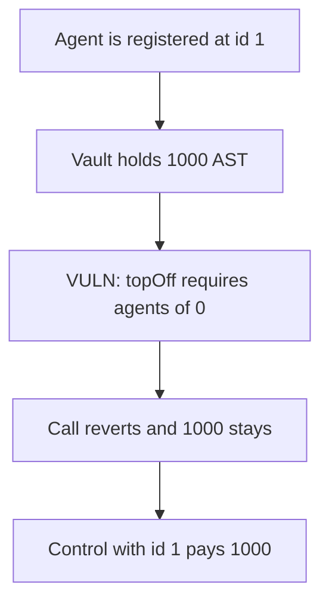

# OmoVault — topOff only accepts agent id 0, so users cannot redeem

> **Vulnerability classes:** vuln/access-control/broken-logic · vuln/dos/frozen-funds

<!-- non-defihacklabs -->
<!-- source-auditvault: https://github.com/Auditware/AuditVault/blob/main/findings/53316-c-05-the-users-are-not-able-to-redeem-their-funds-pashov-aud.md -->
<!-- date: 2025-01 -->

## Key info

| | |
|---|---|
| **Protocol** | OmoVault |
| **Finding** | Pashov Audit Group C-05, AuditVault 53316 |
| **Vulnerable code** | `OmoVault.topOff` checks `agents(0)` |
| **Harm** | Redeem reverts and 1000 AST stays in the vault. Agent id 1 pays 1000 on the control vault. |
| **Chain** | local synthetic |

## TL;DR

Dynamic accounts store agents under an id. `topOff` requires `agents(0) == msg.sender`. Id 0 is never registered, so the agent stored at id 1 cannot redeem. 1000 AST deposited in the vault stays there. A vault that checks the id the caller passes pays that 1000 to the same agent.

## The vulnerable code

```solidity
OmoAgent agent = OmoAgent(payable(userAccount));
// @> VULN: only agent id 0 is checked, and that id was never registered
require(agent.agents(0) == msg.sender, "UNAUTHORIZED_AGENT");
```

The finding's recommendation is to pass the agent id instead of the constant 0.

## Root cause

The authorization read is hardcoded to slot 0 of the agent mapping. Registration uses a non-zero id. No caller can satisfy the check, so the transfer under it never runs.

## Preconditions

The account has an agent at id 1 and nothing at id 0. The vault holds the user's assets. The caller is that registered agent.

## Attack walkthrough

1. `agents(0)` is the zero address. `agents(1)` is the caller.
2. 1000 AST is transferred into the vault.
3. `topOff` reverts `UNAUTHORIZED_AGENT`. The vault balance is still 1000.
4. The control vault is called with id 1 and transfers 1000 AST to the agent.

## Diagrams



## Impact

Users cannot redeem through `topOff`. The 1000 AST in the vulnerable vault remains after the registered agent calls it. The same agent, checked at id 1, is paid 1000 from the control vault.

## Remediation

Pass the account's agent id into the check: `require(agent.agents(agentId) == msg.sender)`.

## How to reproduce

```bash
cd 53316-c-05-the-users-are-not-able-to-redeem-their-funds-pashov-aud_exp
forge test -vv
```

## Sources

- AuditVault finding: https://github.com/Auditware/AuditVault/blob/main/findings/53316-c-05-the-users-are-not-able-to-redeem-their-funds-pashov-aud.md
- Pashov report: https://github.com/pashov/audits/blob/master/team/md/Omo-security-review_2025-01-25.md
