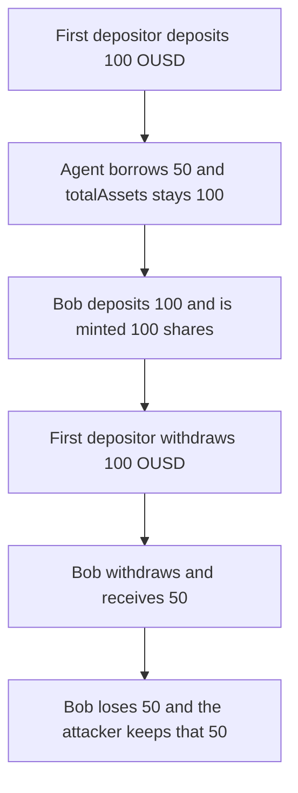

# Omo `borrow` leaves `totalAssets` inflated by the amount sent to the agent

> **Vulnerability classes:** vuln/logic/accounting · vuln/logic/incorrect-state-transition

<!-- non-defihacklabs -->
<!-- source-auditvault: https://github.com/Auditware/AuditVault/blob/main/findings/53317-c-06-borrow-should-decrease-totalassets-value-pashov-audit-g.md -->
<!-- date: 2025-01 -->

## Key info

| Field | Value |
|---|---|
| **Loss** | Later depositor puts in 100 OUSD and receives 50. Attacker keeps the other 50 |
| **Vulnerable contract** | `OmoVault.borrow` |
| **Attacker EOA** | `0x1111111111111111111111111111111111111111` |
| **Attack contract** | `Exploit` |
| **Attack tx** | `Exploit.run()` |
| **Chain / block / date** | Ethereum model · block 0 · 2025-01 |
| **Compiler** | solc 0.8.27, cancun, via IR |
| **Bug class** | Borrowed assets stay inside the share-price total |

## TL;DR

`borrow` transfers 50 OUSD to the agent and does not subtract that amount from `totalAssets`. Cash is 50 and `totalAssets` is still 100. A later depositor who adds 100 OUSD is minted shares as if the vault still held the borrowed funds, then receives 50 back. The first depositor withdraws 100, which is 50 more than the cash that was left after the borrow. Subtracting the borrowed amount from `totalAssets` pays the later depositor the full 100 and limits the first depositor to 50.

## Background

Pashov Audit Group reviewed Omo on 2025-01-25 (C-06, high). `OmoVault.borrow` is agent-only. It sends vault assets to the agent and never records the debt. Share price is `totalAssets`, so the borrowed assets are still treated as depositor property.

## The vulnerable code

```solidity
function borrow(uint256 assets, address receiver) external {
    address msgSender = msg.sender;
    require(msgSender == agent, "only agent");
    require(assets != 0, "ZERO_ASSETS");
    // @> VULN: assets leave the vault and totalAssets is not reduced
    asset.transfer(receiver, assets);
}
```

The report's fix records the outflow:

```diff
         require(assets != 0, "ZERO_ASSETS");
+        totalAssets -= assets;
         asset.transfer(receiver, assets);
```

## Root cause

`deposit` and `withdraw` price shares with `totalAssets`. `borrow` moves tokens out of the contract and leaves that variable alone, so the share price counts assets the vault no longer holds. The next deposit is diluted, and an earlier depositor can withdraw against the stale total.

## Preconditions

- The vault has one depositor: 100 OUSD deposited, 100 shares, `totalAssets` 100.
- The agent borrows 50 OUSD out of the vault.
- A second depositor then deposits 100 OUSD and both later withdraw.

## Attack walkthrough

1. The first depositor deposits 100 OUSD. `totalAssets` and cash are 100.
2. The agent borrows 50. Cash is 50. `totalAssets` is still 100. The gap is 50.
3. Bob deposits 100. Shares are `100 * 100 / 100 = 100`. With the borrow removed from `totalAssets` he would receive 200 shares.
4. The first depositor withdraws 100 shares and is paid 100 OUSD. The fair claim on the post-borrow cash was 50.
5. Bob withdraws and receives the remaining 50. He deposited 100, so he loses 50.
6. That 50 is transferred to the attacker.

## Diagrams



## Impact

Bob deposits 100 OUSD and is paid 50. The first depositor withdraws 100 after the vault only had 50 left for them, and 50 of that payout is transferred to the attacker. On the fixed vault the same sequence pays the first depositor 50 and Bob 100, and `totalAssets` equals cash immediately after the borrow.

## PoC

```bash
cd 53317-c-06-borrow-should-decrease-totalassets-value-pashov-audit-g_exp
forge test -vv
```

`test_exploit_later_depositor_loses_the_borrowed_amount` asserts `totalAssets` is 50 above cash, the first depositor withdraws 100, Bob receives 50, and the caller is paid that 50. `test_control_decreasing_total_assets_pays_bob_in_full` asserts the subtraction makes `totalAssets` match cash and pays Bob 100.

## Sources

- AuditVault finding: https://github.com/Auditware/AuditVault/blob/main/findings/53317-c-06-borrow-should-decrease-totalassets-value-pashov-audit-g.md
- Pashov report (Omo, 2025-01-25): https://github.com/pashov/audits/blob/master/team/md/Omo-security-review_2025-01-25.md
- Quoted source: `OmoVault.borrow` as printed in that report. The client repository is not linked from the report; this file is the reduced synthetic.
