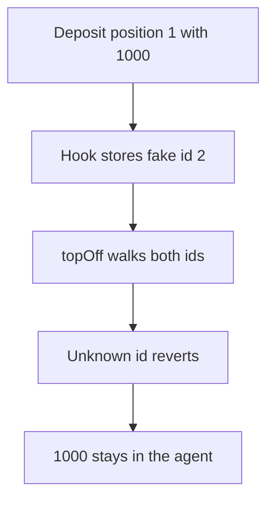

# Omo: unrestricted onERC721Received locks 1000

> **Vulnerability classes:** vuln/dos/frozen-funds · vuln/access-control/missing-auth

<!-- non-defihacklabs -->
<!-- source-auditvault: https://github.com/Auditware/AuditVault/blob/main/findings/53318-c-07-unrestricted-omoagentonerc721received-allows-permanent.md -->
<!-- date: 2025-01 -->

## Key info

| | |
|---|---|
| **Protocol** | Omo |
| **Finding** | Pashov Audit Group C-07, AuditVault 53318 |
| **Vulnerable code** | `OmoAgent.onERC721Received` |
| **Harm** | A fake position id makes topOffToAgent revert, so 1000 of backing stays in the agent. The fixed hook does not track the id and pays the 1000. |
| **Chain** | local synthetic |

## TL;DR

`depositPosition` moves the NFT with `transferFrom`, so `onERC721Received` is not part of a real deposit. The hook still has no caller check. An attacker adds token id 2. `topOffToAgent` reverts on that id and the 1000 already deposited cannot leave.

## The vulnerable code

```solidity
            // @> VULN: any caller adds tokenId; depositPosition uses transferFrom so this hook never runs on a real deposit
            _addPositionId(tokenId);
```

## Root cause

The hook writes `_positionIds` for any caller. A later loop requires every id to have a nonzero value.

## Preconditions

The agent already holds position 1 backed by 1000. The attacker can call the hook directly.

## Attack walkthrough

1. Deposit position 1 with 1000 of backing. See [output.txt](output.txt).
2. Call `onERC721Received` with token id 2.
3. `_addPositionId` stores id 2.
4. `positionCount` is 2.
5. `topOffToAgent` reverts on the unknown id.
6. The agent balance is still 1000. The fixed hook leaves the count at 1 and pays the 1000.

## Diagrams



## Impact

The owner's 1000 cannot be withdrawn. The fixed hook returns the selector and does not record the id, so topOff pays 1000.

## Remediation

Do not call `_addPositionId` from `onERC721Received`. The deposit path already records the id.

## How to reproduce

```bash
cd 53318-c-07-unrestricted-omoagentonerc721received-allows-permanent_exp
forge test -vv
```
