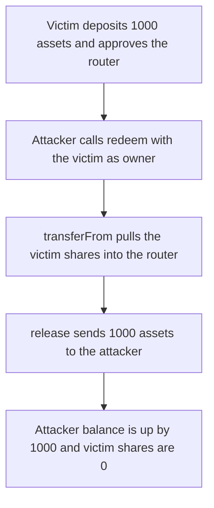

# Omo — anyone can redeem another user's shares and take the assets

> **Vulnerability classes:** vuln/access-control/missing-owner-check · vuln/access-control/missing-auth · vuln/logic/missing-check

> **Reproduction:** a self-contained Foundry PoC that compiles and runs with only `forge-std` — no fork, no RPC. Full trace: [output.txt](output.txt). PoC: [test/53319-h-01-anyone-can-redeem-from-users-and-take-the-funds-pashov_exp.sol](test/53319-h-01-anyone-can-redeem-from-users-and-take-the-funds-pashov_exp.sol).

<!-- non-defihacklabs -->
<!-- source-auditvault: https://github.com/Auditware/AuditVault/blob/main/findings/53319-h-01-anyone-can-redeem-from-users-and-take-the-funds-pashov.md -->
<!-- date: 2025-01 -->

**AuditVault taxonomy:** `lang/solidity` · `sector/token` · `has/github` · `severity/high` · genome: `access-roles` · `direct-drain` · `mev/frontrun`

---

## Key info

| | |
|---|---|
| **Impact** | **HIGH** — any caller redeems a victim's vault shares and the attacker's asset balance increases by the victim's full **1000e18** |
| **Protocol** | Omo — `OmoRouter.redeem` |
| **Vulnerable code** | `IOmoVault(vault).transferFrom(owner, address(this), shares)` |
| **Bug class** | `owner` is a parameter. The router spends the allowance the user granted it, then sends the assets to a caller-chosen receiver |
| **Finding** | Pashov Audit Group — Omo, 2025-01-25 · #53319 (H-01) |
| **Report** | [Omo-security-review_2025-01-25](https://github.com/pashov/audits/blob/master/team/md/Omo-security-review_2025-01-25.md) |
| **Source** | [AuditVault](https://github.com/Auditware/AuditVault/blob/main/findings/53319-h-01-anyone-can-redeem-from-users-and-take-the-funds-pashov.md) |
| **Status** | Audit finding, reproduced as a local synthetic |
| **Compiler** | solc 0.8.27, cancun, via_ir |

The report's `redeem` pulls shares from `owner` after that user has approved the router, which is the normal step before a user redeems. The caller does not have to be `owner`, and `receiver` is arbitrary. The diff in the report swaps the minus and plus lines; the description and the quoted body agree that the live code uses `owner`.

---

## TL;DR

1. The victim deposits `1000e18` assets and receives `1000e18` shares, then approves the router for those shares.
2. The attacker calls `redeem(vaultId, 1000e18, attacker, victim)` without being the owner.
3. The router `transferFrom`s the victim's shares and `release`s the underlying to the attacker.
4. **Harm:** attacker balance goes from `0` to `1000000000000000000000`. Victim shares go from that amount to `0`. The vault's asset balance is `0`.
5. **Control:** a router that sets `owner = msg.sender` reverts when a stranger calls it. The victim calling it receives the `1000e18` assets back.

---

## The vulnerable code

Quoted from the report and kept as the executed line:

```solidity
function redeem(uint256 vaultId, uint256 shares, address receiver, address owner) external returns (uint256 assets) {
    address vault = vaultOf[vaultId];
    // Transfer shares from owner to router first
    // @> VULN: spends the router's allowance on `owner`; the caller does not have to be owner
    IOmoVault(vault).transferFrom(owner, address(this), shares);
    assets = IOmoVault(vault).release(shares, receiver);
}
```

The control drops the `owner` argument:

```solidity
function redeem(uint256 vaultId, uint256 shares, address receiver) external returns (uint256 assets) {
    address owner = msg.sender;
    address vault = vaultOf[vaultId];
    IOmoVault(vault).transferFrom(owner, address(this), shares);
    assets = IOmoVault(vault).release(shares, receiver);
}
```

```diff
- function redeem(uint256 vaultId, uint256 shares, address receiver, address owner)
+ function redeem(uint256 vaultId, uint256 shares, address receiver)
      // Transfer shares from owner to router first
-     IOmoVault(vault).transferFrom(owner, address(this), shares);
+     IOmoVault(vault).transferFrom(msg.sender, address(this), shares);
```

---

## Root cause

Approving the router is required for the user to redeem through it. `redeem` treats that approval as usable by every caller, because `owner` and `receiver` are both arguments. The shares move to the router and the assets move to `receiver`. A searcher who sees the approval in the mempool can take the position before the user does.

## Preconditions

- The victim holds vault shares. Here, `1000e18` shares against `1000e18` assets, 1:1.
- The victim has approved the router for those shares. That approval is what the report says the owner sets.
- The attacker has no allowance of their own and starts with `0` assets.

## Attack walkthrough

Numbers from [output.txt](output.txt):

1. Victim shares before: `1000000000000000000000`.
2. Attacker assets before: `0`.
3. `redeem` returns `1000000000000000000000`.
4. Attacker assets after: `1000000000000000000000`.
5. Victim shares after: `0`.

The difference `attackerAfter - attackerBefore` equals the victim's deposit. The control test uses the same deposit against `OmoRouterFixed`: a stranger's `redeem` reverts and the shares stay put; the victim's own call returns the `1000e18` assets to the victim.

## Diagrams



## Impact

The victim loses the assets behind every share they approved to the router. In the PoC that is the entire `1000e18` deposit: the attacker is paid that amount and the vault is emptied. The victim cannot redeem afterwards because their share balance is `0`. Any later approval of the router is stealable the same way, including by a transaction ordered in front of the user's own redeem.

## Remediation

Redeem only for `msg.sender`, or require `msg.sender == owner` before `transferFrom`. Do not let the caller choose both the share owner and the asset receiver.

## Sources

- AuditVault finding: https://github.com/Auditware/AuditVault/blob/main/findings/53319-h-01-anyone-can-redeem-from-users-and-take-the-funds-pashov.md
- Pashov report (2025-01-25): https://github.com/pashov/audits/blob/master/team/md/Omo-security-review_2025-01-25.md
- `OmoRouter.redeem`'s `transferFrom(owner, address(this), shares)` line is the snippet in that report. The audited Omo repository commit was not published with the finding.
