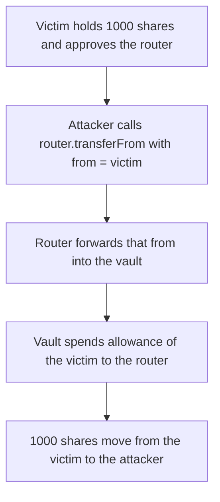

# OmoRouter `transferFrom` spends a victim's allowance to the router

> **Vulnerability classes:** vuln/access-control/missing-auth · vuln/logic/missing-check

<!-- non-defihacklabs -->
<!-- source-auditvault: https://github.com/Auditware/AuditVault/blob/main/findings/53320-h-02-the-transferfrom-in-omoroutersol-has-approval-vulnerabi.md -->
<!-- date: 2025-01 -->

## Key info

| Field | Value |
|---|---|
| **Loss** | 1000 vault shares taken from a victim who had approved the router |
| **Vulnerable contract** | `OmoRouter.transferFrom` |
| **Attacker EOA** | `0x1111111111111111111111111111111111111111` |
| **Attack contract** | `Exploit` |
| **Attack tx** | `Exploit.run()` |
| **Chain / block / date** | Ethereum model · block 0 · 2025-01 |
| **Compiler** | solc 0.8.27, cancun, via IR |
| **Bug class** | Router forwards a caller-supplied `from` |

## TL;DR

`OmoRouter.transferFrom` takes `from` from the caller and passes it to `OmoVault.transferFrom`. The vault spends `allowance[from][router]`. A victim who approved the router for 1000 shares loses all 1000 to the attacker. The fixed function drops `from` and spends `msg.sender`, so the same approval does not move the victim. A caller who approved 100 of their own shares can move only those 100.

## Background

Pashov Audit Group reviewed Omo on 2025-01-25 (H-02, high). Users approve the router, then the router is supposed to move that user's shares. The router accepts any `from`. This is separate from the finding that anyone can redeem.

## The vulnerable code

```solidity
function transferFrom(uint256 vaultId, address from, address to, uint256 amount) external returns (bool) {
    address vault = vaultFactory.getVault(vaultId);
    // @> VULN: `from` is caller-supplied, so the router's allowance spends the victim
    return IOmoVault(vault).transferFrom(from, to, amount);
}
```

The report's fix removes `from`:

```diff
-    function transferFrom(uint256 vaultId, address from, address to, uint256 amount) external returns (bool) {
+    function transferFrom(uint256 vaultId, address to, uint256 amount) external returns (bool) {
         address vault = vaultFactory.getVault(vaultId);
-        return IOmoVault(vault).transferFrom(from, to, amount);
+        return IOmoVault(vault).transferFrom(msg.sender, to, amount);
     }
```

## Root cause

The vault's `transferFrom` is a normal allowance check against `msg.sender`. When the router calls it, `msg.sender` is the router, so the allowance that matters is the one the victim granted the router. The router never checks that the external caller is `from`, so that allowance is usable by anyone.

## Preconditions

- The victim holds 1000 vault shares.
- The victim has approved the router for 1000.
- The attacker is any external caller.

## Attack walkthrough

1. The victim is minted 1000 shares and approves the router for 1000.
2. The attacker calls `router.transferFrom(1, victim, attacker, 1000)`.
3. The router loads the vault and forwards `from = victim`.
4. The vault decreases `allowance[victim][router]` by 1000.
5. The victim's balance goes to 0 and the attacker's balance goes to 1000.

## Diagrams



## Impact

The attacker receives 1000 shares and the victim is left at 0. On the fixed router the victim's 1000 approval is not spendable by the attacker. A caller who holds 100 shares and has approved the fixed router moves only those 100, and the victim stays at 1000.

## PoC

```bash
cd 53320-h-02-the-transferfrom-in-omoroutersol-has-approval-vulnerabi_exp
forge test -vv
```

`test_exploit_router_spends_victims_allowance` asserts the caller receives 1000, the victim holds 0, and the router allowance is spent. `test_control_spends_only_the_caller_allowance` asserts a caller with 100 approved shares moves only those 100, while the victim's 1000 approval and balance stay put.

## Sources

- AuditVault finding: https://github.com/Auditware/AuditVault/blob/main/findings/53320-h-02-the-transferfrom-in-omoroutersol-has-approval-vulnerabi.md
- Pashov report (Omo, 2025-01-25): https://github.com/pashov/audits/blob/master/team/md/Omo-security-review_2025-01-25.md
- Quoted source: `OmoRouter.transferFrom` as printed in that report. The client repository is not linked from the report; this file is the reduced synthetic.
