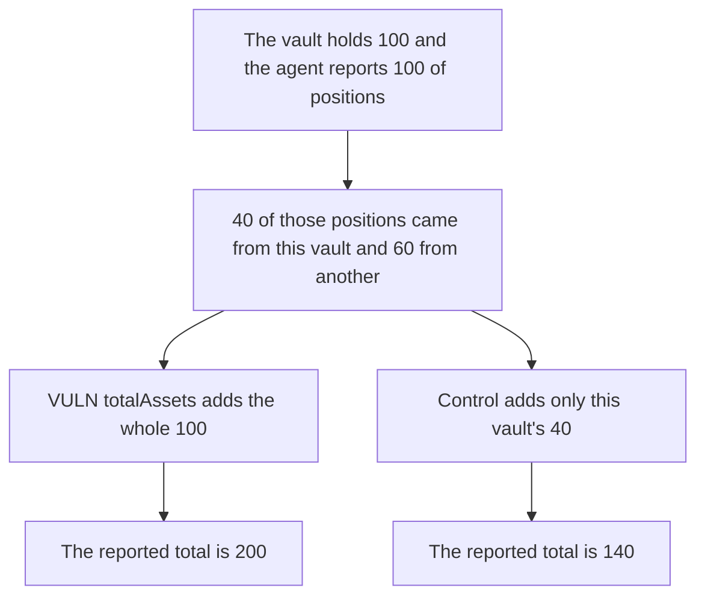

# OmoVault totalAssets counts positions that belong to another vault

> **Vulnerability classes:** vuln/logic/asset-valuation · vuln/defi/share-price

<!-- non-defihacklabs -->
<!-- source-auditvault: https://github.com/Auditware/AuditVault/blob/main/findings/53322-h-04-cross-vault-misattribution-leads-to-incorrect-omovaults.md -->
<!-- date: 2025-01 -->

## Key info

| Field | Value |
|---|---|
| **Loss** | `totalAssets` reports 200. This vault's cash plus its own positions is 140. The other vault's 60 is inside the total |
| **Vulnerable contract** | `Vault.totalAssets` |
| **Attacker EOA** | `0x1111111111111111111111111111111111111111` |
| **Attack contract** | `Exploit` at `0x15452ec016c4dc8c549e7fe6ff4b26324ea8b7a4` |
| **Attack tx** | `Exploit.run()` |
| **Chain / block / date** | Ethereum model · block 0 · 2025-01 |
| **Compiler** | solc 0.8.27, cancun, via IR |
| **Bug class** | `totalAssets` adds `getPositionValue` for every position on the agent |



## TL;DR

`OmoVault.totalAssets` starts from the vault's own holdings and then adds `getPositionValue` for every registered agent. The agent holds positions opened with assets from more than one vault. The sum does not filter by vault.

Cash is 100. The agent reports 100, of which 40 belongs to this vault and 60 to another. `totalAssets` stores 200. The control adds `valueFor(1)`, which is 40, and returns 140. The overstatement is 60.

## The vulnerable code

```solidity
uint256 accountHoldings = agent.getPositionValue(address(this));
uint256 sum = vaultHoldings + accountHoldings; // @> VULN: every position on the agent is counted, including the other vault's 60
lastAssets = sum;
```

## Impact

Share price for this vault includes 60 of assets that belong to another vault's accounting. The reported total is 200 against 140.

## How to reproduce

```bash
cd 53322-h-04-cross-vault-misattribution-leads-to-incorrect-omovaults_exp
forge test -vv
```

`test_exploit_counts_the_other_vault` asserts the stored total is 200. `test_control_counts_only_this_vault` asserts 140.

## Sources

- AuditVault finding: https://github.com/Auditware/AuditVault/blob/main/findings/53322-h-04-cross-vault-misattribution-leads-to-incorrect-omovaults.md
- Pashov report: Omo security review, 2025-01-25
