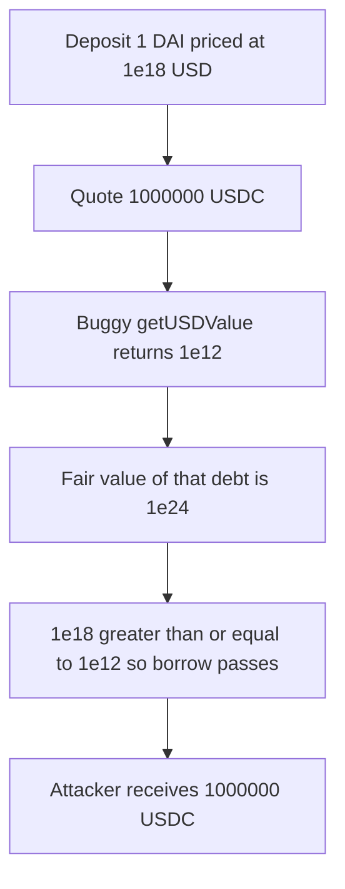

# Omo — `getUSDValue` ignores token decimals and prices 1,000,000 USDC as 1e12

> **Vulnerability classes:** vuln/arithmetic/decimal-mismatch · vuln/oracle/wrong-feed · vuln/logic/price-calculation

> **Reproduction:** a self-contained Foundry PoC that compiles and runs with only `forge-std` — no fork, no RPC. Full trace: [output.txt](output.txt). PoC: [test/53324-h-06-omooracle-incorrect-token-decimals-handling-in-getusdva_exp.sol](test/53324-h-06-omooracle-incorrect-token-decimals-handling-in-getusdva_exp.sol).

<!-- non-defihacklabs -->
<!-- source-auditvault: https://github.com/Auditware/AuditVault/blob/main/findings/53324-h-06-omooracle-incorrect-token-decimals-handling-in-getusdva.md -->
<!-- date: 2025-01 -->

**AuditVault taxonomy:** `lang/solidity` · `has/github` · `severity/high` · `sector/oracle` · genome: `token-decimal-normalization` · `decimal-mismatch` · `math-is-safe`

---

## Key info

| | |
|---|---|
| **Impact** | **HIGH** — 1 DAI (`1e18`, worth `1e18` USD) borrows **1,000,000 USDC** (`1e12` raw units) because the buggy debt value is `1e12` instead of the fair `1e24` |
| **Protocol** | Omo — `OmoOracle.getUSDValue` |
| **Vulnerable code** | `return (amount * normalizedPrice) / 1e18` after reading `priceFeed.decimals()` and not `token.decimals()` |
| **Bug class** | Decimal mismatch. Every amount is treated as 18 decimals |
| **Finding** | Pashov Audit Group — Omo, 2025-01-25 · #53324 (H-06) |
| **Report** | [Omo-security-review_2025-01-25](https://github.com/pashov/audits/blob/master/team/md/Omo-security-review_2025-01-25.md) |
| **Source** | [AuditVault](https://github.com/Auditware/AuditVault/blob/main/findings/53324-h-06-omooracle-incorrect-token-decimals-handling-in-getusdva.md) |
| **Status** | Audit finding, reproduced as a local synthetic |
| **Compiler** | solc 0.8.27, cancun, via_ir |

Both tokens are priced at $1 (`1e8` on an 8-decimal feed). DAI has 18 decimals, so the bug happens to price it correctly. USDC has 6 decimals, so the same function understates it by `10**12`.

---

## TL;DR

1. `getUSDValue` normalizes the **feed** decimals, then returns `(amount * normalizedPrice) / 1e18`.
2. For `1_000_000e6` USDC the buggy result is `1000000000000` (`1e12`). The fair result, dividing by `10**6`, is `1000000000000000000000000` (`1e24`).
3. 1 DAI is `1e18` on both the buggy and the fair oracle.
4. A lender that requires `collateralUsd >= debtUsd` therefore accepts the borrow: `1e18 >= 1e12`. The fair check `1e18 >= 1e24` fails.
5. The attacker receives `1e12` raw USDC. The lender keeps the 1 DAI.
6. **Control:** the fixed oracle rejects `borrow(1_000_000e6)` and allows `borrow(1e6)`, which is 1 USDC and a fair value of `1e18`.

---

## The vulnerable code

The three lines below are the report's body. The price load is the `--snip--` the report left out; it does not scale the amount.

```solidity
function getUSDValue(address token, uint256 amount) public view returns (uint256) {
    int256 price = priceFeed.latestAnswer(token);
    uint8 decimals = priceFeed.decimals();
    uint256 normalizedPrice = uint256(price) * 1e18 / 10 ** decimals;
    // @> VULN: divides by 1e18, not by 10**token.decimals()
    return (amount * normalizedPrice) / 1e18;
}
```

Fair value, matching the report's `amount * price * decimalsUSD / (decimalsToken * 1e18)` once `decimalsUSD` and `decimalsToken` are read as powers of ten:

```solidity
return amount * uint256(price) * 1e18 / (10 ** priceDecimals) / (10 ** tokenDecimals);
```

```diff
- uint8 decimals = priceFeed.decimals();
- uint256 normalizedPrice = uint256(price) * 1e18 / 10 ** decimals;
- return (amount * normalizedPrice) / 1e18;
+ uint8 priceDecimals = priceFeed.decimals();
+ uint8 tokenDecimals = IERC20Metadata(token).decimals();
+ return amount * uint256(price) * 1e18 / (10 ** priceDecimals) / (10 ** tokenDecimals);
```

---

## Root cause

`priceFeed.decimals()` is the decimals of the USD quote (8 here), not the decimals of `token`. Dividing the product by `1e18` assumes `amount` is already an 18-decimal quantity. For a token with `d` decimals the buggy value is `10**(18-d)` times too small when `d < 18`, and too large when `d > 18`. USDC (`d = 6`) is understated by `10**12`, so a debt denominated in USDC looks cheap next to 18-decimal collateral.

## Preconditions

- Collateral and debt use different decimals. Here DAI is 18 and USDC is 6. Both feeds answer $1.
- The lender compares `getUSDValue` of collateral with `getUSDValue` of debt and pays the debt token out of its balance.
- The lender holds at least `1_000_000e6` USDC. The attacker deposits `1e18` DAI.

## Attack walkthrough

Numbers from [output.txt](output.txt):

| Quantity | Buggy `getUSDValue` | Fair `getUSDValue` |
|---|---|---|
| 1 DAI (`1e18`) | `1000000000000000000` | `1000000000000000000` |
| 1,000,000 USDC (`1e12`) | `1000000000000` | `1000000000000000000000000` |

`1e18 >= 1e12` passes, so `borrow` transfers `1000000000000` raw USDC to the attacker. `1e18 >= 1e24` would revert. The control lender, wired to the fair oracle, reverts on `1_000_000e6` and succeeds on `1e6` (1 USDC, fair value `1e18`).

## Diagrams



## Impact

The lender hands out a million USDC against one dollar of DAI. The attacker keeps the USDC. The protocol is left with 1 DAI and a receivable of 1,000,000 USDC that the oracle still values at `1e12`, so the position never looks unhealthy. Any other token whose decimals are not 18 is mis-priced by `10**(18-decimals)` on both the collateral side and the debt side; mixing those tokens is what turns the scaling error into a borrow.

## Remediation

Divide by `10**token.decimals()` as well as the feed decimals, and scale to one USD precision (18) on every asset. Do not assume `amount` is 18 decimals.

## Sources

- AuditVault finding: https://github.com/Auditware/AuditVault/blob/main/findings/53324-h-06-omooracle-incorrect-token-decimals-handling-in-getusdva.md
- Pashov report (2025-01-25): https://github.com/pashov/audits/blob/master/team/md/Omo-security-review_2025-01-25.md
- The `priceFeed.decimals()` / `normalizedPrice` / `(amount * normalizedPrice) / 1e18` lines are the snippet in that report. The audited Omo repository commit was not published with the finding.
