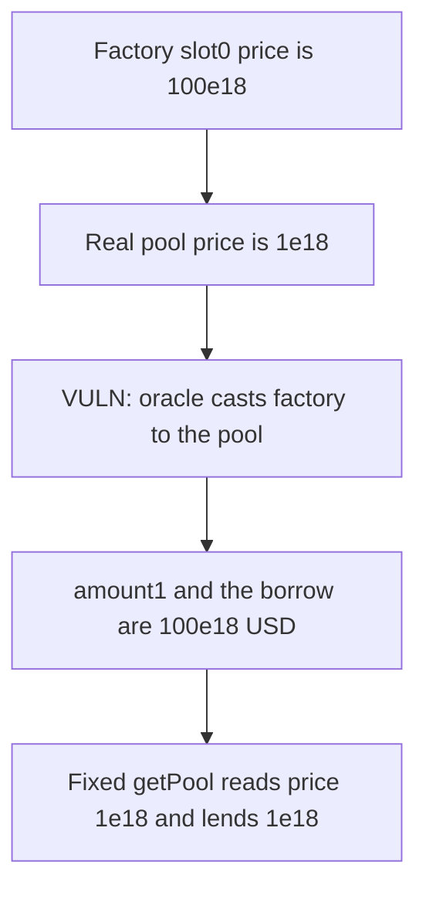

# Omo — the oracle reads the factory and lends 100 USD against a 1 USD pool

> **Vulnerability classes:** vuln/oracle/wrong-feed · vuln/logic/price-calculation

<!-- non-defihacklabs -->
<!-- source-auditvault: https://github.com/Auditware/AuditVault/blob/main/findings/53325-h-07-omooracle-wrong-use-of-uniswap-interface-to-get-pool-ad.md -->
<!-- date: 2025-01 -->

## Key info

| | |
|---|---|
| **Protocol** | Omo |
| **Finding** | Pashov Audit Group H-07, AuditVault 53325 |
| **Vulnerable code** | `OmoOracle.getLiquidityAmounts` |
| **Harm** | Price 100e18 and a 100e18 borrow; the position's pool is priced at 1e18 |
| **Chain** | local synthetic |

## TL;DR

`getLiquidityAmounts` needs the Uniswap V3 pool for the NFT position so it can read `slot0`. It casts `nftManager.factory()` to `IUniswapV3Pool` and calls `slot0` on that address. The factory is not the pool. In this reduction the factory's `slot0` is `10 << 96`, a price of 100e18. The pool returned by `getPool(token0, token1, fee)` is `1 << 96`, a price of 1e18. Both tokens use 18 decimals. The lender then pays `amount1`, so the borrower receives 100e18 USD for 1e18 of liquidity. The corrected call lends 1e18.

## The vulnerable code

```solidity
function getLiquidityAmounts(
    address _positionManager,
    uint256 tokenId,
    uint128 liquidity
) public view returns (uint256 amount0, uint256 amount1) {
    if (liquidity == 0) return (0, 0); // Handle zero liquidity case
    INonfungiblePositionManager nftManager = INonfungiblePositionManager(_positionManager);
    // positions() supplies token0, token1, fee, tickLower, tickUpper
    // @> VULN: factory() is the factory, not the position's pool, so slot0 is the wrong price.
    IUniswapV3Pool pool = IUniswapV3Pool(nftManager.factory()); //Wrong pool address
    (uint160 sqrtPriceX96,,,,,,) = pool.slot0();
    (amount0, amount1) = LiquidityAmounts.getAmountsForLiquidity(
        sqrtPriceX96,
        TickMath.getSqrtRatioAtTick(tickLower),
        TickMath.getSqrtRatioAtTick(tickUpper),
        liquidity
    );
}
```

`borrow` sets the debt to `amount1`. With `liquidity = 1e18`, `amount1` equals the price. The factory price is 100e18, so the transfer is 100e18 USD.

```diff
- IUniswapV3Pool pool = IUniswapV3Pool(nftManager.factory());
+ address poolAddress = IUniswapV3Factory(nftManager.factory()).getPool(token0, token1, fee);
+ IUniswapV3Pool pool = IUniswapV3Pool(poolAddress);
  (uint160 sqrtPriceX96,,,,,,) = pool.slot0();
```

## Root cause

`INonfungiblePositionManager.factory()` returns the factory, which is how you *find* a pool. It is not a pool. `slot0` on that address is some other contract's storage. The position already exposes `token0`, `token1`, and `fee` from `positions(tokenId)`. Those three arguments are what `IUniswapV3Factory.getPool` needs.

## Preconditions

The position manager's factory is a contract whose `slot0` does not match the pool for the position. Here the factory reports price 100e18 and `getPool` returns a pool at price 1e18. The lender holds 100e18 USD. No special role is required to call `borrow`.

## Attack walkthrough

1. The lender is minted 100 USD.
2. The caller borrows against 1e18 of liquidity.
3. `getLiquidityAmounts` casts `factory()` to `IUniswapV3Pool` and reads `slot0`.
4. That sqrt price is `10 << 96`. The price is `100 * 1e18`.
5. `amount1` is `100e18`. `borrow` transfers 100e18 USD to the caller.
6. `fairPrice` calls `getPool(token0, token1, 3000)` and reads the real pool: price `1e18`.

The control uses the diff above on the same factory and the same pool. The quote is 1e18 and the transfer is 1e18. 99e18 stays in the lender.

## Diagrams



## Impact

The borrower is paid 100e18 USD for a position the real pool prices at 1e18. The lender is short 99e18 on this call. Any mint or borrow sized off `getLiquidityAmounts` inherits the same price.

## Remediation

Read `token0`, `token1`, and `fee` from `positions(tokenId)`, call `IUniswapV3Factory(nftManager.factory()).getPool(token0, token1, fee)`, and read `slot0` on that address.

## How to reproduce

```bash
cd 53325-h-07-omooracle-wrong-use-of-uniswap-interface-to-get-pool-ad_exp
forge test -vv
```

## Sources

- AuditVault finding: https://github.com/Auditware/AuditVault/blob/main/findings/53325-h-07-omooracle-wrong-use-of-uniswap-interface-to-get-pool-ad.md
- Pashov report: https://github.com/pashov/audits/blob/master/team/md/Omo-security-review_2025-01-25.md
- Reviewed tree: https://github.com/omo-protocol/omo-mvp/tree/c52b6d39ec34f640533c4fd30310e1fba31f5f39
