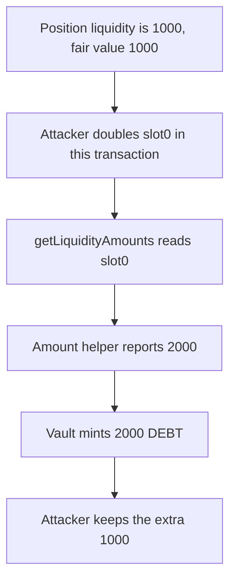

# OmoOracle prices liquidity from `slot0`, so a same-transaction swap mints extra debt

> **Vulnerability classes:** vuln/oracle/spot-price · vuln/oracle/price-manipulation

<!-- non-defihacklabs -->
<!-- source-auditvault: https://github.com/Auditware/AuditVault/blob/main/findings/53326-h-08-omooracle-getliquidityamounts-uses-spot-price-making-it.md -->
<!-- date: 2025-01 -->

## Key info

| Field | Value |
|---|---|
| **Loss** | 1000 extra DEBT minted. The position's fair value is 1000 and the spot read reports 2000 |
| **Vulnerable contract** | `OmoOracle.getLiquidityAmounts` |
| **Attacker EOA** | `0x1111111111111111111111111111111111111111` |
| **Attack contract** | `Exploit` |
| **Attack tx** | `Exploit.run()` |
| **Chain / block / date** | Ethereum model · block 0 · 2025-01 |
| **Compiler** | solc 0.8.27, cancun, via IR |
| **Bug class** | Liquidity amounts taken from the spot price |

## TL;DR

`getLiquidityAmounts` passes `pool.slot0()` into the amount helper. Doubling that sqrt price in the same transaction turns a position worth 1000 into a reported value of 2000. The vault mints 2000 DEBT and the attacker keeps the extra 1000. The same helper fed a constant fair sqrt price still returns 1000 after that swap, so the control mint is 1000.

## Background

Pashov Audit Group reviewed Omo on 2025-01-25 (H-08, high). Position value is used as collateral. The report shows `getLiquidityAmounts` reading `slot0` and passing that sqrt price to `LiquidityAmounts.getAmountsForLiquidity`. The recommendation is to use a TWAP instead of the spot price.

## The vulnerable code

```solidity
IUniswapV3Pool pool = IUniswapV3Pool(nftManager.factory());
// @> VULN: slot0 is the spot price, so a same-transaction swap changes the amounts
(uint160 sqrtPriceX96,,,,,,) = pool.slot0();
(amount0, amount1) = LiquidityAmounts.getAmountsForLiquidity(
    sqrtPriceX96,
    TickMath.getSqrtRatioAtTick(tickLower),
    TickMath.getSqrtRatioAtTick(tickUpper),
    liquidity
);
```

The fixed path passes the fair sqrt price and does not read `slot0`:

```diff
-        (uint160 sqrtPriceX96,,,,,,) = pool.slot0();
+        uint160 sqrtPriceX96 = uint160(1 << 96);
         (amount0, amount1) = LiquidityAmounts.getAmountsForLiquidity(
             sqrtPriceX96, sqrtLower, sqrtUpper, liquidity);
```

## Root cause

`slot0` is the pool's current price. It is writable by a swap in the same transaction that asks for the position value. The amount helper treats that price as the amount of token the liquidity represents, so the reported collateral moves with the spot.

## Preconditions

- The position's liquidity is 1000. At the fair sqrt price of 2^96 the two amounts are 500 and 500, so the value is 1000.
- The pool's spot price can be replaced before the oracle read, in the same transaction.
- The vault mints DEBT 1:1 with the reported value.

## Attack walkthrough

1. The attacker sets `sqrtPriceX96` to 2^97, twice the fair price.
2. The vault calls `getPositionValue`.
3. `getLiquidityAmounts` loads `slot0`.
4. The amount helper takes the else branch and sets `amount1` to `1000 * 2 = 2000`.
5. The reported value is 2000. The vault mints 2000 DEBT.
6. 1000 of that is the fair value. The extra 1000 is transferred to the attacker.

## Diagrams



## Impact

The protocol mints 1000 DEBT that the fair price does not support. The attacker receives that 1000. After the same spot move, the fixed oracle still reports 1000 and the control mint is 1000.

## PoC

```bash
cd 53326-h-08-omooracle-getliquidityamounts-uses-spot-price-making-it_exp
forge test -vv
```

`test_exploit_spot_price_mints_extra_debt` asserts the mint is 2000, the extra is 1000, and the caller receives that 1000. `test_control_fixed_price_ignores_the_swap` asserts the fixed sqrt price still values the position at 1000 after the same spot move, and the mint is 1000.

## Sources

- AuditVault finding: https://github.com/Auditware/AuditVault/blob/main/findings/53326-h-08-omooracle-getliquidityamounts-uses-spot-price-making-it.md
- Pashov report (Omo, 2025-01-25): https://github.com/pashov/audits/blob/master/team/md/Omo-security-review_2025-01-25.md
- Quoted source: `OmoOracle.getLiquidityAmounts` as printed in that report. The client repository is not linked from the report; this file is the reduced synthetic.
