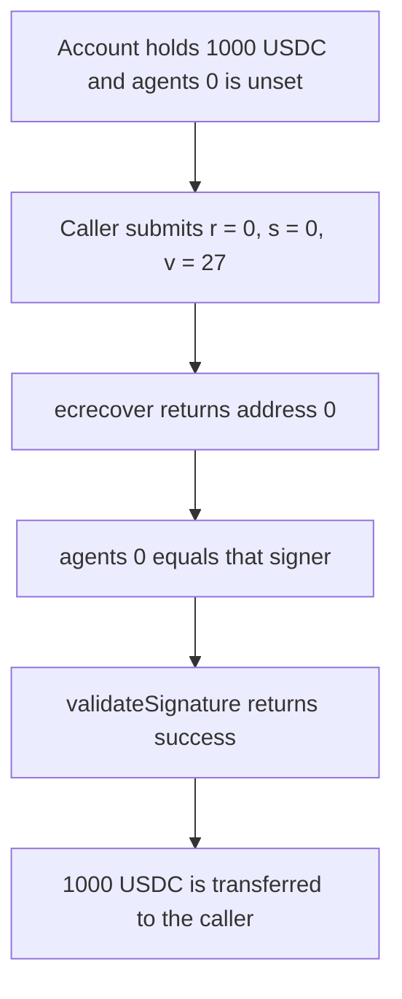

# DynamicAccount accepts `address(0)` from `ecrecover` and pays out

> **Vulnerability classes:** vuln/auth/signature-validation · vuln/access-control/missing-auth

<!-- non-defihacklabs -->
<!-- source-auditvault: https://github.com/Auditware/AuditVault/blob/main/findings/53328-h-10-validatesignature-does-not-properly-handle-address0-pa.md -->
<!-- date: 2025-01 -->

## Key info

| Field | Value |
|---|---|
| **Loss** | 1000 USDC moved on a zero signature |
| **Vulnerable contract** | `DynamicAccount._validateSignature` |
| **Attacker EOA** | `0x1111111111111111111111111111111111111111` |
| **Attack contract** | `Exploit` |
| **Attack tx** | `Exploit.run()` |
| **Chain / block / date** | Ethereum model · block 0 · 2025-01 |
| **Compiler** | solc 0.8.27, cancun, via IR |
| **Bug class** | `ecrecover` zero address compared to an unset agent |

## TL;DR

`ecrecover` of a signature with `r = 0`, `s = 0`, `v = 27` returns `address(0)`. `agents(0)` is unset, so it is also `address(0)`. `_validateSignature` returns success, and `execute` transfers 1000 USDC to the caller. The fixed account returns before the transfer when the recovered signer is `address(0)`, and the 1000 stays in the account.

## Background

Pashov Audit Group reviewed Omo on 2025-01-25 (H-10, high). `DynamicAccount._validateSignature` recovers a signer with `ECDSA.recover`. The audited helper returns the precompile's `address(0)` on an invalid signature. The next check treats that zero address as the primary agent when no agent has been set.

## The vulnerable code

```solidity
address signer = ECDSA.recover(hash, signature);
if (isAdmin(signer)) return 0;
// @> VULN: address(0) from ecrecover compares equal to the unset agents(0)
if (this.agents(0) == signer) {
    return 0;
}
```

The report's fix rejects the zero address before the agent check:

```diff
         address signer = ECDSA.recover(hash, userOp.signature);
+        if (signer == address(0)) return SIG_VALIDATION_FAILED;
         if (isAdmin(signer)) return 0;
```

## Root cause

`ecrecover` returns `address(0)` when the signature is not a valid point. An unset `agents(0)` is the same value. Comparing them with `==` accepts every invalid signature whenever the account has not registered an agent. `isAdmin(address(0))` is false, so the zero signer falls through to that comparison.

## Preconditions

- The account holds 1000 USDC.
- `agents(0)` is `address(0)`.
- The caller supplies a 65-byte signature whose `r` and `s` are zero and whose `v` is 27.

## Attack walkthrough

1. 1000 USDC is minted to the account.
2. The caller invokes `execute` with the zero signature, naming themselves as the recipient.
3. `ECDSA.recover` calls `ecrecover` and gets `address(0)`.
4. `this.agents(0)` is `address(0)`, so the comparison succeeds and validation returns 0.
5. `execute` transfers the 1000 USDC to the caller.

## Diagrams



## Impact

The caller receives 1000 USDC and the account balance is 0. No private key was used. On the fixed account the same signature is recognized as `address(0)` and the transfer is skipped, so the account still holds 1000 and the caller holds 0.

## PoC

```bash
cd 53328-h-10-validatesignature-does-not-properly-handle-address0-pa_exp
forge test -vv
```

`test_exploit_zero_signature_moves_funds` asserts the recovered signer is `address(0)`, the caller received 1000, and the account is empty. `test_control_rejects_address_zero` asserts the fixed account pays nothing and keeps the 1000.

## Sources

- AuditVault finding: https://github.com/Auditware/AuditVault/blob/main/findings/53328-h-10-validatesignature-does-not-properly-handle-address0-pa.md
- Pashov report (Omo, 2025-01-25): https://github.com/pashov/audits/blob/master/team/md/Omo-security-review_2025-01-25.md
- Quoted source: `DynamicAccount._validateSignature` as printed in that report. The client repository is not linked from the report; this file is the reduced synthetic.
