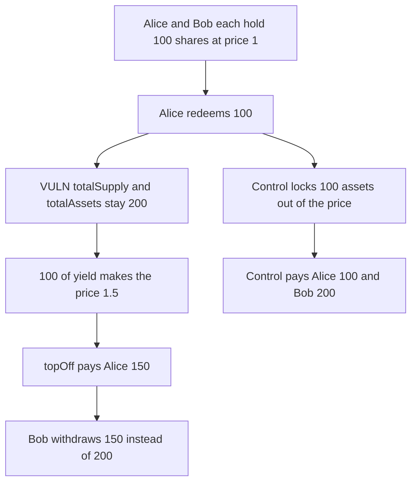

# Omo: a pending redeem stays in the share price and takes half the next yield

> **Vulnerability classes:** `vuln/logic/price-calculation` · `vuln/logic/reward-calculation`

<!-- non-defihacklabs -->
<!-- source-auditvault: https://github.com/Auditware/AuditVault/blob/main/findings/53329-h-11-pending-withdrawal-tokens-in-redeem-affect-share-price.md -->
<!-- date: 2025-01 -->

## Key info

| Field | Value |
|---|---|
| **Loss** | Alice is paid 150 on a 100-share exit. Bob receives 150 instead of 200 |
| **Vulnerable contract** | `OmoVault.redeem` |
| **Attacker EOA** | `0x1111111111111111111111111111111111111111` |
| **Attack contract** | `Exploit` |
| **Attack tx** | `Exploit.run()` |
| **Chain / block / date** | Ethereum model · block 0 · 2025-01 |
| **Compiler** | solc 0.8.27, cancun, via IR |
| **Bug class** | Pending shares are moved to the vault and left inside `totalSupply` and `totalAssets` |

## TL;DR

Alice and Bob each hold 100 shares against 200 assets. Price is 1. Alice's `redeem` moves her shares onto the vault and does not change `totalSupply` or `totalAssets`. A later 100 of yield makes `totalAssets` 300, so the price is 1.5 instead of 2. `topOff` pays Alice 150. Bob withdraws 150. Locking the assets out of the price at redeem time pays Alice 100 and Bob 200.

## Background

Pashov Audit Group, Omo security review of 2025-01-25, finding H-11. The quoted body only transfers shares from the owner to the vault. The review says `totalSupply` and `_totalAssets` are not updated, so profit and loss after the request are priced against shares that are already leaving, and `topOff` settles them at the later price. This reduction is that sequence with a 100 yield on a 200-asset vault.

## The vulnerable code

```solidity
function redeem(address owner, uint256 shares) external {
    balanceOf[owner] -= shares;
    balanceOf[address(this)] += shares;
    pendingShares[owner] += shares; // @> VULN: totalSupply and totalAssets still include this exit
}
```

The price is `totalAssets * 1e18 / totalSupply`. `topOff` pays `shares * price() / 1e18`.

The fix removes both the shares and the assets they were worth at request time, and `topOff` pays that locked amount:

```diff
- balanceOf[address(this)] += shares;
- pendingShares[owner] += shares;
+ uint256 assetsLocked = shares * totalAssets / totalSupply;
+ totalSupply -= shares;
+ totalAssets -= assetsLocked;
+ pendingAssets[owner] += assetsLocked;
```

## Root cause

A pending exit is still in the denominator and the numerator of the share price. Yield that arrives before `topOff` is shared with shares that have already asked to leave at the old price.

## Preconditions

- Two depositors, 100 shares each. Total assets 200. Price 1.
- Alice calls `redeem` for 100 shares and does not finalize.
- 100 of yield is accrued before `topOff`.

## Attack walkthrough

1. Alice and Bob deposit 100 each.
2. Alice redeems 100. `totalSupply` and `totalAssets` stay 200.
3. 100 of yield arrives. Price is `300 / 200 = 1.5`, not 2.
4. `topOff` pays Alice 150.
5. Bob withdraws 150.
6. The control pays Alice the 100 locked at redeem time and Bob 200.

## Diagrams



## Impact

Alice receives 150 assets for shares that were worth 100 when she redeemed. Bob, the depositor who stayed, receives 150 instead of 200. The 50 difference is Bob's half of the yield, paid to an exit that should have been priced before the yield. The control gives Bob the full 200.

## Remediation

When `redeem` moves shares aside, also remove those shares from `totalSupply` and remove the assets they were worth from `totalAssets`. Settle `topOff` at that locked amount, not at the price after later profit or loss.

## How to reproduce

```bash
cd 53329-h-11-pending-withdrawal-tokens-in-redeem-affect-share-price_exp
forge test -vv
```

`test_exploit_pending_redeem_takes_half_the_yield` asserts the price is 1.5 and both users receive 150. `test_control_redeem_locks_the_price` asserts Alice receives 100 and Bob receives 200.

## Sources

- AuditVault finding: https://github.com/Auditware/AuditVault/blob/main/findings/53329-h-11-pending-withdrawal-tokens-in-redeem-affect-share-price.md
- Pashov review: https://github.com/pashov/audits/blob/master/team/md/Omo-security-review_2025-01-25.md
- Quoted lines: `redeem`, the share transfer that does not update `totalSupply` or `_totalAssets`
