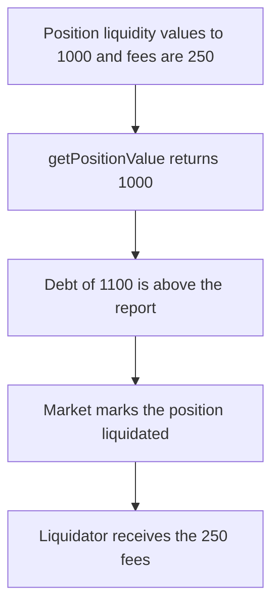

# `getPositionValue` ignores Uniswap fees, so a healthy position is liquidated

> **Vulnerability classes:** vuln/logic/fee-calculation · vuln/logic/accounting

<!-- non-defihacklabs -->
<!-- source-auditvault: https://github.com/Auditware/AuditVault/blob/main/findings/53330-h-12-getpositionvalue-does-not-consider-accumulated-fees-pas.md -->
<!-- date: 2025-01 -->

## Key info

| Field | Value |
|---|---|
| **Loss** | Liquidator seizes 250 of fees. Reported value is 1000, true value is 1250, debt is 1100 |
| **Vulnerable contract** | `OmoOracle.getPositionValue` |
| **Attacker EOA** | `0x1111111111111111111111111111111111111111` |
| **Attack contract** | `Exploit` |
| **Attack tx** | `Exploit.run()` |
| **Chain / block / date** | Ethereum model · block 0 · 2025-01 |
| **Compiler** | solc 0.8.27, cancun, via IR |
| **Bug class** | Position value omits `tokensOwed` |

## TL;DR

`getPositionValue` reads `positions()` and adds only the liquidity amounts. `tokensOwed0` is 250 and is not added, so the position is reported as 1000 instead of 1250. Debt of 1100 is above the report and below the true value, so the market liquidates and the liquidator takes the 250. Adding the owed fees makes the value 1250, the debt is covered, and nothing is seized.

## Background

Pashov Audit Group reviewed Omo on 2025-01-25 (H-12, high). Uniswap V3 positions earn fees that sit in `tokensOwed0` and `tokensOwed1` until collected. The report's `getPositionValue` converts `getLiquidityAmounts` and returns that sum. The fee words from `positions(tokenId)` are never used.

## The vulnerable code

```solidity
// @> VULN: positions() is read without tokensOwed0 and tokensOwed1, so fees never enter the value
(,, address token0, address token1,,,, uint128 liquidity,,,,) = INonfungiblePositionManager(positionManager).positions(tokenId);
```

The fixed value adds the owed fees:

```diff
-        return value0 + value1;
+        return value0 + value1 + uint256(tokensOwed0) + uint256(tokensOwed1);
```

## Root cause

`positions` returns twelve words. The destructure binds liquidity and the token addresses and discards the last two words, which are the uncollected fees. Collateral that includes a position is therefore short by those fees, and a debt that sits between the two numbers looks unsafe.

## Preconditions

- Liquidity converts to 1000 of the quote token.
- `tokensOwed0` is 250 and `tokensOwed1` is 0, so the true value is 1250.
- The position's debt is 1100.

## Attack walkthrough

1. `getPositionValue` calls `positions` and ignores the owed words.
2. The returned value is 1000.
3. The market compares debt 1100 with 1000. 1100 is greater, so it liquidates.
4. The position is marked liquidated and 250 of fee tokens are seized.
5. 1100 is less than 1250, so the same debt is healthy once the fees are counted.

## Diagrams



## Impact

The position is liquidated even though 1250 of value covers 1100 of debt. The liquidator receives the 250 the oracle left out. The fixed function returns 1250, the debt is covered, and no fees are seized.

## PoC

```bash
cd 53330-h-12-getpositionvalue-does-not-consider-accumulated-fees-pas_exp
forge test -vv
```

`test_exploit_liquidation_is_short_the_fees` asserts the reported value is 1000, the position is liquidated, and the caller receives 250, while 1100 is below the true 1250. `test_control_including_fees_does_not_liquidate` asserts the fixed value is 1250, the debt is covered, and nothing is seized.

## Sources

- AuditVault finding: https://github.com/Auditware/AuditVault/blob/main/findings/53330-h-12-getpositionvalue-does-not-consider-accumulated-fees-pas.md
- Pashov report (Omo, 2025-01-25): https://github.com/pashov/audits/blob/master/team/md/Omo-security-review_2025-01-25.md
- Quoted source: `OmoOracle.getPositionValue` as printed in that report. The client repository is not linked from the report; this file is the reduced synthetic.
