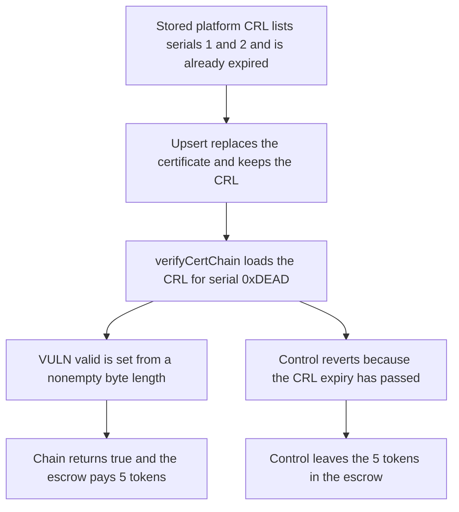

# Automata DCAP: an expired CRL still releases a 5 token attestation bounty

> **Vulnerability classes:** `vuln/logic/missing-validation` · `vuln/logic/missing-check`

<!-- non-defihacklabs -->
<!-- source-auditvault: https://github.com/Auditware/AuditVault/blob/main/findings/53368-certificate-chain-verification-allows-expired-and-irrelevant.md -->
<!-- date: 2025-02 -->

## Key info

| Field | Value |
|---|---|
| **Loss** | 5 tokens paid to a caller whose platform certificate serial is 0xDEAD |
| **Vulnerable contract** | `PccsRouter._getPcsAttestationData` |
| **Attacker EOA** | `0x1111111111111111111111111111111111111111` |
| **Attack contract** | `Exploit` |
| **Attack tx** | `Exploit.run()` |
| **Chain / block / date** | Ethereum model · block 0 · 2025-02 |
| **Compiler** | solc 0.8.27, cancun, via IR |
| **Bug class** | A CRL is accepted whenever the byte string is nonempty |

## TL;DR

Certificate verification loads a CRL and treats it as valid if `ret.length > 0`. It does not check expiry or that the CRL belongs to the current issuer certificate. The stored platform CRL expired at timestamp 0 and lists serials 1 and 2, not 0xDEAD. Intel's published revocation is 0xDEAD. `verifyCertChain` still returns true, and the escrow pays its 5 token bounty. A router that reverts on an expired CRL leaves the 5 tokens in place.

## Background

Trail of Bits, February 2025, Automata DCAP attestation and on-chain PCCS. `X509ChainBase.verifyCertChain` pulls CRLs through `PCCSRouter.getCrl`. `upsertPcsCertificates` replaces a certificate and does not delete the old CRL.

## The vulnerable code

```solidity
ret = pcsDao.getAttestedData(pcsDao.PCS_KEY(ca, crl));
// @> VULN: a CRL is accepted whenever the bytes are nonempty; expiry and issuer are never checked
valid = ret.length > 0;
```

The platform CRL is `abi.encode(1, 2)` with `crlExpiry` 0. `block.timestamp` is 1, so the list is already expired. Serial 0xDEAD is not in those bytes, so `serialNumberIsRevoked` is false and the chain returns true.

## Root cause

`_getPcsAttestationData` only checks that the stored bytes are nonempty. Expiry, issuer identity, and the current published revocation are ignored. Upserting a certificate does not replace the CRL.

## Preconditions

- A nonempty platform CRL is stored, expired, and does not contain serial 0xDEAD.
- The published revocation for that CA is 0xDEAD.
- An escrow pays its balance to any caller whose `verifyCertChain` returns true.

## Attack walkthrough

1. `upsertPcsCertificates` writes a new platform certificate and leaves the old CRL.
2. The CRL expiry is 0, which is before this block's timestamp.
3. Serial 0xDEAD is absent from the stored list.
4. `verifyCertChain` loads that CRL, sees nonempty bytes, and returns true.
5. The escrow transfers 5 tokens to the caller and ends empty.
6. The fixed router reverts because the CRL is expired, so the bounty stays.

## Diagrams



## Impact

A revoked platform certificate is accepted. The caller collects the 5 token bounty that a current CRL would have blocked. Any later gate that trusts `verifyCertChain` grants the same privilege.

## Remediation

Reject a CRL whose expiry is before `block.timestamp`, and require the CRL's issuer to match the certificate currently stored for that CA. Include the published revocation serial before returning success.

## How to reproduce

```bash
cd 53368-certificate-chain-verification-allows-expired-and-irrelevant_exp
forge test -vv
```

`test_exploit_expired_crl_pays_revoked_cert` asserts verification succeeds and the caller holds 5 tokens. `test_control_expired_crl_keeps_the_bounty` expects the fixed claim to revert and the escrow to keep 5 tokens. Captured output is `output.txt`.

## Sources

- AuditVault finding: https://github.com/Auditware/AuditVault/blob/main/findings/53368-certificate-chain-verification-allows-expired-and-irrelevant.md
- Trail of Bits review: https://github.com/trailofbits/publications/blob/master/reviews/2025-02-automata-dcap-attestation-onchain-pccs-securityreview.pdf
