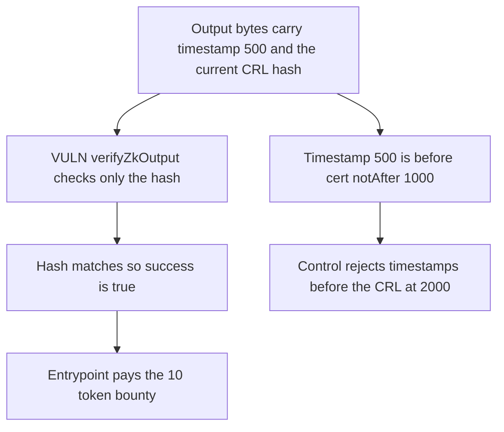

# Automata DCAP: verifyZkOutput accepts a RISC0 or SP1 quote whose timestamp is older than the CRL

> **Vulnerability classes:** `vuln/input-validation/missing` · `vuln/auth/signature-validation`

<!-- non-defihacklabs -->
<!-- source-auditvault: https://github.com/Auditware/AuditVault/blob/main/findings/53370-risc0-and-sp1-based-attestation-may-accept-expired-certifica.md -->
<!-- date: 2025-02 -->

**AuditVault taxonomy:** `severity/high` · `platform/trailofbits` · `sector/attestation`

## Key info

| Field | Value |
|---|---|
| **Loss** | 10 bounty tokens paid for an attestation whose embedded timestamp is 500. The certificate notAfter is 1000 and the current CRL was issued at 2000 |
| **Vulnerable contract** | `V3QuoteVerifier.verifyZkOutput` |
| **Attacker EOA** | `0x1111111111111111111111111111111111111111` |
| **Attack contract** | `Exploit` |
| **Attack tx** | `Exploit.run()` |
| **Chain / block / date** | Ethereum model · block 0 · 2025-02 |
| **Compiler** | solc 0.8.27, cancun, via IR |
| **Bug class** | The 72-byte timestamp region of the zkVM output is not checked |

## TL;DR

`verifyZkOutput` checks that the collateral hashes in a RISC0 or SP1 output match the hashes stored on chain. It does not read the 72 bytes between the quote output and those hashes, which is where the proof's timestamp sits. A synthetic output with timestamp 500 and the current CRL hash is accepted. The certificate's notAfter is 1000, and the CRL that no longer lists the compromised PCK was issued at 2000. The entrypoint pays its 10-token bounty. Requiring the timestamp to be at least the CRL issue date rejects the same bytes.

## Background

Trail of Bits' February 2025 review of Automata DCAP Attestation and Onchain PCCS, Joe Doyle, figures 7.1 and 7.2. V3 and V4 `verifyZkOutput` both call `checkCollateralHashes(offset + 72, outputBytes)` and, on success, return `outputBytes[2:offset]`. The timestamp lives in the skipped 72 bytes. The report's scenario is a compromised Intel SGX PCK that has expired and dropped off the issuer CRL. A zk proof generated with an old timestamp can still match the new collateral hashes, and the chain never notices the timestamp. The `dcap-rs` program was out of scope. This reduction is the on-chain parser, with the byte layout the V3 function actually walks, not a real RISC0 proof.

## The vulnerable code

```solidity
uint256 offset = 2 + uint16(bytes2(outputBytes[0:2]));
// @> VULN: the 72-byte timestamp region at `offset` is never compared to CRL_ISSUED_AT or CERT_NOT_AFTER
success = checkCollateralHashes(offset + 72, outputBytes);
if (success) {
    output = outputBytes[2:offset];
}
```

A freshness check the report asks for, applied to the same bytes:

```diff
 uint256 offset = 2 + uint16(bytes2(outputBytes[0:2]));
+uint256 timestamp = uint256(bytes32(outputBytes[offset:offset + 32]));
+if (timestamp < CRL_ISSUED_AT) return (false, bytes("stale timestamp"));
 success = checkCollateralHashes(offset + 72, outputBytes);
```

## Root cause

`offset` is the end of the quote output. The next 72 bytes are skipped on the way to the collateral hashes. Nothing in `verifyZkOutput` compares those bytes to the CRL issue time or to the certificate validity window.

## Preconditions

- The on-chain collateral hash is the current CRL, which no longer contains the compromised certificate. The proof's hash word equals that hash.
- The proof's timestamp word is 500. `CERT_NOT_AFTER` is 1000. `CRL_ISSUED_AT` is 2000.
- The entrypoint pays 10 bounty tokens to any caller whose `verifyZkOutput` returns success.

## Attack walkthrough

1. The output is 2 length bytes, 32 bytes of quote, 72 bytes starting with timestamp 500, and the 32-byte CRL hash.
2. `embeddedTimestamp` reads 500 from the word at `offset`.
3. `verifyZkOutput` compares only the hash at `offset + 72`. It matches.
4. The entrypoint marks the caller attested and transfers 10 bounty tokens.
5. The control requires `timestamp >= CRL_ISSUED_AT` and reverts on these bytes.

## Diagrams



## Impact

The caller receives 10 bounty tokens and is recorded as attested. The timestamp in the output is 500, which is before both the certificate expiry at 1000 and the CRL issue time at 2000. A quote that had to be fresh against that CRL would not have been paid.

## Remediation

Read the timestamp in the 72-byte region and reject the output unless it falls in a window the contract derives from the current CRL, as the review's short-term recommendation describes. V4's `verifyZkOutput` skips the same region and needs the same check.

## How to reproduce

```bash
cd 53370-risc0-and-sp1-based-attestation-may-accept-expired-certifica_exp
forge test -vv
```

`test_expired_timestamp_still_pays_bounty` asserts timestamp 500, acceptance, and a 10-token payment. `test_control_timestamp_after_crl_rejects_this_proof` asserts the freshness check reverts. Captured output is `output.txt`.

## Sources

- AuditVault finding: https://github.com/Auditware/AuditVault/blob/main/findings/53370-risc0-and-sp1-based-attestation-may-accept-expired-certifica.md
- Trail of Bits report: https://github.com/trailofbits/publications/blob/master/reviews/2025-02-automata-dcap-attestation-onchain-pccs-securityreview.pdf
- Blamed function: `automata-dcap-attestation/contracts/verifiers/V3QuoteVerifier.sol` `verifyZkOutput`, figure 7.1 of that review
